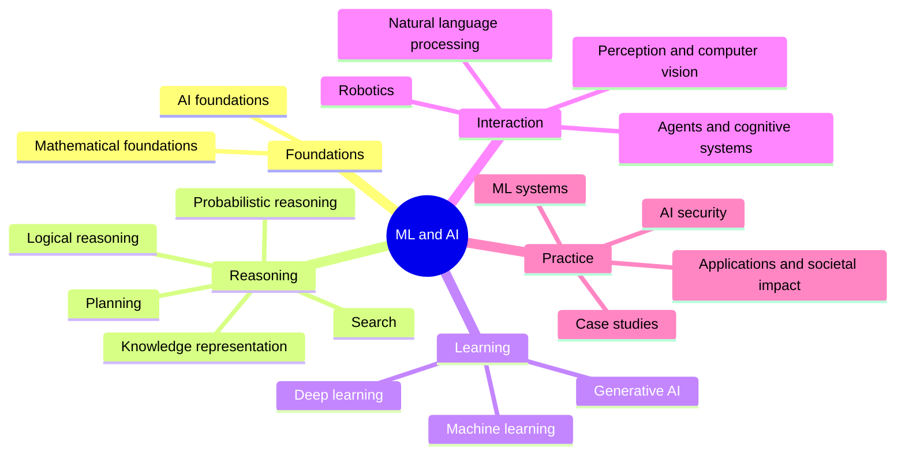

# ML and AI Knowledge

A personal, framework agnostic knowledge base of artificial intelligence and machine learning: concepts, methods, systems and practices, organized by the knowledge units of the AI knowledge area of the ACM/IEEE-CS/AAAI Computer Science Curricula 2023 (CS2023).

## Table of Contents

- [About](#about)
- [Purpose](#purpose)
- [Scope](#scope)
- [Knowledge areas](#knowledge-areas)
- [Full table of contents](#full-table-of-contents)
- [How to use this repository](#how-to-use-this-repository)
- [Reading the library](#reading-the-library)
- [Repository layout](#repository-layout)
- [Sources and migration](#sources-and-migration)
- [Contributing and working with AI agents](#contributing-and-working-with-ai-agents)
- [Status](#status)

## About

This repository collects what I learn about artificial intelligence and machine learning: the foundations of the field, classical machine learning, deep learning, generative AI and prompt engineering, AI agents, the security of AI systems and the hardware and software that train and run models. Each note explains one idea in plain English, with a reproducible example, at least one diagram or chart, and links to primary sources. The notes aim at expert depth while staying readable for someone new to the topic.

This is a personal knowledge base, not a tutorial site or a product. The goal is depth and correctness.

## Purpose

The repository exists to:

- build a durable reference on AI and ML that I can search, extend and trust,
- force real understanding by requiring every concept to be explained precisely, with examples, analogies and their limits,
- keep one consistent standard and one predictable structure, so that it is always clear where new material belongs,
- provide a source of truth that both people and AI assistants can work with under the same rules.

## Scope

**In scope**

- Framework agnostic AI and ML: methods, models, algorithms, evaluation, systems, security and societal impact.
- Worked examples with real outputs, comparisons, checklists and decision guides. Code appears as an illustration in one declared language, usually Python with NumPy.
- Case studies of real AI systems and landmark results, in my own words and with a link to the original source.

**Out of scope**

- Tutorials for one specific framework or product (PyTorch, LangChain, a vendor console), except as dated examples inside a concept note.
- Credentials, tokens, private keys, personal data or proprietary code and data from employers or clients.
- Text copied wholesale from books, papers, courses or articles.

## Knowledge areas

The top level follows the twelve knowledge units of the AI knowledge area of [CS2023](https://csed.acm.org/), published jointly by ACM, IEEE-CS and AAAI. Because of the volume of material, the machine learning unit (AI-ML) is split into three areas: machine learning, deep learning and generative AI. Three supporting areas cover what CS2023 places outside the AI knowledge area, and case studies have their own entry point. Inside each area, the sections follow the topics of the corresponding knowledge unit.

| Knowledge area | CS2023 basis | What it covers |
| --- | --- | --- |
| [AI foundations](ai-foundations/README.md) | AI-Introduction | Definitions of AI, the nesting of AI, ML, DL and GenAI, models, history and philosophy. |
| [Search](search/README.md) | AI-Search | State space, uninformed, heuristic and adversarial search. |
| [Knowledge representation and reasoning](knowledge-representation-and-reasoning/README.md) | AI-KRR | Types of representation and Bayesian reasoning. |
| [Machine learning](machine-learning/README.md) | AI-ML | Fundamentals, learning paradigms, data preparation, optimization, evaluation and classical algorithms. |
| [Deep learning](deep-learning/README.md) | AI-ML | Neural networks, training, architectures and representation learning. |
| [Generative AI](generative-ai/README.md) | AI-ML, AI-SEP, AI-NLP | Generative models, LLMs, decoding, prompt engineering, RAG, adaptation, evaluation and applications. |
| [Applications and societal impact](applications-and-societal-impact/README.md) | AI-SEP | Applications, bias and fairness, explainability, privacy, governance, ethics and sustainability. |
| [Logical representation and reasoning](logical-representation-and-reasoning/README.md) | AI-LRR | Logic and inference, knowledge engineering, advanced reasoning, logic programming and expert systems. |
| [Probabilistic reasoning](probabilistic-reasoning/README.md) | AI-Probability | Bayesian networks, Markov models and decision theory. |
| [Planning](planning/README.md) | AI-Planning | Classical, hierarchical and multi-agent planning, planning under uncertainty. |
| [Agents and cognitive systems](agents-and-cognitive-systems/README.md) | AI-Agents | Agent fundamentals and types, LLM-based agents, multi-agent systems, cognitive architectures. |
| [Natural language processing](natural-language-processing/README.md) | AI-NLP | Classical NLP, semantics, retrieval and extraction, classification, translation, deep learning for NLP. |
| [Robotics](robotics/README.md) | AI-Robotics | Robot perception, motion planning and control, robot learning. |
| [Perception and computer vision](perception-and-computer-vision/README.md) | AI-Vision | Image processing, recognition and segmentation, motion, speech and other modalities. |
| [AI security](ai-security/README.md) | Supporting | Threat landscape, prompt attacks, agent security, adversarial ML, ML supply chain. |
| [ML systems](ml-systems/README.md) | Supporting | Hardware accelerators, compilers, distributed training, serving and MLOps. |
| [Mathematical foundations](mathematical-foundations/README.md) | Supporting | Linear algebra, calculus, probability and statistics, optimization and information theory. |
| [Case studies](case-studies/README.md) | Not CS2023 | Real AI systems and landmark results. |

The map shows the same areas grouped by theme.



Where a topic fits two areas, it has one home note and the other area links to it. [GUIDELINE.md](GUIDELINE.md#311-placement-of-a-note) lists the primary home of each kind of topic.

## Full table of contents

[ToC.md](ToC.md) lists every file in the repository as an indented tree, with planned topics shown without links. Use it to see the whole structure at once. Use the knowledge area and section READMEs for the recommended reading order.

## How to use this repository

- To learn a topic, open the knowledge area, then the section, and read the notes in the order the section `README.md` gives.
- To follow a guided path, open the Librarian OS roadmap [`_roadmaps/generative-ai.json`](_roadmaps/generative-ai.json), a four stage learning path for generative AI.
- To look something up, start from [ToC.md](ToC.md) or search with `grep -rn "term" --include="*.md" .`.
- To find open gaps, run `grep -rn "^TODO:" --include="*.md" .`.

## Reading the library

This repository is set up for Librarian OS, a reader for Markdown knowledge repositories. [librarian-os.json](librarian-os.json) names the project and lists the entry points (the 17 knowledge area directories and `case-studies`). Librarian OS renders the notes in the browser with themes, search, a graph of the relations between notes, roadmaps and practice questions.

```bash
# in the librarian-os directory
npm install
npm run dev -- --repo /absolute/path/to/this/repository
```

The relations come from the sidecar files described in [GUIDELINE.md](GUIDELINE.md#35-sidecar-metadata): every `note.md` has a `note.md.json` next to it. The tools that keep them valid run from Librarian OS: `npm run check`, `npm run scaffold` and `npm run toc`, each with this repository's path as the argument. [INSTRUCTIONS.md](INSTRUCTIONS.md) describes the Librarian OS format.

## Repository layout

```text
ToC.md                      # full tree of every file
GUIDELINE.md                # rules for structure, note format and style
INSTRUCTIONS.md             # the Librarian OS repository format
librarian-os.json           # configuration for Librarian OS (project name, entry points, rules)
_assets/<knowledge-area>/   # images, diagram sources and other files used by notes
_roadmaps/                  # Librarian OS learning paths
<knowledge-area>/
    README.md               # sections of the knowledge area
    <section>/
        README.md           # notes in reading order and planned topics
        <topic>.md          # a single note
        <topic>.md.json     # its sidecar: node header, relations, sources and questions
case-studies/               # real systems, linked to the concept notes
```

The full rules for structure and naming are in [GUIDELINE.md](GUIDELINE.md#3-repository-structure-and-naming).

## Sources and migration

The local directory `_sources/` holds the original ClickUp exports (HTML) that the first notes came from. It is excluded from version control. Their content was moved into the knowledge area tree without loss: text was rephrased into the note format where needed, screenshots of model conversations were transcribed into text blocks, formula images were rewritten as math, and diagrams were redrawn as Mermaid diagrams or SVG files. Where the original content was inaccurate or out of date, the note keeps it and states the correction next to it. Migrated notes start with the status `draft`, and their content has not yet been verified against the sources listed in each note.

## Contributing and working with AI agents

All notes follow [GUIDELINE.md](GUIDELINE.md). It applies to people and to AI agents alike. Agent-specific entry points are [AGENTS.md](AGENTS.md) and [CLAUDE.md](CLAUDE.md). Both point to the GUIDELINE and do not repeat its rules.

## Status

The full structure is in place: every knowledge area and section exists, and sections marked `(planned)` in [ToC.md](ToC.md) have a `README.md` with planned topics and no notes yet. Written notes are drafts: each ends with a `TODO:` line for verification against its sources.
