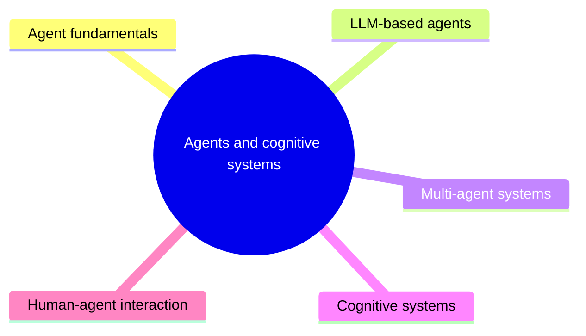

# Agents and cognitive systems

Systems that perceive, decide and act toward goals: agent fundamentals and types, LLM-based agents with their planning, tools, memory and evaluation, multi-agent systems, cognitive architectures and human-agent interaction.

This knowledge area follows the knowledge unit AI-Agents (Agents and Cognitive Systems) of the AI knowledge area in [Computer Science Curricula 2023](https://csed.acm.org/) (ACM, IEEE-CS and AAAI), with the definitions of agents from AI-Introduction. LLM-based agents are a catalog section for the large body of material on agents built around language models.

## Map

The map shows the sections of this knowledge area.

## Sections

- [Agent fundamentals](agent-fundamentals/README.md) (2 notes): What an agent is, how its task environment is described, and the main types of agents.
- [LLM-based agents](llm-agents/README.md) (8 notes): Catalog section: agents that use a large language model as their reasoning engine.
- [Multi-agent systems](multi-agent-systems/README.md) (1 note): Several agents that collaborate, compete or are organized in hierarchies.
- [Cognitive systems](cognitive-systems/README.md) (1 note): Architectures that integrate memory, reasoning, planning and learning, often modeled on human cognition.
- [Human-agent interaction](human-agent-interaction/README.md) (planned): How people and agents communicate, and the ethical and legal questions of their interaction.
