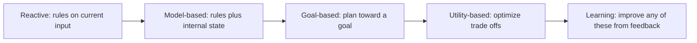

# Agent types

## Summary

Agents are classified by how they choose actions. Reactive agents map the current input directly to an action and keep no memory. Deliberative agents maintain an internal model of the world and plan before acting. Hybrid agents combine fast reactions with planning, and most modern LLM-based agents are hybrids. Learning agents improve over time from rewards or feedback, and multi-agent systems combine several agents that collaborate or compete.

## Prerequisites

- [AI agent](ai-agent.md) for the definition of an agent and its environment.

## Core concepts

### The types

- **Reactive agents**
  - No memory.
  - Direct mapping from input to action.
  - Example: a rule-based chatbot.
- **Deliberative agents**
  - Maintain an internal model of the world.
  - Plan before acting.
  - Example: pathfinding systems.
- **Hybrid agents**
  - Combine reactive behavior with planning.
  - Most modern LLM agents fall here.
- **Learning agents**
  - Improve over time through reinforcement learning or other feedback loops.
  - Use reward signals or evaluation metrics.
- **Multi-agent systems**
  - Multiple agents collaborate or compete.
  - Distributed decision-making (see [multi-agent systems](../multi-agent-systems/multi-agent-systems.md)).

### Mapping to the textbook taxonomy

Russell and Norvig classify agent programs by what they keep and what they optimize. The table relates the two classifications.

| Type in this note | Textbook agent programs | What the agent uses to decide |
| --- | --- | --- |
| Reactive | Simple reflex agent | Condition-action rules on the current percept. |
| Reactive with state | Model-based reflex agent | Rules plus an internal state that tracks what cannot be seen now. |
| Deliberative | Goal-based agent | A model of the world and a goal. It searches or plans for action sequences that reach the goal. |
| Deliberative, with trade offs | Utility-based agent | A utility function that ranks outcomes, so it can trade off goals, risk and cost. |
| Learning | Learning agent | Any of the above plus a learning element that improves it from feedback. |

The flowchart orders the types by how much of the world and the future they consider before acting.

### Learning agents and reinforcement learning

A learning agent has four components: a *performance element* that chooses actions, a *critic* that judges outcomes against a performance standard, a *learning element* that improves the performance element, and a *problem generator* that proposes exploratory actions. Reinforcement learning is the most direct form: the agent improves through reward signals (see [reinforcement learning](../../machine-learning/learning-paradigms/reinforcement-learning.md)). Integrating reinforcement learning with LLM agents, so that agents improve from reward signals on completed tasks, is an active research direction, and reinforcement learning is already used to train the reasoning behavior of current language models.

## Worked example

The same goal, "keep a web service healthy", handled by each type:

1. **Reactive:** "if CPU above 90 % then add one instance". Fast and predictable, but blind to causes: it scales up during a runaway loop that more instances will not fix.
2. **Model-based reactive:** tracks the last scale event and waits 5 minutes before scaling again, which avoids flapping.
3. **Goal-based (deliberative):** given the goal "p99 latency below 300 ms", it models load, capacity and startup times and plans the number of instances for the next hour from the forecast.
4. **Utility-based:** weighs latency against cost per instance and accepts 320 ms at night when traffic is low and the cost saving is large.
5. **Learning:** adjusts its forecast model and thresholds from the outcomes of past decisions.
6. **Hybrid LLM agent:** reacts to an alert immediately with fixed runbook steps (reactive layer), then investigates the cause with a plan of log and metric queries (deliberative layer).

Each step up adds capability and also adds failure modes and cost, which is why simple reactive rules remain the backbone of most production automation.

## Trade offs and when to use it

| Type | Strengths | Weaknesses |
| --- | --- | --- |
| Reactive | Fast, predictable, easy to verify | No foresight, fails outside its rules |
| Deliberative | Handles new goals and multi-step problems | Slow, needs an accurate model of the world |
| Hybrid | Fast where possible, deliberate where needed | Complexity of coordinating the layers |
| Learning | Improves with experience | Needs feedback data, can learn the wrong thing |
| Multi-agent | Specialization and parallelism | Coordination overhead, harder to debug |

## Common mistakes

- **Using a deliberative agent where a rule suffices.** Fix: start with the simplest type that meets the goal.
- **Assuming an LLM agent learns from use.** Without an explicit learning loop (memory, fine-tuning, reinforcement learning) it does not improve. Fix: design the feedback path explicitly.
- **Treating "multi-agent" as automatically better.** Fix: add agents only when roles really differ or work can run in parallel.

## Practice

1. Classify: a vending machine, a GPS navigator, a spam filter retrained weekly on user reports.
2. Why are most LLM agents hybrids?
3. What does a utility-based agent add over a goal-based agent?

Answers:

1. Reactive (rules on input), goal-based (plans a route to a destination), learning (improves from feedback).
2. They follow fixed patterns for routine steps such as tool calls and formats, and deliberate (plan, reflect) for open parts of the task.
3. A way to compare outcomes that all reach the goal, or to trade off conflicting goals, through a utility function.

## Further reading

- Russell, S. and Norvig, P. (2021). [*Artificial Intelligence: A Modern Approach, 4th edition*](https://aima.cs.berkeley.edu/). Pearson. Section 2.4 describes reflex, model-based, goal-based, utility-based and learning agents.
- Wooldridge, M. (2009). *An Introduction to MultiAgent Systems, 2nd edition*. Wiley. Chapter 5 covers reactive and hybrid agent architectures.
- Xi, Z. et al. (2023). [*The Rise and Potential of Large Language Model Based Agents: A Survey*](https://arxiv.org/abs/2309.07864). arXiv. A survey of LLM agents, their construction and applications.

TODO: check the content of this note against the sources above and record what was verified and when.
