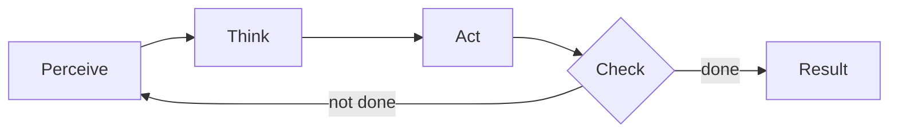

# AI agent

## Summary

An AI agent is a system that perceives its environment, reasons about its goals and context, decides on actions and carries them out through tools or interfaces, often in a loop until the goal is reached. Formally, it is an autonomous or semi-autonomous system that maps observations to actions in order to achieve defined objectives under constraints. The concept is as old as AI itself: a thermostat, a chess engine and a language model that calls APIs are all agents, differing in how they choose actions.

## Prerequisites

- [Artificial intelligence](../../ai-foundations/what-is-ai/artificial-intelligence.md) for the rational agent view of AI.

## Core concepts

### Definition

An AI agent is a system that:

- **perceives** its environment (input),
- **reasons** about goals and context,
- **decides** on actions,
- **acts** through tools or interfaces,
- **learns or adapts** over time (optional, but increasingly common).

Formal definition: an AI agent is an **autonomous or semi-autonomous system that maps observations to actions in order to achieve defined objectives under constraints.**

In the textbook formulation of Russell and Norvig, an agent is described by its *agent function*, which maps the full history of percepts to an action, and is implemented by an *agent program* running on some architecture. A *rational agent* chooses the action expected to maximize its performance measure given its percepts and built-in knowledge.

*Analogy.* A building's facility manager is an agent: they observe the building (sensors, complaints), decide what to do according to goals (comfort, budget), act through tools (thermostats, contractors) and check the result. The analogy holds for the loop and the use of tools. It breaks on judgment: a software agent has no common sense beyond what its model and rules encode, so it will execute a plausible but wrong plan without hesitation.

### Key properties

- **Goal-oriented behavior:** actions serve an explicit objective.
- **Context awareness:** the agent may be stateful (keeps memory of earlier steps) or stateless.
- **Ability to use tools:** APIs, databases and other systems extend what it can do.
- **Decision-making capability:** rule-based or learned.
- **Feedback loop:** a closed-loop system that observes the effect of its own actions.

### The control loop

Agents run in a loop: observe, think, act, evaluate, and repeat until the goal is met or a limit is reached. The flowchart shows the loop as perceive, think, act and check. "Not done" returns to perception with the new state of the world, and "done" produces the result.

The "check" step is what distinguishes an agent from a single model call: the agent sees the consequences of its actions (a tool's output, an error message, a changed environment) and adapts its next step. Production agents add limits to the loop, such as a maximum number of iterations, a time budget and a cost budget, because a loop that never reaches "done" otherwise runs forever.

### Describing an agent's task: PEAS

Russell and Norvig specify an agent's task environment with four elements, PEAS: the *performance measure*, the *environment*, the *actuators* and the *sensors*. The environment is further characterized by properties that decide which agent designs work:

| Property | Easy end | Hard end |
| --- | --- | --- |
| Observability | Fully observable | Partially observable |
| Agents | Single agent | Multi-agent |
| Outcomes | Deterministic | Stochastic |
| Episodes | Episodic (each decision independent) | Sequential (decisions affect the future) |
| Change | Static | Dynamic (changes while the agent thinks) |
| States and actions | Discrete | Continuous |

### Agents in this library

Agent types (reactive, deliberative, hybrid, learning) are described in [agent types](agent-types.md). Agents built around language models, which are the dominant architecture today, are described in [LLM-based agents](../llm-agents/llm-based-agents.md), together with their planning, tools, memory and evaluation. Systems of several agents are covered in [multi-agent systems](../multi-agent-systems/multi-agent-systems.md).

### Key takeaways

- AI agents are goal-driven systems that combine reasoning and action.
- In LLM-based agents, the language model acts as the decision engine, not as the executor: tools execute.
- Tools and memory define how useful an agent is in the real world.
- Security is a first-class concern (see [AI agent security](../../ai-security/agent-security/ai-agent-security.md)).
- Production agents require DevSecOps discipline: testing, observability, least privilege and change control.
- Multi-agent and more autonomous systems are an active direction of development.

## Worked example

Two agents described with PEAS show how the same concept spans very different systems.

| PEAS element | Smart thermostat | Incident triage agent |
| --- | --- | --- |
| Performance measure | Room within 0.5 °C of the set point, minimal energy use | Correct root cause found, time to diagnosis, no harmful actions |
| Environment | A room with heating | Production services, logs, metrics, deployment history |
| Actuators | Heater on or off | Tool calls: query logs, query metrics, post a summary to the incident channel |
| Sensors | Temperature sensor, clock | Alert payload, tool outputs, user messages |
| Environment type | Fully observable, deterministic enough, continuous, single agent | Partially observable, stochastic, sequential, dynamic |

The thermostat is a simple reflex agent: one rule maps the current temperature to an action. The triage agent must plan several steps, remember what it has already checked and decide when it has enough evidence, which is why it needs a language model, memory and a loop with a check step.

## Trade offs and when to use it

- **Use an agent** when the path to the goal is not known in advance and depends on intermediate results, such as investigating an incident.
- **Use a fixed workflow** (a predefined sequence of model calls and code) when the steps are known. Workflows are cheaper, faster and easier to test, and many problems described as "agents" are better solved this way.
- **Autonomy costs control:** every additional decision the agent makes on its own is a decision that can be wrong without anyone noticing. Match the level of autonomy to the cost of a mistake.

## Common mistakes

- **Calling every LLM application an agent.** A single prompt and response is not an agent. Fix: reserve the term for systems that choose actions in a loop based on feedback.
- **No stopping condition.** Fix: define the "done" check and hard limits on steps, time and cost.
- **Unclear performance measure.** An agent optimizes what it is told. Fix: write down the goal and the constraints, including what it must never do.

## Practice

1. Which of these is an agent: a spam classifier, a chess engine, a chatbot that answers one question, a coding assistant that runs tests and fixes failures until they pass?
2. Write PEAS for a robot vacuum cleaner.
3. Why does the check step matter?

Answers:

1. The chess engine (it chooses actions toward a goal in an environment) and the coding assistant (it acts, observes test results and repeats). The classifier and the single-question chatbot map inputs to outputs without acting in a loop.
2. Performance: share of floor cleaned, battery use, no collisions. Environment: rooms, furniture, dirt, people. Actuators: wheels, brushes, suction. Sensors: bump sensors, cliff sensors, camera or lidar, battery level.
3. It closes the feedback loop: the agent learns the effect of its last action and can correct course or stop, instead of executing a fixed plan blindly.

## Further reading

- Russell, S. and Norvig, P. (2021). [*Artificial Intelligence: A Modern Approach, 4th edition*](https://aima.cs.berkeley.edu/). Pearson. Chapter 2 defines agents, rationality, PEAS and environment properties.
- Wooldridge, M. and Jennings, N. (1995). [*Intelligent Agents: Theory and Practice*](https://doi.org/10.1017/S0269888900008122). The Knowledge Engineering Review 10(2). A classic definition of agent properties: autonomy, reactivity, proactiveness and social ability.
- Anthropic (2024). [*Building effective agents*](https://www.anthropic.com/engineering/building-effective-agents). Practical guidance on when to use workflows and when to use agents.

TODO: check the content of this note against the sources above and record what was verified and when.
