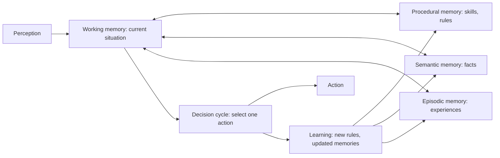

# Cognitive architectures

## Summary

A cognitive architecture is a fixed blueprint for an intelligent system that integrates memory, reasoning, planning and learning in one design, usually modeled on theories of human cognition. ACT-R and Soar are the best known examples, developed since the 1980s to model human problem solving and to build general agents. Their ideas, such as separate working, episodic, semantic and procedural memories and a decision cycle that selects one action at a time, reappear in the design of current LLM-based agents.

## Prerequisites

- [AI agent](../agent-fundamentals/ai-agent.md).
- [Agent memory](../llm-agents/agent-memory.md) for memory types in LLM agents.

## Core concepts

### Definition

A cognitive architecture specifies the parts of a mind that stay constant across tasks: the memories, their contents and formats, the processes that operate on them and the cycle that coordinates them. Task knowledge is added on top, for example as rules. The aim is integration: memory, reasoning, planning and learning in one system, rather than separate components for each task.

### ACT-R

ACT-R (Adaptive Control of Thought, Rational), developed by John Anderson and colleagues at Carnegie Mellon University, models human cognition as the interaction of modules (visual, manual, goal, declarative memory) through limited buffers. *Declarative memory* stores facts as chunks with activation levels that rise with use and decay over time. *Procedural memory* stores production rules (if-then), and in each cycle one rule whose conditions match the buffers fires. ACT-R models predict human reaction times and error rates in experiments, which makes it a scientific theory as well as an architecture.

### Soar

Soar, developed by John Laird, Allen Newell and Paul Rosenbloom from 1983, frames all behavior as search in problem spaces. In each decision cycle it proposes, evaluates and applies operators. When it cannot decide (an *impasse*), it creates a subgoal to resolve it, and *chunking* stores the result as a new rule, so the same impasse never recurs. Later versions added reinforcement learning, semantic memory and episodic memory.

### The common structure

The diagram shows the components that ACT-R, Soar and modern LLM agent designs share.

### From cognitive architectures to language agents

LLM-based agents rebuilt much of this structure with a language model as the reasoning core, often described as "ACT-R inspired" or Soar-like systems. The CoALA framework (Sumers et al., 2023) makes the mapping explicit:

| Cognitive architecture | Language agent |
| --- | --- |
| Working memory | The context window and the agent's current state |
| Episodic memory | Logs of past actions and trajectories |
| Semantic memory | Vector databases and knowledge bases |
| Procedural memory | The model's weights, plus the agent's code and prompts |
| Decision cycle | The agent loop: plan, choose an action, observe |
| Learning (chunking, reinforcement) | Writing to memory, fine-tuning, reinforcement learning |

The main difference is that classic architectures use hand written symbolic rules, which are transparent but brittle, while language agents use a learned model, which is flexible but opaque and harder to guarantee.

## Worked example

How the two kinds of system would solve "Plan a meeting for three people next week":

- **Soar-style agent:** working memory holds the request and the calendars. Production rules propose operators such as "check slot Monday 10:00". When two slots are equally good it reaches an impasse, creates a subgoal ("prefer earlier slots"), resolves it and stores a chunk, so next time it decides immediately. Every step is inspectable, but every rule had to be written by someone.
- **Language agent:** the context holds the request, a calendar tool returns free slots, and the model proposes "Tuesday 14:00, the first slot free for all three". It needed no rules, but nothing guarantees it checked all three calendars, so the orchestrator verifies the slot with a final tool call.

## Trade offs and when to use it

- Classic cognitive architectures are the right tool for cognitive modeling (predicting human behavior) and for agents that must be transparent and verifiable within a narrow domain.
- Language agents cover open domains with little engineering per task, at the cost of guarantees.
- Hybrid designs (a language model inside an architecture with explicit memories and rules) are an active research direction.

## Common mistakes

- **Treating "cognitive architecture" as a buzzword for any agent.** Fix: use it for designs that specify fixed memories and a decision cycle across tasks.
- **Assuming a language model has episodic memory by default.** Fix: implement episodic memory explicitly, as a store the agent writes to and retrieves from.

## Practice

1. What happens in Soar when it reaches an impasse?
2. Which memory of an LLM agent corresponds to procedural memory?
3. Why are ACT-R models testable as scientific theories?

Answers:

1. It creates a subgoal to resolve the impasse, and chunking stores the result as a new rule.
2. The model's weights, together with the agent's code and prompts.
3. They make quantitative predictions, such as reaction times and error rates, that can be compared with human experimental data.

## Further reading

- Anderson, J. et al. (2004). [*An Integrated Theory of the Mind*](https://doi.org/10.1037/0033-295X.111.4.1036). Psychological Review 111(4). The overview of ACT-R.
- Laird, J. (2012). *The Soar Cognitive Architecture*. MIT Press. The reference description of Soar.
- Kotseruba, I. and Tsotsos, J. (2020). [*40 years of cognitive architectures: core cognitive abilities and practical applications*](https://doi.org/10.1007/s10462-018-9646-y). Artificial Intelligence Review 53. A survey of 84 architectures.
- Sumers, T. et al. (2023). [*Cognitive Architectures for Language Agents*](https://arxiv.org/abs/2309.02427). TMLR 2024. The CoALA framework mapping cognitive architectures to LLM agents.

TODO: check the content of this note against the sources above and record what was verified and when.
