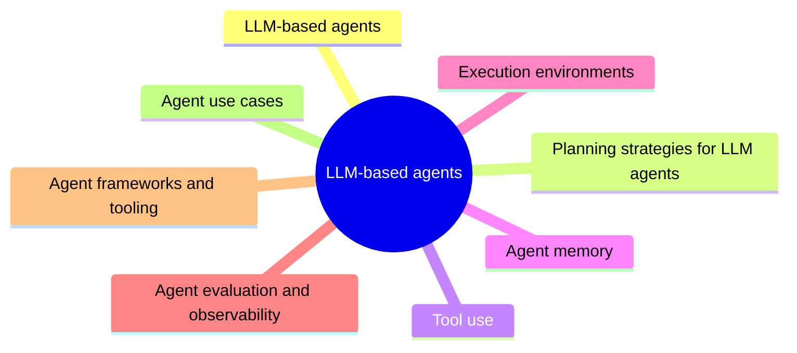

# LLM-based agents

Catalog section: agents that use a large language model as their reasoning engine.

This section is part of the knowledge area [Agents and cognitive systems](../README.md). Read the notes in the order below.

## Map

The map shows the notes of this section.

## Notes

- [LLM-based agents](llm-based-agents.md): An LLM-based agent uses a large language model as its reasoning engine: the model reads the goal and the current context, decides which tool to call next, reads the tool's result and repeats until the task is done.
- [Planning strategies for LLM agents](planning-strategies.md): A planning strategy decides how an LLM agent turns a goal into a sequence of actions.
- [Tool use](tool-use.md): Tool use, also called function calling, lets a language model act beyond text: the application describes available tools (name, purpose, argument schema), the model responds with a structured request to call one, the application executes it and returns the result to the model.
- [Agent memory](agent-memory.md): An LLM agent's memory is everything that lets it use information beyond the current model call.
- [Execution environments](execution-environments.md): An execution environment is where an agent's actions actually run: the code it writes, the commands it issues and the tools it calls.
- [Agent evaluation and observability](agent-evaluation-and-observability.md): Agents are evaluated on whether they complete tasks (task success rate, accuracy, latency), on AI-specific quality (hallucination rate, context relevance, reasoning quality) and on safety (policy violations, sensitive data leakage).
- [Agent frameworks and tooling](agent-frameworks-and-tooling.md): Agent frameworks provide the plumbing of LLM-based agents: model abstraction, tool definitions, memory, retrieval and the control loop.
- [Agent use cases](agent-use-cases.md): LLM-based agents are used where a task needs several steps that depend on intermediate results and on access to tools: DevOps and security operations (incident analysis, log triage, alert investigation), software engineering (code generation, pull request review, test generation) and business automation (customer support, workflow automation, data analysis).

## Planned topics

- Workflows versus agents
- Agent communication protocols: MCP and agent-to-agent
- Computer use agents
