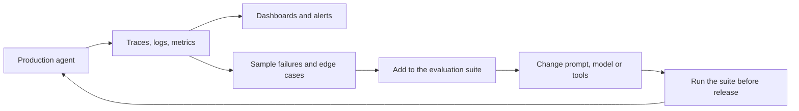

# Agent evaluation and observability

## Summary

Agents are evaluated on whether they complete tasks (task success rate, accuracy, latency), on AI-specific quality (hallucination rate, context relevance, reasoning quality) and on safety (policy violations, sensitive data leakage). Observability makes those measurements possible in production: traces of every model and tool call, structured logs of reasoning steps, and metrics such as success rate, hallucination rate and tool failure rate. Without an evaluation pipeline, an agent's quality is not measurable, and every change to a prompt, model or tool is a guess.

## Prerequisites

- [LLM-based agents](llm-based-agents.md).
- [Classification metrics](../../machine-learning/model-evaluation/classification-metrics.md) for accuracy and related measures.

## Core concepts

### Evaluation metrics

**Functional metrics**

- Task success rate.
- Accuracy.
- Latency.

**AI-specific metrics**

- Hallucination rate: the share of answers that contain claims not supported by the sources or tool results.
- Context relevance: whether the retrieved or provided context was relevant to the task.
- Reasoning quality: whether the steps taken were sensible, not only whether the result was right.

**Safety metrics**

- Policy violations.
- Sensitive data leakage.

Practical additions are cost per task, number of steps per task (efficiency) and tool call error rate.

### How agents are evaluated

| Method | How | Good for |
| --- | --- | --- |
| Task suites with checkable outcomes | Run the agent on fixed tasks and check the final state (tests pass, ticket has the right label, database row exists). | Success rate, regressions after changes. |
| Reference answers | Compare outputs with expected answers by rules or similarity. | Question answering, extraction. |
| LLM as a judge | A model scores outputs against a rubric. | Open ended quality at scale. Must itself be validated against human ratings. |
| Human review | Experts rate a sample. | Ground truth for the other methods, high stakes outputs. |
| Red teaming and adversarial tests | Attempt prompt injection, data exfiltration and misuse. | Safety metrics. |

Because agents are nondeterministic, each task should be run several times and reported as a rate. A common measure is pass@k (at least one success in k runs) and its stricter counterpart, success in all k runs, which matters more for reliability.

### Observability

Observability for agents follows the same three signals as for any distributed system:

- **Traces (OpenTelemetry):** one trace per task, with a span for every model call, tool call and retrieval, including inputs, outputs, token counts and durations. OpenTelemetry defines semantic conventions for generative AI spans.
- **Logs:** structured records of reasoning steps, tool arguments and results, and decisions such as "stopped after 12 steps".
- **Metrics:** success rate, hallucination rate, tool failure rate, plus latency, tokens and cost per task.

The flowchart shows how production traces feed back into evaluation.

## Worked example

A team runs its incident triage agent on a suite of 40 past incidents, five runs each (200 runs), before and after switching to a new model version. The numbers are illustrative.

| Metric | Old model | New model |
| --- | --- | --- |
| Correct root cause | 128 / 200 (64 %) | 150 / 200 (75 %) |
| Hallucinated facts (claims not in tool outputs), by human review of 40 runs | 6 / 40 | 3 / 40 |
| Tool call errors | 4 % | 9 % |
| Median steps per task | 7 | 5 |
| Median cost per task | 0.08 dollars | 0.05 dollars |

The new model is better on the main metric and cheaper, but its tool call error rate more than doubled. The traces show it formats the `time_range` argument as `"1h"` instead of `"last_1h"`. A fix to the tool description (with an example value) is tested on the suite before release. Without per-metric tracking, the regression would have been hidden inside an improved success rate.

## Trade offs and when to use it

- Building an evaluation suite costs time up front but is the only way to change prompts, models and tools safely.
- LLM-as-judge scales evaluation cheaply, but judges have biases (favoring longer answers, their own style) and must be checked against human labels.
- Full tracing of prompts and outputs is invaluable for debugging but stores sensitive data. Apply retention limits, access control and redaction.

## Common mistakes

- **Evaluating on a handful of examples by eye.** Fix: a fixed suite with automatic checks, run several times per task.
- **Only measuring the final answer.** Fix: also measure intermediate steps (tool errors, retrieval relevance), where most regressions start.
- **No baseline.** Fix: record the metrics of the current version before changing anything.
- **Logging secrets.** Fix: redact credentials and personal data from traces.

## Practice

1. Why should an agent task be run several times during evaluation?
2. Name one functional, one AI-specific and one safety metric.
3. What does a rising tool failure rate with a stable success rate suggest?

Answers:

1. Agents are nondeterministic. A single run can succeed or fail by chance, so success must be measured as a rate.
2. For example: task success rate, hallucination rate, sensitive data leakage.
3. The agent recovers from tool errors by retrying, which hides the problem in the success rate but costs latency and money, and may fail on harder tasks.

## Further reading

- OpenTelemetry (2025). [*Semantic conventions for generative AI systems*](https://opentelemetry.io/docs/specs/semconv/gen-ai/). The standard attributes for tracing model and tool calls.
- Zheng, L. et al. (2023). [*Judging LLM-as-a-Judge with MT-Bench and Chatbot Arena*](https://arxiv.org/abs/2306.05685). NeurIPS 2023. Measures agreement and biases of model judges.
- Yao, S. et al. (2024). [*τ-bench: A Benchmark for Tool-Agent-User Interaction in Real-World Domains*](https://arxiv.org/abs/2406.12045). arXiv. Introduces the pass^k reliability measure for agents.

TODO: check the content of this note against the sources above and record what was verified and when.
