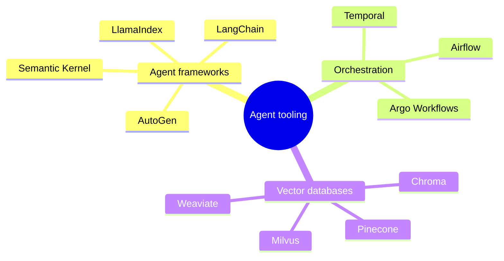

# Agent frameworks and tooling

## Summary

Agent frameworks provide the plumbing of LLM-based agents: model abstraction, tool definitions, memory, retrieval and the control loop. Workflow orchestrators run long, multi-step processes reliably, with retries and state. Vector databases store embeddings for retrieval and long-term memory. The tools change fast, so this note describes what each category does and names examples with a date, rather than recommending products.

## Prerequisites

- [LLM-based agents](llm-based-agents.md).
- [Agent memory](agent-memory.md) for vector databases.

## Core concepts

### Categories

The mind map groups widely used tools by category.

| Category | What it provides | Examples (as of 2025) |
| --- | --- | --- |
| Agent frameworks | Model clients, prompt templates, tool calling, memory, retrieval and agent loops. | LangChain (with LangGraph for stateful graphs), LlamaIndex (strong on retrieval over documents), Semantic Kernel (Microsoft, for .NET, Python and Java), AutoGen (Microsoft Research, multi-agent conversations). |
| Orchestration | Durable execution of long workflows: state, retries, schedules, timeouts. | Temporal (durable code workflows), Apache Airflow (scheduled DAGs, mostly batch), Argo Workflows (Kubernetes-native workflows). |
| Vector databases | Storage and similarity search of embeddings, with metadata filters. | Pinecone (managed service), Weaviate (open source, hybrid search), Milvus (open source, large scale), Chroma (lightweight, embedded). Relational databases with vector extensions, such as PostgreSQL with pgvector, also fill this role. |
| Protocols | Standard interfaces between agents, tools and other agents. | Model Context Protocol (MCP) for tools and resources. Agent-to-agent protocols are emerging. |

### Choosing

- **Frameworks** speed up prototypes, but add abstraction layers that hide prompts and control flow. Many teams move to thin custom code once requirements are clear. Use a framework when its integrations save real work, and keep the core loop understandable.
- **Orchestrators** matter when an agent's task runs for minutes to days, must survive restarts, or waits for human approval. An in-memory loop is fine for interactive requests that finish in seconds.
- **Vector databases** are needed when the corpus exceeds what fits in memory or needs filtering and updates. For a few thousand documents, an in-process index or a database extension is often enough.

## Worked example

Stack choices for two agents:

1. **Internal documentation assistant** (interactive, answers in seconds, 20,000 documents): a thin custom loop calling the model API directly, PostgreSQL with pgvector for retrieval (the documents' metadata already lives there), and no orchestrator. Reason: few moving parts, and the existing database handles permissions.
2. **Invoice processing agent** (runs for hours per batch, needs human approval for amounts above a limit, must not lose work on restarts): Temporal for durable workflow state and approval waits, a framework's document loaders for PDF parsing, and a managed vector database for supplier contracts. Reason: durability and human-in-the-loop steps dominate the design.

## Trade offs and when to use it

| Choice | Benefit | Cost |
| --- | --- | --- |
| Heavy framework | Many integrations, fast start | Abstraction overhead, frequent breaking changes, harder debugging |
| Thin custom code | Full control and transparency | More code to write and maintain |
| Managed vector database | No operations work, scales | Cost, data leaves your infrastructure |
| Database extension (pgvector) | One system, transactional consistency, existing access control | Less specialized indexing at very large scale |

## Common mistakes

- **Choosing a framework before understanding the loop.** Fix: build one agent loop by hand first, so you know what the framework does for you.
- **Using a batch scheduler for interactive agents.** Airflow is built for scheduled pipelines, not millisecond responses. Fix: match the orchestrator to the latency and duration of the task.
- **Treating this list as current.** Fix: check the projects' status and licenses before adopting them, and record the date.

## Practice

1. When does an agent need a durable workflow orchestrator?
2. Why might a team replace a framework with custom code after the prototype?
3. What is pgvector?

Answers:

1. When tasks run long, must survive failures and restarts, or wait for external events such as human approval.
2. To remove hidden prompts and control flow, reduce dependencies and make the agent easier to debug and test.
3. A PostgreSQL extension that adds a vector type and similarity search, so embeddings can be stored and queried in the same database as the other data.

## Further reading

- LangChain (2025). [*LangChain documentation*](https://python.langchain.com/). Framework documentation.
- LlamaIndex (2025). [*LlamaIndex documentation*](https://docs.llamaindex.ai/). Framework documentation focused on retrieval.
- Microsoft (2025). [*Semantic Kernel documentation*](https://learn.microsoft.com/en-us/semantic-kernel/). Framework documentation.
- Wu, Q. et al. (2023). [*AutoGen: Enabling Next-Gen LLM Applications via Multi-Agent Conversation*](https://arxiv.org/abs/2308.08155). arXiv. The AutoGen framework paper.
- Temporal (2025). [*Temporal documentation*](https://docs.temporal.io/). Durable execution platform documentation.
- pgvector (2025). [*pgvector*](https://github.com/pgvector/pgvector). Open source vector similarity search for PostgreSQL.

TODO: check the content of this note against the sources above and record what was verified and when.
