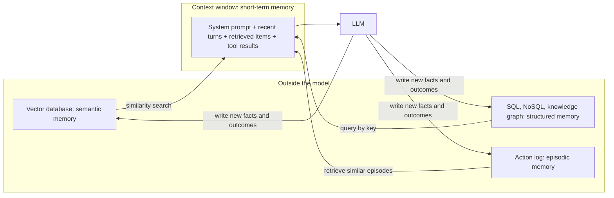

# Agent memory

## Summary

An LLM agent's memory is everything that lets it use information beyond the current model call. Short-term memory is the context window: the conversation and recent tool results, limited by the token budget. Long-term memory lives outside the model, in vector databases searched by meaning (the retrieval of retrieval-augmented generation) or in structured stores such as SQL databases and knowledge graphs. Episodic memory records the agent's past actions and their outcomes, which enables learning from experience. Memory design decides what an agent can know, and poor design causes either forgetting or noise.

## Prerequisites

- [LLM-based agents](llm-based-agents.md).
- [Multi-turn conversation context](../../generative-ai/prompt-engineering/multi-turn-conversation-context.md) for the context window.
- [Retrieval-augmented generation](../../generative-ai/retrieval-augmented-generation/retrieval-augmented-generation.md) for semantic retrieval.

## Core concepts

### Memory models

**Short-term memory**

- The context window.
- Limited by the number of tokens the model accepts.

**Long-term memory**

- *Vector databases* store embeddings and support semantic retrieval (RAG). Examples: Pinecone, Weaviate, Chroma, Milvus.
- *Structured memory* in SQL or NoSQL databases and knowledge graphs, for facts with exact keys and relations (a customer's plan, the owner of a service).

**Episodic memory**

- Logs of past actions and their results.
- Enables learning and adaptation: an agent can retrieve how a similar task went last time.

The diagram shows where each kind of memory lives relative to the model and how it reaches the context.

### Relation to cognitive science

The CoALA framework (Sumers et al., 2023) maps agent memory onto categories from cognitive architectures: *working memory* (the current context), *episodic memory* (experiences), *semantic memory* (facts about the world) and *procedural memory* (skills, stored in the model's weights and in the agent's code and prompts). The terms in this note follow the same split, with semantic memory implemented by vector and structured stores. See [cognitive architectures](../cognitive-systems/cognitive-architectures.md).

### Writing to memory

Reading is half of memory design. The other half is deciding what to write and when:

- **What:** durable facts (user preferences, resolved incidents and their causes), not every turn.
- **When:** at the end of a task, or when the model flags something worth remembering.
- **How long:** with expiry or review, because stored facts go stale.
- **Who may read it:** memory must respect the same access rules as the data it came from.

## Worked example

An IT support agent handles a ticket: "VPN disconnects every 10 minutes."

1. **Short-term:** the ticket text, the user's last two messages and the results of a `get_device_info` call are in the context.
2. **Structured memory:** a SQL lookup returns the user's laptop model and the VPN client version (`4.2.1`).
3. **Semantic memory:** a vector search over past resolved tickets finds "VPN client 4.2.x drops idle connections, fixed by upgrading to 4.3.0" (similarity 0.82).
4. **Episodic memory:** the agent's own log shows that last week it recommended the upgrade for two similar tickets, and both were closed as resolved.
5. **Write back:** after this ticket is resolved, the outcome is appended to the episodic log, raising confidence for the next case.

Each memory type answered a different question: what is happening now (short-term), what are the facts about this user (structured), what do we know about this problem (semantic) and what worked before (episodic). The scores and versions are illustrative.

## Trade offs and when to use it

| Memory | Strength | Cost or risk |
| --- | --- | --- |
| Context window | Exact, immediately available to the model | Limited size, cost per token on every call, long contexts dilute attention |
| Vector database | Finds related content by meaning at scale | Approximate, may retrieve plausible but wrong items, needs chunking and embedding upkeep |
| Structured store | Exact answers, enforceable access control | Needs a schema, cannot answer fuzzy questions |
| Episodic log | Learning from experience | Can reinforce past mistakes, grows without bound, may contain sensitive data |

## Common mistakes

- **Context loss.** Important early facts are trimmed from the window. Fix: pin key facts in the system prompt or summarize them before trimming.
- **Noise.** Retrieving too many loosely related memories distracts the model. Fix: retrieve fewer, better items with thresholds and reranking.
- **Storing everything.** Fix: write only durable, useful facts, with expiry.
- **Memory as an injection channel.** Content written to memory from untrusted sources can carry instructions into later sessions. Fix: treat memory as untrusted data and sanitize what is stored.

## Practice

1. Which memory type answers "what plan is customer 1042 on"? Which answers "have we seen errors like this before"?
2. Why is the context window called short-term memory?
3. What risk does episodic memory add that short-term memory does not?

Answers:

1. Structured memory (exact lookup). Semantic or episodic memory (similarity search over past cases).
2. It holds information only for the current requests and is limited in size. Anything outside it is not available to the model.
3. Persistence: a wrong lesson or injected instruction stored once affects future tasks.

## Further reading

- Sumers, T. et al. (2023). [*Cognitive Architectures for Language Agents*](https://arxiv.org/abs/2309.02427). TMLR 2024. The CoALA framework for memory, action and decision making in language agents.
- Packer, C. et al. (2023). [*MemGPT: Towards LLMs as Operating Systems*](https://arxiv.org/abs/2310.08560). arXiv. Managing a hierarchy of memory around a limited context window.
- Park, J. et al. (2023). [*Generative Agents: Interactive Simulacra of Human Behavior*](https://arxiv.org/abs/2304.03442). UIST 2023. Agents with a memory stream, reflection and retrieval by recency, importance and relevance.

TODO: check the content of this note against the sources above and record what was verified and when.
