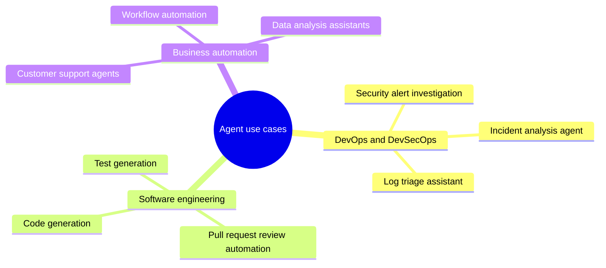
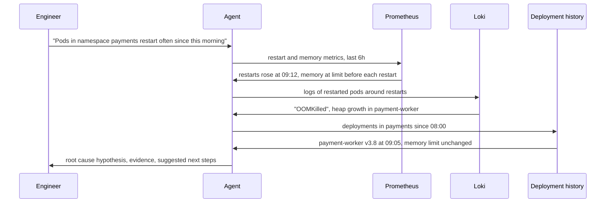

# Agent use cases

## Summary

LLM-based agents are used where a task needs several steps that depend on intermediate results and on access to tools: DevOps and security operations (incident analysis, log triage, alert investigation), software engineering (code generation, pull request review, test generation) and business automation (customer support, workflow automation, data analysis). A DevSecOps agent that analyzes Kubernetes logs and suggests a root cause shows the typical shape: retrieve data, analyze it, correlate it with changes and propose, but not execute, a fix.

## Prerequisites

- [LLM-based agents](llm-based-agents.md) and [tool use](tool-use.md).

## Core concepts

### Practical use cases

The mind map groups common use cases by domain.

What makes a task a good fit for an agent:

| Property | Good fit | Poor fit |
| --- | --- | --- |
| Steps | Depend on what earlier steps found | Fixed and known in advance (use a workflow) |
| Verification | Results can be checked (tests, data, a reviewer) | Results cannot be checked |
| Actions | Mostly read-only, or reversible | Irreversible and high impact without approval |
| Data | Accessible through tools with scoped permissions | Requires broad, unrestricted access |
| Volume and value | Enough to justify evaluation and maintenance | One-off tasks |

## Worked example

**A DevSecOps agent.** Scenario: analyze Kubernetes logs and detect anomalies.

Flow:

1. User query.
2. The agent retrieves logs (Prometheus for metrics, Loki for logs).
3. It runs anomaly detection.
4. It correlates the anomalies with deployment events.
5. It suggests a root cause.

The sequence diagram shows the same flow with the tools involved.

A useful final answer states the hypothesis ("payment-worker v3.8, deployed at 09:05, exceeds its memory limit: OOMKilled restarts began 7 minutes after the deployment"), the evidence with links to the queries, its confidence, and suggested actions (roll back v3.8, or raise the limit after checking for a leak), leaving the change itself to the engineer or to an approved runbook. The times and versions in the example are illustrative.

Design choices that make this agent safe and useful:

- read-only credentials for Prometheus, Loki and the deployment history,
- queries limited to the namespaces the engineer can access,
- every claim in the answer linked to the tool output that supports it,
- rollback available only through an approval step, see [AI agent security](../../ai-security/agent-security/ai-agent-security.md).

## Trade offs and when to use it

- Agents save the most time on investigation tasks with many data sources, where a person spends most of the time collecting and correlating data.
- Code generation and review agents are most effective with fast automatic feedback (tests, linters, type checks). Without it, errors pass silently.
- Customer support agents need strict grounding in policy documents and clear escalation to humans, since wrong answers reach customers directly.

## Common mistakes

- **Automating actions before diagnosis is reliable.** Fix: start with read-only agents that recommend, measure their accuracy, then automate the safest actions.
- **Answers without evidence.** Fix: require the agent to cite tool outputs for every claim.
- **Choosing a use case without a success measure.** Fix: define how success is measured (time to diagnosis, resolution rate) before building.

## Practice

1. Why is a log triage assistant a better first agent than an automatic remediation agent?
2. What feedback signal makes a test generation agent effective?
3. Name two controls that limit the damage a compromised DevSecOps agent can do.

Answers:

1. It is read-only, so mistakes cost time, not outages, and its accuracy can be measured before any automation.
2. Running the generated tests: whether they compile, pass on correct code and fail on injected bugs (mutation testing).
3. For example: read-only, namespace-scoped credentials, and an approval step for any change.

## Further reading

- Anthropic (2024). [*Building effective agents*](https://www.anthropic.com/engineering/building-effective-agents). Includes customer support and coding as established agent use cases.
- Jimenez, C. et al. (2024). [*SWE-bench: Can Language Models Resolve Real-World GitHub Issues?*](https://arxiv.org/abs/2310.06770). ICLR 2024. A benchmark of software engineering agents on real repositories.
- Prometheus (2025). [*Prometheus documentation*](https://prometheus.io/docs/introduction/overview/) and Grafana Labs (2025). [*Grafana Loki documentation*](https://grafana.com/docs/loki/latest/). The metrics and log systems used in the example.

TODO: check the content of this note against the sources above and record what was verified and when.
