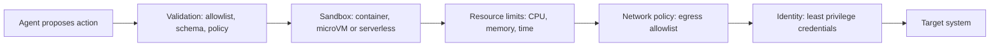

# Execution environments

## Summary

An execution environment is where an agent's actions actually run: the code it writes, the commands it issues and the tools it calls. Because an agent's decisions can be wrong or manipulated, actions must run in a controlled environment that limits what they can reach and consume: a sandboxed interpreter, a locked-down container or a short-lived serverless function. The rule is to assume the agent will eventually run something harmful, and to make sure that the environment contains the damage.

## Prerequisites

- [Tool use](tool-use.md).
- [LLM-based agents](llm-based-agents.md).

## Core concepts

### Options

Agents require controlled environments. The usual options:

- **Sandboxed Python execution:** an isolated interpreter for code the agent writes, for example for data analysis.
- **Containerized runtime (Docker):** a container with restricted file system, network, memory and CPU.
- **Serverless functions (Cloud Run, AWS Lambda):** short-lived, isolated executions with their own identity and permissions.

Stronger isolation is available from microVMs (such as Firecracker) and user space kernels (such as gVisor), which put a smaller attack surface between agent code and the host than a standard container does.

### Isolation layers

The diagram shows the layers of control between an agent's proposed action and the systems it can affect. Each layer limits a different kind of damage.



| Control | Prevents |
| --- | --- |
| Read-only root file system | Persistent modification of the environment, planting files. |
| Memory and CPU limits | Resource exhaustion, runaway loops, crypto mining. |
| Timeouts | Infinite loops and hung processes. |
| No network, or an egress allowlist | Data exfiltration and downloading payloads. |
| Non-root user, dropped capabilities | Escalation inside the container. |
| Scoped, short-lived credentials | Access beyond the task, reuse of stolen credentials. |
| Ephemeral environments | State leaking between tasks or users. |

## Worked example

A basic secure execution of an agent runner container:

```bash
docker run --read-only --memory=256m --cpus=0.5 agent-runner
```

The flags make the container's file system read-only, cap memory at 256 MB and limit it to half a CPU. A hardened version adds the controls from the table above. The flags are those documented for Docker Engine. The command is untested: the image name and paths are placeholders.

```bash
# Run agent-generated code with no network, a writable scratch area only,
# no privileges and a hard time limit
timeout 30s docker run --rm \
  --read-only --tmpfs /tmp:rw,size=64m \
  --memory=256m --cpus=0.5 --pids-limit=128 \
  --network=none \
  --user=65534:65534 --cap-drop=ALL --security-opt=no-new-privileges \
  agent-runner python /tmp/task.py
```

What each addition does: `--tmpfs` gives a small writable directory while the rest stays read-only, `--pids-limit` stops fork bombs, `--network=none` blocks exfiltration, `--user` runs as the unprivileged `nobody` user, `--cap-drop=ALL` and `no-new-privileges` remove Linux capabilities and privilege escalation, `--rm` deletes the container afterwards, and `timeout` kills it after 30 seconds. The code file must be copied or mounted into `/tmp` by the runner.

TODO: run the hardened command against a test image and record the Docker version.

## Trade offs and when to use it

- Containers are fast to start and familiar, but share the host kernel. For untrusted code from many users, microVMs or gVisor give stronger isolation at some startup cost.
- Serverless functions offer isolation and per-function identity with no servers to manage, but have cold starts, time limits and less control over the runtime.
- Blocking the network is the strongest single control against exfiltration, but many tasks need some network access. Then use an egress proxy with an allowlist of domains.

## Common mistakes

- **Running agent code on the host or in the application's own process.** Fix: always execute in a separate sandbox.
- **Mounting the Docker socket or host directories into the sandbox.** Either one gives the agent control of the host. Fix: never mount them.
- **Long-lived broad credentials in the environment.** Fix: inject short-lived, task-scoped credentials, or none.
- **Reusing one environment across users.** Fix: create a fresh environment per task or session.

## Practice

1. Which single flag most reduces the risk of data exfiltration from agent code?
2. Why is `--read-only` alone not enough?
3. When would you choose a microVM over a container?

Answers:

1. `--network=none` (or an egress allowlist when some network is needed).
2. It prevents writes to the file system but not network access, resource abuse, privilege escalation or misuse of credentials present in the environment.
3. When running untrusted code from many users or tenants, where a kernel level escape from a container would be severe.

## Further reading

- Docker (2025). [*Docker run reference: resource constraints and security*](https://docs.docker.com/reference/cli/docker/container/run/). Docker documentation. Reference for the flags used above.
- Agache, A. et al. (2020). [*Firecracker: Lightweight Virtualization for Serverless Applications*](https://www.usenix.org/conference/nsdi20/presentation/agache). NSDI 2020. The microVM design used by AWS Lambda.
- gVisor (2025). [*gVisor documentation*](https://gvisor.dev/docs/). An application kernel that sandboxes containers.

TODO: check the content of this note against the sources above and record what was verified and when.
