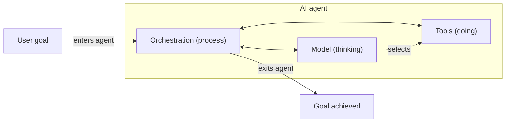
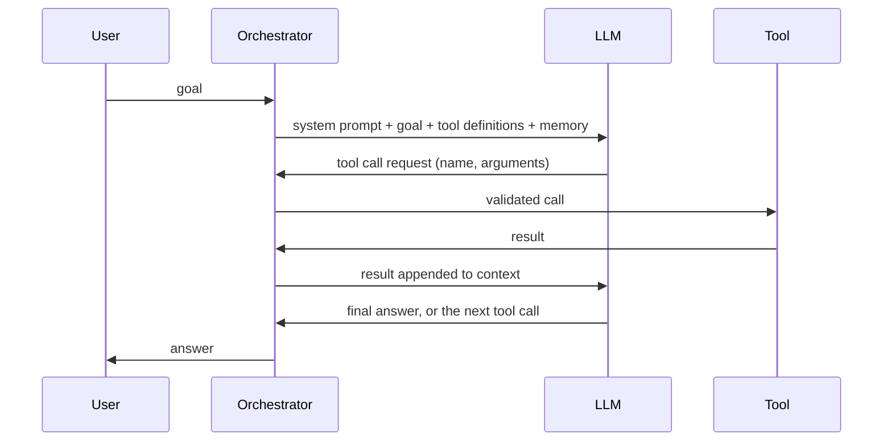

# LLM-based agents

## Summary

An LLM-based agent uses a large language model as its reasoning engine: the model reads the goal and the current context, decides which tool to call next, reads the tool's result and repeats until the task is done. Around the model sit an orchestrator that runs the loop, a set of tools that act on the world, and memory that holds context. This is the dominant agent architecture today. Its power comes from the model's flexibility, and its risks come from the same source: the model's decisions are probabilistic and can be manipulated, so the system around it must constrain, observe and validate them.

## Prerequisites

- [AI agent](../agent-fundamentals/ai-agent.md) and [agent types](../agent-fundamentals/agent-types.md).
- [Prompt engineering](../../generative-ai/prompt-engineering/prompt-engineering.md).

## Core concepts

### Key components

- **Prompt (system and user):** the system prompt defines role, rules and available tools, and the user prompt states the task.
- **Tools (functions and APIs):** the actions the agent can take (see [tool use](tool-use.md)).
- **Planner (optional):** produces a multi-step plan before or during execution (see [planning strategies](planning-strategies.md)).
- **Executor:** runs the tool calls the model requests and returns the results.
- **Memory store:** short-term conversation context and long-term knowledge (see [agent memory](agent-memory.md)).

The diagram shows these parts as three roles inside the agent: the orchestration (process) runs the loop, the model does the thinking, and the tools do the doing. A user goal enters the agent and leaves as an achieved goal.

### Layered architecture

Modern AI agents, especially LLM-based ones, follow a layered architecture:

| Layer | Contents |
| --- | --- |
| Input layer | User input (text, voice, events), system context (memory, state), external signals (APIs, telemetry). |
| Reasoning layer | The LLM or reasoning engine, the prompt with context and policies, and an optional planning strategy. |
| Action layer | Tool invocation, API calls, code execution and other interaction with systems. |
| Memory layer | Short-term memory (conversation context), long-term memory (vector database, knowledge base) and episodic memory (past actions). |
| Control loop | Observe, think, act, evaluate, repeat. |

The sequence diagram shows one iteration of the control loop with a tool call.

### Example flow

1. User: "Analyze logs and detect anomalies."
2. Agent: retrieves the logs, calls an analysis tool, interprets the results and returns insights.

A fuller version of this scenario is in [agent use cases](agent-use-cases.md).

### Autonomy

Agents differ in how much they do without a person. At one end, an assistant proposes each action and a human approves it. At the other, *autonomous agents* are long-running, trigger their own actions and react to events (a new alert, a new ticket) without being asked. Autonomy should grow with evidence of reliability and with the reversibility of the agent's actions: reading logs autonomously is low risk, deleting resources is not.

### Design best practices

- Start with a **single agent with tools**.
- Add planning only if necessary.
- Use **retrieval-augmented generation for knowledge grounding** (see [retrieval-augmented generation](../../generative-ai/retrieval-augmented-generation/retrieval-augmented-generation.md)).
- Enforce **strict identity and access management (IAM) and sandboxing** (see [execution environments](execution-environments.md)).
- Implement **observability from day one** (see [agent evaluation and observability](agent-evaluation-and-observability.md)).
- **Validate outputs** against schemas and policies.
- Treat agents as **untrusted components**: the model's decisions can be wrong or manipulated, so the system enforces the limits, not the prompt.

## Worked example

A trace of an agent answering "Why did checkout errors spike at 14:00?" with three tools: `get_metrics`, `get_logs` and `get_deployments`. Each step shows the model's decision and the orchestrator's action.

| Step | Model output (decision) | Orchestrator action and result |
| --- | --- | --- |
| 1 | Call `get_metrics(service="checkout", window="13:30-14:30")` | Error rate rose from 0.2 % to 7 % at 14:02. |
| 2 | Call `get_deployments(service="checkout", window="13:00-14:30")` | Version 2.14.0 deployed at 14:00. |
| 3 | Call `get_logs(service="checkout", level="ERROR", window="14:00-14:10")` | 92 % of errors: `PaymentClient timeout after 2000 ms`. |
| 4 | Final answer | "Errors began 2 minutes after deployment 2.14.0. Most are payment client timeouts at 2,000 ms. Check whether 2.14.0 changed the payment client timeout or connection pool. Suggest rollback if confirmed." |

The model chose the order of the calls from intermediate results: step 2 was chosen because step 1 showed a sharp change. A fixed workflow would have to query everything every time. The agent did not roll back on its own: the action with side effects is left to a person, which is the right autonomy level for production changes. The numbers in this trace are illustrative.

## Trade offs and when to use it

- **Use an LLM agent** when the steps depend on intermediate results and the tools and data are too varied to script.
- **Prefer a workflow** (fixed chain of model calls and code) when the steps are known. It is cheaper, faster and easier to test.
- **Costs:** several model calls per task (latency and money), nondeterminism, and a larger attack surface.
- **Benefits:** flexibility, natural language interfaces, and the ability to combine many tools.

## Common mistakes

- **Over-reliance on the LLM.** There are no deterministic guarantees. Fix: put hard rules, validations and limits in code.
- **Lack of guardrails.** It leads to unsafe behavior. Fix: allowlisted tools, parameter validation, policy checks and human approval for risky actions.
- **Poor memory design.** It causes context loss or noise. Fix: decide explicitly what is kept, summarized, retrieved and forgotten.
- **Tool overexposure.** Every tool is attack surface. Fix: give each agent only the tools and permissions its task needs.
- **No evaluation pipeline.** Without it, quality is not measurable. Fix: build a test set of tasks and track success rate and failure types before and after every change.

## Practice

1. Name the five key components of an LLM-based agent.
2. Why should the orchestrator, not the model, execute tool calls?
3. In the worked example, why is rollback left to a person?

Answers:

1. Prompt, tools, planner (optional), executor and memory store.
2. The orchestrator can validate arguments, enforce permissions, apply timeouts and log every action. The model only proposes.
3. Rollback changes production. The cost of a wrong decision is high and the agent's diagnosis is probabilistic, so a human confirms.

## Further reading

- Yao, S. et al. (2023). [*ReAct: Synergizing Reasoning and Acting in Language Models*](https://arxiv.org/abs/2210.03629). ICLR 2023. The reason and act loop that most LLM agents use.
- Anthropic (2024). [*Building effective agents*](https://www.anthropic.com/engineering/building-effective-agents). Guidance on workflows versus agents and on simple, composable designs.
- Wiesinger, J., Marlow, P. and Vuskovic, V. (2024). [*Agents*](https://www.kaggle.com/whitepaper-agents). Google whitepaper. Describes the model, tools and orchestration layer of an agent.
- Wang, L. et al. (2024). [*A Survey on Large Language Model based Autonomous Agents*](https://arxiv.org/abs/2308.11432). Frontiers of Computer Science 18. A survey of profiles, memory, planning and action in LLM agents.

TODO: check the content of this note against the sources above and record what was verified and when.
