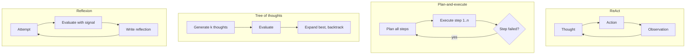

# Planning strategies for LLM agents

## Summary

A planning strategy decides how an LLM agent turns a goal into a sequence of actions. ReAct interleaves short reasoning steps with actions and observations. Plan-and-execute writes a full plan first and then runs it step by step. Tree of thoughts explores several reasoning paths and keeps the best one. Reflexion adds self-critique: the agent evaluates its own result and tries again with the lessons learned. The strategies trade adaptability against cost and predictability.

## Prerequisites

- [LLM-based agents](llm-based-agents.md).
- [Chain-of-thought prompting](../../generative-ai/prompt-engineering/chain-of-thought-prompting.md), which these strategies build on.

## Core concepts

### ReAct (reason and act)

- Interleaves reasoning and actions: thought, action, observation, thought, and so on.
- Makes the decision steps transparent, because each action is preceded by a written reason.
- Widely used, for example as the default agent loop in frameworks such as LangChain.

ReAct (Yao et al., 2023) adapts well to surprises, because each next step is chosen after seeing the last observation. It can wander on long tasks, since it never commits to an overall plan.

### Plan-and-execute

- Step 1: create a plan.
- Step 2: execute the steps sequentially.
- Better for long tasks.

Separating planning from execution lets a strong model plan and a cheaper model or plain code execute, makes the plan reviewable before anything runs, and keeps the agent on track over many steps. The weakness is rigidity: when step 3 fails or reveals something unexpected, the agent needs a *replanning* step. Plan-and-solve prompting (Wang et al., 2023) is a single-prompt version of the same idea.

### Tree of thoughts (ToT)

- Explores multiple reasoning paths.
- Selects the best branch.

Tree of thoughts (Yao et al., 2023) generates several candidate next steps ("thoughts"), has the model evaluate them, and searches the resulting tree with breadth-first or depth-first search, backtracking from dead ends. It helps on problems where early choices decide success, such as puzzles and planning with constraints, at a cost of many more model calls.

### Reflexion and self-critique

- The agent evaluates its own outputs.
- It improves iteratively.

Reflexion (Shinn et al., 2023) has the agent write a verbal reflection after a failed attempt ("the test failed because I did not handle empty input") and store it in memory, so the next attempt avoids the mistake. Self-critique works best when there is an external signal to reflect on, such as test results, a compiler error or a validator. Without such a signal, a model judging its own output often fails to find its errors.

### Comparison

The flowchart contrasts the control flow of the four strategies.

| Strategy | Model calls | Adapts to surprises | Best for |
| --- | --- | --- | --- |
| ReAct | One per step | High | Interactive tool use, investigations |
| Plan-and-execute | One plan plus one per step | Medium (needs replanning) | Long tasks with a clear structure |
| Tree of thoughts | Many per step | High | Search problems where early choices matter |
| Reflexion | One per attempt plus reflection | Across attempts | Tasks with an automatic success check, such as code with tests |

## Worked example

Goal: "Add a `--dry-run` flag to the deploy script and make the tests pass."

- **ReAct:** Thought: "I need to see the script first." Action: read `deploy.sh`. Observation: the script parses flags with `getopts`. Thought: "Add a `d` option and skip the `kubectl apply` call when set." Action: edit the file. Observation: edit applied. Thought: "Run the tests." Action: run the tests. Observation: one failure, the help text test.
- **Reflexion on top:** reflection after the failure: "The help text test expects every flag to be documented. Update the usage message when adding flags." The next attempt updates the usage message and the tests pass.
- **Plan-and-execute alternative:** plan: (1) read the script, (2) add the flag, (3) guard the apply command, (4) update the usage message, (5) add a test, (6) run the tests. A good plan anticipates the usage message, and the plan is reviewable before any file changes.

## Trade offs and when to use it

- Start with ReAct and a small set of tools. Add an explicit planner when tasks get long and the agent loses track, and add reflection when there is an automatic success signal.
- More elaborate strategies multiply model calls: tree of thoughts can use tens to hundreds of calls for one problem.
- Reasoning models that plan internally reduce the need for elaborate external strategies on many tasks, but not the need for external checks.

## Common mistakes

- **Planning without feedback.** A plan executed blindly fails at the first surprise. Fix: check the result of every step and allow replanning.
- **Self-critique without a signal.** Fix: give the reflection step something objective: tests, validators, retrieved facts.
- **No step limit.** ReAct loops can repeat the same failing action. Fix: cap iterations and detect repeated actions.

## Practice

1. Which strategy suits a 30-step data migration with a known structure?
2. Why does Reflexion work better for coding than for essay writing?
3. What is the main cost of tree of thoughts?

Answers:

1. Plan-and-execute, with checks after each step and replanning on failure.
2. Coding has an objective success signal (tests, compiler), which makes reflections specific and verifiable.
3. The number of model calls, because it generates and evaluates many candidate thoughts at each step.

## Further reading

- Yao, S. et al. (2023). [*ReAct: Synergizing Reasoning and Acting in Language Models*](https://arxiv.org/abs/2210.03629). ICLR 2023.
- Wang, L. et al. (2023). [*Plan-and-Solve Prompting: Improving Zero-Shot Chain-of-Thought Reasoning by Large Language Models*](https://arxiv.org/abs/2305.04091). ACL 2023.
- Yao, S. et al. (2023). [*Tree of Thoughts: Deliberate Problem Solving with Large Language Models*](https://arxiv.org/abs/2305.10601). NeurIPS 2023.
- Shinn, N. et al. (2023). [*Reflexion: Language Agents with Verbal Reinforcement Learning*](https://arxiv.org/abs/2303.11366). NeurIPS 2023.
- Huang, J. et al. (2024). [*Large Language Models Cannot Self-Correct Reasoning Yet*](https://arxiv.org/abs/2310.01798). ICLR 2024. Shows the limits of self-critique without external feedback.

TODO: check the content of this note against the sources above and record what was verified and when.
