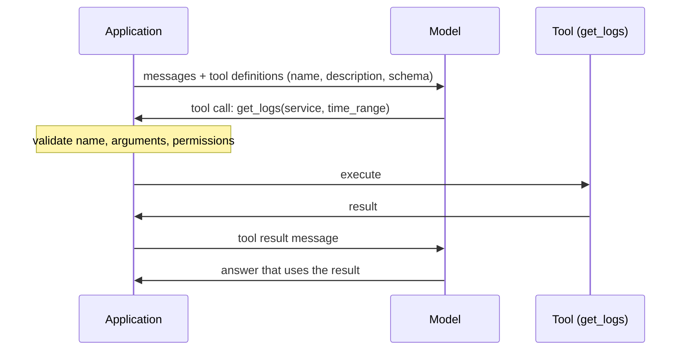

# Tool use

## Summary

Tool use, also called function calling, lets a language model act beyond text: the application describes available tools (name, purpose, argument schema), the model responds with a structured request to call one, the application executes it and returns the result to the model. The key principle is a division of labor: the LLM decides *what* to do, and tools execute *how* to do it. Because the model only proposes calls, the application can and must validate every call before running it.

## Prerequisites

- [LLM-based agents](llm-based-agents.md).
- [Output formats](../../generative-ai/prompt-engineering/output-formats.md) for structured output and JSON Schema.

## Core concepts

### What tools are

Agents extend their capabilities through tools. Examples:

- REST APIs, such as payment systems,
- databases (SQL and NoSQL),
- command line (CLI) commands,
- cloud services (GCP, AWS),
- observability tools (Grafana, Prometheus).

### The pattern

The model emits a structured tool call, for example:

```json
{
  "tool": "get_logs",
  "arguments": {
    "service": "auth-service",
    "time_range": "last_1h"
  }
}
```

The exact wire format differs by provider, but every function calling API has the same three parts: tool definitions sent with the request (a name, a description and a JSON Schema for the arguments), a tool call returned by the model, and a tool result sent back in the next request. The sequence diagram shows the round trip.



### Key principle

The LLM decides *what* to do. Tools execute *how* to do it. The model never executes anything itself: it outputs text that the application interprets as a request. This separation is the main security control of an agent. Everything that must be guaranteed (permissions, argument limits, rate limits, approvals) is enforced in the application between the model's proposal and the execution.

### Tool design

Models choose tools from their names, descriptions and schemas, so tool definitions are prompts:

- give each tool one clear purpose and a description that says when to use it and when not to,
- use narrow argument types (enums, ranges, formats) instead of free strings,
- return compact, structured results with clear errors the model can act on ("service 'auth' not found, valid services: auth-service, billing-service"),
- prefer several safe, specific tools (`restart_pod`) over one general one (`run_shell`).

The *Model Context Protocol* (MCP), published by Anthropic in November 2024, standardizes how applications expose tools, resources and prompts to models, so a tool server can be reused across agent frameworks.

## Worked example

A dispatcher that executes model-proposed tool calls only after checking them against an allowlist. Tested with Python 3.10 (standard library only).

```python
import json

def get_logs(service: str, time_range: str) -> list[str]:
    # stand-in for a call to a log backend such as Loki
    return [f"{service} ERROR token validation failed ({time_range})"]

# Allowlist: the only tools the agent may call, with their argument rules
TOOLS = {
    "get_logs": {
        "fn": get_logs,
        "args": {"service": {"auth-service", "billing-service"},
                 "time_range": {"last_15m", "last_1h", "last_24h"}},
    },
}

def dispatch(model_output: str):
    call = json.loads(model_output)                      # the model only proposes
    spec = TOOLS.get(call.get("tool"))
    if spec is None:
        return {"error": f"tool {call.get('tool')!r} is not allowed"}
    args = call.get("arguments", {})
    if set(args) != set(spec["args"]):
        return {"error": "unexpected or missing arguments"}
    for name, allowed in spec["args"].items():
        if args[name] not in allowed:
            return {"error": f"value {args[name]!r} not allowed for {name}"}
    return {"result": spec["fn"](**args)}                # the runtime executes

print(dispatch('{"tool": "get_logs", "arguments": {"service": "auth-service", "time_range": "last_1h"}}'))
print(dispatch('{"tool": "delete_logs", "arguments": {"service": "auth-service"}}'))
print(dispatch('{"tool": "get_logs", "arguments": {"service": "auth-service; rm -rf /", "time_range": "last_1h"}}'))
```

Output:

```text
{'result': ['auth-service ERROR token validation failed (last_1h)']}
{'error': "tool 'delete_logs' is not allowed"}
{'error': "value 'auth-service; rm -rf /' not allowed for service"}
```

The first call is valid and runs. The second asks for a tool that is not on the allowlist, and the third smuggles a shell command into an argument, as a prompt injection might cause. Both are rejected by plain code, whatever the model was persuaded to output. The error messages go back to the model, so it can correct a genuine mistake.

## Trade offs and when to use it

- Tools make agents useful: access to live data and the ability to act. Each tool also adds attack surface and a way to cause damage.
- Many fine-grained tools give control but crowd the context and confuse tool selection. A few well designed tools usually work better. Large tool sets need retrieval over tool descriptions.
- Read-only tools can usually run automatically. Tools with side effects (payments, deletions, emails) need stricter validation and often human approval.

## Common mistakes

- **Executing model output directly** (for example passing it to a shell). Fix: map model calls to specific functions with validated arguments.
- **Vague tool descriptions.** Fix: write descriptions as instructions to the model, with examples of when to use the tool.
- **Huge tool results.** A 50,000 line log dump fills the context. Fix: filter, paginate and summarize in the tool.
- **Credentials in the prompt.** Fix: tools authenticate themselves with their own scoped credentials. The model never sees secrets.

## Practice

1. What three parts does every function calling API have?
2. Why is an enum better than a free string for the `time_range` argument?
3. Where should the permission check for a `refund_payment` tool live?

Answers:

1. Tool definitions sent to the model, tool calls returned by the model, and tool results sent back to the model.
2. It limits the model to known valid values, which prevents malformed and injected values and makes validation trivial.
3. In the application code (or the payment service) that executes the call, based on the end user's permissions, never in the prompt.

## Further reading

- Schick, T. et al. (2023). [*Toolformer: Language Models Can Teach Themselves to Use Tools*](https://arxiv.org/abs/2302.04761). NeurIPS 2023. Early work on models learning when to call APIs.
- OpenAI (2025). [*Function calling*](https://platform.openai.com/docs/guides/function-calling). OpenAI platform documentation. A reference implementation of tool definitions, calls and results.
- Anthropic (2024). [*Model Context Protocol*](https://modelcontextprotocol.io/). The specification for exposing tools and resources to models.
- OWASP (2025). [*OWASP Top 10 for LLM Applications 2025*](https://genai.owasp.org/llm-top-10/). Includes excessive agency, the risk of giving tools too much power.

TODO: check the content of this note against the sources above and record what was verified and when.
