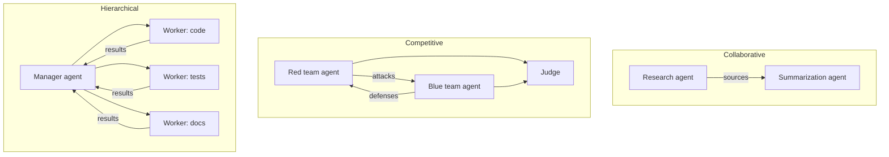

# Multi-agent systems

## Summary

A multi-agent system consists of several agents that interact to reach goals: they collaborate on shared goals, compete or evaluate each other, or are organized in a hierarchy where a manager agent delegates to workers. Decision-making is distributed, so the system can split a problem into specialized roles and work in parallel. The price is coordination: more messages, more cost and new failure modes such as agents agreeing on a wrong answer or looping on each other.

## Prerequisites

- [AI agent](../agent-fundamentals/ai-agent.md) and [agent types](../agent-fundamentals/agent-types.md).
- [LLM-based agents](../llm-agents/llm-based-agents.md).

## Core concepts

### Definition

A multi-agent system (MAS) is a system of multiple autonomous agents in a shared environment, where each agent has its own perception, goals or role, and the outcome depends on their interaction. The field predates language models: it includes auctions, voting and negotiation between software agents, robot teams and multi-agent reinforcement learning. With LLMs, agents typically interact by exchanging messages in natural language or structured formats.

### Patterns

- **Collaborative:** agents share goals. Example: a research agent gathers sources and a summarization agent writes the report.
- **Competitive:** agents evaluate or oppose each other. Example: a red team agent attacks a system and a blue team agent defends it, or a debater and a judge.
- **Hierarchical:** a manager agent delegates tasks to worker agents and combines their results.

The diagrams show the message flow of the three patterns.

### Agent swarms

*Agent swarms* push distribution further: many simple agents follow local rules, and useful behavior emerges from their interaction without a central controller, as in ant colony optimization and robot swarms. The goals are distributed intelligence and parallel problem solving. With LLM agents, "swarm" is also used more loosely for frameworks where many agents hand tasks to each other.

### Why several agents can beat one

- **Specialization:** each agent has a focused prompt, tool set and permissions, which is easier to get right than one agent that does everything.
- **Parallelism:** independent subtasks run at the same time.
- **Context isolation:** each agent works in its own context window, so a long research task does not crowd out the writing task.
- **Checks and balances:** a critic or judge agent catches errors that the producing agent misses, especially when the critic has different information or tools.

## Worked example

A hierarchical system answers "Compare the pricing of our three main competitors":

1. The manager splits the task into three research subtasks, one per competitor, and one comparison task.
2. Three worker agents run in parallel, each with web search and a page reader, and each returns a structured price table with source links.
3. A checker agent verifies that every price has a source and that the currency and billing period match.
4. The manager merges the tables and writes the comparison.

Compared with a single agent doing the three searches in sequence, the elapsed time drops to roughly one third of the research time, and each worker's context holds only one competitor's pages. The total number of model calls, and therefore the cost, is higher. If one worker misreads a price, the checker catches only errors in sources and units, not a misread number, so the final report still needs spot checks.

## Trade offs and when to use it

| Benefit | Cost |
| --- | --- |
| Specialized, simpler agents | More components to build, evaluate and secure |
| Parallel work | Higher total token cost (multi-agent systems commonly use several times the tokens of a single agent) |
| Independent review | Agents can amplify each other's errors or converge on a wrong consensus |
| Isolated contexts | Information can be lost at the handoffs between agents |

Use a single agent with tools first. Move to multiple agents when the task splits naturally into parallel, independent parts, or when roles need different permissions.

## Common mistakes

- **Multi-agent by default.** Fix: start with one agent and split only when there is a measured reason.
- **Unbounded conversations between agents.** Fix: limit rounds and define termination conditions.
- **Losing context at handoffs.** Fix: pass structured results with sources, not loose summaries.
- **Trusting agent-to-agent messages.** A compromised or injected agent can instruct the others. Fix: treat messages from other agents as untrusted data and give each agent only the permissions of its role.

## Practice

1. Which pattern fits a code generator plus an independent reviewer?
2. Why can a multi-agent system be faster but more expensive than a single agent?
3. What emerges in a swarm, and what is missing?

Answers:

1. Competitive, or collaborative with an evaluator, in which one agent produces and another evaluates.
2. Subtasks run in parallel, which reduces elapsed time, but each agent consumes its own tokens and coordination adds messages.
3. Collective behavior emerges from local rules. A central controller is missing.

## Further reading

- Wooldridge, M. (2009). *An Introduction to MultiAgent Systems, 2nd edition*. Wiley. The standard textbook on agent interaction, cooperation, negotiation and voting.
- Wu, Q. et al. (2023). [*AutoGen: Enabling Next-Gen LLM Applications via Multi-Agent Conversation*](https://arxiv.org/abs/2308.08155). arXiv. A framework for conversations between LLM agents.
- Du, Y. et al. (2023). [*Improving Factuality and Reasoning in Language Models through Multiagent Debate*](https://arxiv.org/abs/2305.14325). arXiv. Shows gains from agents debating answers.
- Anthropic (2025). [*How we built our multi-agent research system*](https://www.anthropic.com/engineering/multi-agent-research-system). Reports trade offs of a production orchestrator and worker design, including token costs.
- Dorigo, M., Birattari, M. and Stützle, T. (2006). [*Ant colony optimization*](https://doi.org/10.1109/MCI.2006.329691). IEEE Computational Intelligence Magazine 1(4). A classic swarm intelligence method.

TODO: check the content of this note against the sources above and record what was verified and when.
