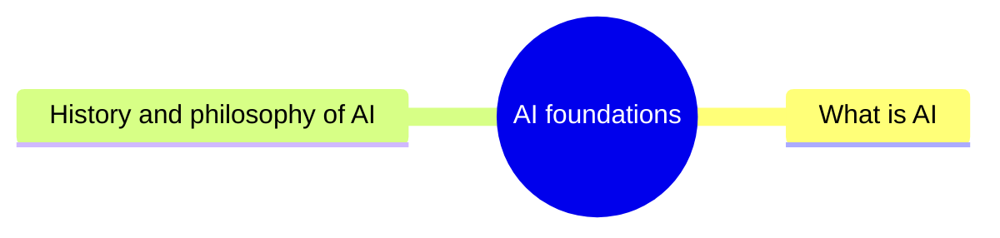

# AI foundations

The fundamental issues of artificial intelligence: what AI is, how its subfields relate, what a model is, and the history and philosophy of the field.

This knowledge area follows the knowledge unit AI-Introduction (Fundamental Issues) of the AI knowledge area in [Computer Science Curricula 2023](https://csed.acm.org/) (ACM, IEEE-CS and AAAI). Agents, also part of that unit, have their own area: [agents and cognitive systems](../agents-and-cognitive-systems/README.md).

## Map

The map shows the sections of this knowledge area.

## Sections

- [What is AI](what-is-ai/README.md) (2 notes): Definitions of artificial intelligence, the nesting of AI, machine learning, deep learning and generative AI, and the vocabulary of models.
- [History and philosophy of AI](history-and-philosophy/README.md) (planned): How the field developed, its recurring cycles of optimism and disappointment, and the philosophical questions it raises.
