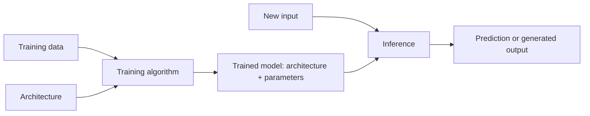

# AI model

## Summary

An AI model is a parameterized function that maps inputs to outputs, together with the learned values of its parameters. A model is produced by training an algorithm on data and is then used for inference on new inputs. The word *parameters* means the values the model learned (its weights). It does not mean the settings that control text generation, such as temperature, which are inference settings.

## Prerequisites

- [Artificial intelligence](artificial-intelligence.md) for the place of models in the field.
- [Machine learning](../../machine-learning/fundamentals/machine-learning.md) for how models are learned from data.

## Core concepts

### Definition

A *model* is a function `f(x; θ)` from an input `x` to an output `y`, where `θ` (theta) is the vector of *parameters*. Three things must be kept apart:

| Term | What it is | Example |
| --- | --- | --- |
| Algorithm | The procedure that produces a model from data. | Least squares fitting, gradient descent, k-means. |
| Model architecture | The form of the function, with the parameters still free. | "A linear function of two features", "a transformer with 32 layers". |
| Trained model | The architecture plus the learned parameter values. This is the artifact that is shipped. | `price = 3.08 * area - 8.52 * distance + 137.6` |

*Analogy.* The architecture is a recipe with blank quantities, the training algorithm is the cook who tastes and adjusts the quantities, and the trained model is the recipe with the quantities filled in. The analogy breaks for large models: nobody can read the "quantities" of a neural network with billions of weights and understand the dish from them.

### Training and inference

A model has two phases with very different costs and risks. The flowchart shows how data, the algorithm and the model meet in each phase.



- **Training** adjusts the parameters to minimize a [loss function](../../machine-learning/optimization/loss-functions.md) on the training data. It runs once or periodically, is expensive and needs labeled or unlabeled data.
- **Inference** applies the fixed parameters to a new input. It runs for every request, so its latency and cost dominate in production.

### Parameters and hyperparameters

- *Parameters* are learned by the training algorithm: weights and biases of a neural network, coefficients of a linear model, centroids of k-means.
- *Hyperparameters* are chosen by people or by a search before or during training and are not learned from the gradient: learning rate, number of layers, number of clusters, regularization strength.
- *Inference settings* (also called decoding or sampling parameters for generative models) shape how a trained model produces output: temperature, top-k, top-p, maximum output length. They change no weight. See [sampling parameters](../../generative-ai/inference-and-decoding/sampling-parameters.md).

The *parameter count* is the usual measure of model size. A model with 7 billion parameters stored as 16-bit floating point numbers needs 7 × 10^9 × 2 bytes = 14 GB of memory for the weights alone, before any memory for activations or for the key-value cache during generation.

### Kinds of models

- **Discriminative models** learn the conditional distribution `p(y | x)` or a direct mapping from input to label. Logistic regression and most classifiers are discriminative.
- **Generative models** learn the distribution of the data `p(x)` (or `p(x, y)`) and can sample new instances from it. Language models, diffusion models and GANs are generative. See [generative AI](../../generative-ai/fundamentals/generative-ai.md).
- **Foundation models** are large models trained on broad data, usually with self-supervision, that are adapted to many downstream tasks by prompting or fine-tuning. The term was introduced by Bommasani et al. (2021).

### The model as an artifact

A shipped model is a set of files: the architecture definition or code, the weights (for example in the `safetensors` or ONNX format), the preprocessing it expects (a tokenizer for language models, normalization statistics for tabular models) and documentation of its intended use and limits. A *model card* (Mitchell et al., 2019) records the training data, evaluation results, intended uses and known limitations. A model without its preprocessing is not usable: feeding unnormalized inputs to a model trained on normalized ones silently produces wrong outputs.

## Worked example

The linear model below was fitted with least squares on six labeled houses (floor area in square meters and distance to the city center in kilometers, price in thousands of dollars). Tested with Python 3.10 and NumPy 2.2.6.

```python
import numpy as np

# Labeled examples: (floor area in m2, distance to center in km) -> price in k$
X = np.array([[50, 10], [70, 8], [80, 3], [100, 5], [120, 2], [65, 12]], dtype=float)
y = np.array([210, 280, 360, 390, 500, 240], dtype=float)

A = np.column_stack([X, np.ones(len(X))])           # add a bias column
coef, *_ = np.linalg.lstsq(A, y, rcond=None)         # least squares fit
print("weights (area, distance) and bias:", coef.round(2))
new_house = np.array([90, 4, 1.0])
print("predicted price for 90 m2, 4 km:", round(float(new_house @ coef), 1))
```

Output:

```text
weights (area, distance) and bias: [  3.08  -8.52 137.6 ]
predicted price for 90 m2, 4 km: 381.0
```

Mapped to the vocabulary of this note: the architecture is "price is a linear function of area and distance", the algorithm is least squares, the trained model is the three parameters `3.08`, `-8.52` and `137.6`, and the last line is inference. A large language model differs in scale (billions of parameters), in architecture (a transformer) and in algorithm (gradient descent on next token prediction), not in these roles.

## Trade offs and when to use it

- **Larger models** usually generalize better on broad tasks, but cost more memory, latency and money per request. See [choosing a model](../../generative-ai/large-language-models/choosing-a-model.md).
- **Simpler models** are easier to explain, debug and audit, which matters in regulated domains such as credit scoring.
- **Pretrained models** save training cost but inherit the biases and the knowledge cutoff of their training data.

## Common mistakes

- **Calling temperature or top-p "model parameters".** They are inference settings. Fix: say "sampling parameters" or "decoding settings", and reserve "parameters" for learned weights.
- **Shipping weights without preprocessing.** Fix: version the tokenizer, feature pipeline and normalization statistics together with the weights.
- **Confusing the model with the system.** A chatbot is a system: model, prompt, retrieval, tools, filters and user interface. Fix: when something fails, locate the failure in the component, not in "the AI".
- **Estimating memory from the parameter count alone.** Fix: add activations, optimizer state during training (often two or more extra copies of the weights) and the key-value cache during generation.

## Practice

1. Classify each as parameter, hyperparameter or inference setting: the bias of a neuron, the learning rate, top-k, the number of clusters in k-means, a weight matrix.
2. How much memory do the weights of a 70 billion parameter model need in 16-bit precision, and in 4-bit precision?
3. Why is a model card useful to someone who did not train the model?

Answers:

1. Parameter, hyperparameter, inference setting, hyperparameter, parameter.
2. 140 GB in 16-bit precision (70 × 10^9 × 2 bytes) and 35 GB in 4-bit precision (0.5 bytes per parameter), plus overhead for quantization scales.
3. It states the training data, the evaluation results and the intended uses and limits, which the weights themselves do not reveal.

## Further reading

- Russell, S. and Norvig, P. (2021). [*Artificial Intelligence: A Modern Approach, 4th edition*](https://aima.cs.berkeley.edu/). Pearson. Chapter 19 defines hypotheses, models and learning algorithms precisely.
- Mitchell, M. et al. (2019). [*Model Cards for Model Reporting*](https://arxiv.org/abs/1810.03993). FAT* 2019. The proposal for documenting trained models.
- Bommasani, R. et al. (2021). [*On the Opportunities and Risks of Foundation Models*](https://arxiv.org/abs/2108.07258). Stanford CRFM. Introduces the term foundation model and its risks.

TODO: check the content of this note against the sources above and record what was verified and when.
