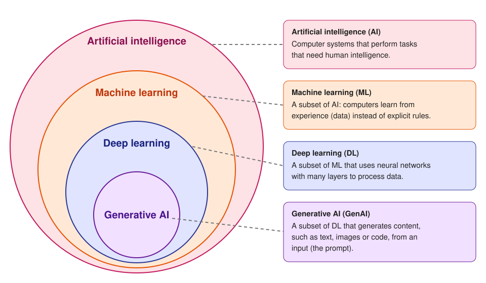
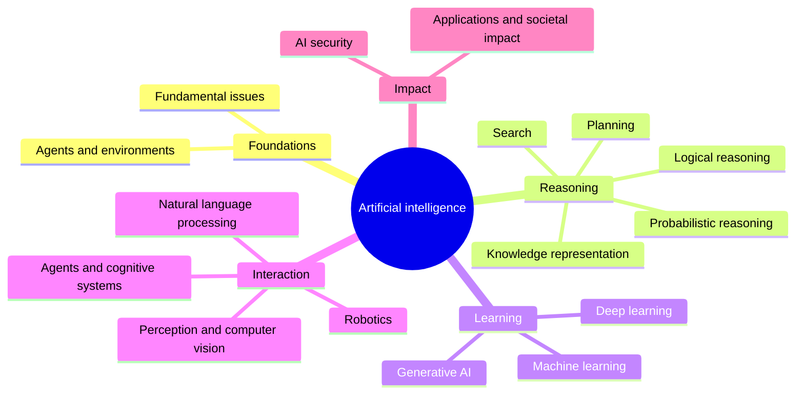

# Artificial intelligence

## Summary

Artificial intelligence (AI) is the field that builds computer systems which perform tasks that would need intelligence if a person did them: perceiving, reasoning, planning, learning, using language and acting toward goals. Machine learning, deep learning and generative AI are nested subfields of AI, but AI also includes methods that do not learn from data at all, such as search, logic and planning. The working definition used in this library is the one of Russell and Norvig: AI studies *rational agents*, systems that choose the action that is expected to achieve their goals best, given what they perceive and know.

## Prerequisites

None. This is the entry note of the library.

## Core concepts

### Definition

There is no single accepted definition of AI. Russell and Norvig sort the historical definitions along two axes: whether they judge a system by its *thinking* or by its *behavior*, and whether they measure it against *human* performance or against an ideal of *rationality*.

| | Measured against humans | Measured against rationality |
| --- | --- | --- |
| Thought | Thinking humanly (cognitive modeling) | Thinking rationally (laws of thought, logic) |
| Behavior | Acting humanly (the Turing test) | Acting rationally (the rational agent) |

The rational agent view (bottom right) dominates modern AI because it is precise and testable: an *agent* perceives its environment through sensors and acts through actuators, and a *rational agent* selects the action that maximizes its expected performance measure. It does not require the system to think like a person, and it covers both a chess engine and a large language model that calls tools. The agent view is developed in [AI agent](../../agents-and-cognitive-systems/agent-fundamentals/ai-agent.md).

The term "artificial intelligence" was coined by John McCarthy and colleagues in the 1955 proposal for the Dartmouth summer research project (held in 1956), which conjectured that "every aspect of learning or any other feature of intelligence can in principle be so precisely described that a machine can be made to simulate it".

### AI, machine learning, deep learning and generative AI

The four terms are often used as synonyms, but they name nested fields. The figure shows each one inside the one that contains it, with a one line definition.

| Field | Definition | Typical example |
| --- | --- | --- |
| Artificial intelligence (AI) | Development of computer systems that perform tasks that need human intelligence. | A route planner using A* search, a rule based expert system, a chess engine. |
| Machine learning (ML) | A subset of AI that enables computers to learn from experience (data) instead of following hand written rules. | A spam filter trained on labeled emails. |
| Deep learning (DL) | A subset of ML that uses neural networks with many layers to process data. | An image classifier built from a convolutional network. |
| Generative AI (GenAI) | A subset of DL that generates new content such as text, images or code based on an input. | A large language model that writes a summary from a prompt. |

Two precision notes on the nesting:

- **AI is much more than ML.** Search, logical reasoning, probabilistic reasoning and planning are AI techniques that need no training data. A sudoku solver based on constraint propagation is AI without any learning.
- **Generative modeling is older than deep learning.** N-gram language models, hidden Markov models and Gaussian mixture models are generative models that are not deep. The nesting in the figure describes today's practice, where nearly all generative AI systems are deep neural networks.

### Symbolic and subsymbolic AI

Two families of methods run through the history of the field:

- **Symbolic AI** represents knowledge explicitly with symbols, rules and logic, and reasons by manipulating them. Its strengths are transparency and exact reasoning. Its weakness is the cost of writing down knowledge by hand (the *knowledge acquisition bottleneck*) and brittleness on noisy perceptual input.
- **Subsymbolic AI** (statistical learning and neural networks) represents knowledge implicitly in numeric parameters learned from data. Its strengths are perception, robustness to noise and scale. Its weaknesses are opacity, the need for large datasets and the lack of guarantees.

Modern systems often combine both: a large language model (subsymbolic) that calls a SQL database or a planner (symbolic) through tools is an example.

### Narrow and general AI

*Narrow AI* (also called weak AI) solves one task or a bounded family of tasks: translation, face recognition, playing Go. Every deployed AI system today is narrow in this sense, although large language models cover an unusually wide range of tasks. *Artificial general intelligence* (AGI) would match human ability across essentially all cognitive tasks. AGI has no agreed operational definition, and claims about it are debated rather than established.

### The map of the field

The library follows the knowledge units of the AI knowledge area of the ACM/IEEE-CS/AAAI Computer Science Curricula 2023 (CS2023). The mind map shows them as the top level of the repository, with machine learning split into three areas because of the volume of material.

## Worked example

One task, filtering spam email, solved with techniques from each of the nested fields shows what each layer adds.

1. **Symbolic AI.** A rule set: `if subject contains "WINNER" or sender domain is on the blocklist then spam`. It is transparent and needs no data, but spammers change wording within days and the rule list grows without end.
2. **Machine learning.** A logistic regression model learns weights for features such as word counts, sender reputation and the number of links from 10,000 emails labeled spam or not spam. It adapts when it is retrained on new labeled mail. Its quality is measured with precision and recall (see [classification metrics](../../machine-learning/model-evaluation/classification-metrics.md)).
3. **Deep learning.** A neural network reads the raw text of the email and learns its own features instead of the hand designed ones. It catches paraphrases that the feature list misses, at the cost of more data and compute.
4. **Generative AI.** A large language model is prompted with a few labeled examples and asked to classify a new email (see [zero-shot and few-shot prompting](../../generative-ai/prompt-engineering/zero-shot-and-few-shot-prompting.md)). It needs no training run at all, but each classification costs a model call, and the prompt can be attacked by text inside the email itself (see [prompt injection](../../ai-security/prompt-attacks/prompt-injection.md)).

The outer layers did not disappear when the inner ones arrived. Production spam filters still combine blocklists (symbolic), trained classifiers (ML and DL) and sometimes language model review for borderline cases.

## Trade offs and when to use it

- **Prefer the simplest layer that solves the problem.** If the rules are known, stable and few, a symbolic solution is cheaper, auditable and exact. Learning is justified when the rules are unknown, too many to write down, or change over time.
- **Machine learning needs representative data.** Without enough labeled examples that look like production inputs, a learned model will not generalize (see [overfitting and underfitting](../../machine-learning/fundamentals/overfitting-and-underfitting.md)).
- **Deep learning pays off on unstructured data** (images, audio, text). On small tabular datasets, gradient boosted trees often match or beat neural networks with far less tuning. This is a widely reported empirical result, not a law.
- **Generative AI trades training cost for inference cost and control.** It is the fastest way to a prototype, but its outputs are probabilistic, can be wrong with full confidence and must be validated.

## Common mistakes

- **Equating AI with machine learning or with chatbots.** Fix: classify a technique by its mechanism. Search, logic and planning are AI without learning.
- **Reading "intelligence" as human-like understanding.** A system can act rationally in a narrow environment with no model of the world beyond it. Fix: evaluate behavior against a stated performance measure, not against intuition.
- **Treating the nested diagram as a strict taxonomy.** Generative models exist outside deep learning, and many systems combine techniques from several circles. Fix: use the diagram as a map of today's practice, not as a definition.
- **Assuming a newer layer is always better.** Fix: compare against a simple baseline (rules, logistic regression) before adopting a deeper or generative model.

## Practice

1. Place each system in the innermost field that describes it: a GPS route planner using A*, a credit scoring model based on logistic regression, a model that writes product descriptions from a list of attributes.
2. Why does the rational agent definition fit modern AI better than the Turing test?
3. Name one generative model that is not a deep learning model.
4. A team wants to "add AI" to route support tickets to five queues, and they have 50,000 historical tickets with the queue that resolved them. Which layer would you try first, and why?

Answers:

1. Route planner: AI (search, no learning). Credit scoring: machine learning. Product descriptions: generative AI.
2. It is defined by a measurable performance criterion rather than by imitation of humans, so it can be tested, and it covers systems that are superhuman in a narrow task and not human-like at all.
3. An n-gram language model, a hidden Markov model or a Gaussian mixture model.
4. Supervised machine learning (a text classifier), because labeled data exists and the task is a fixed classification. Use a generative model only if the classifier fails or labels are missing.

## Further reading

- Russell, S. and Norvig, P. (2021). [*Artificial Intelligence: A Modern Approach, 4th edition*](https://aima.cs.berkeley.edu/). Pearson. Chapter 1 gives the four families of definitions and the rational agent view used here.
- McCarthy, J., Minsky, M., Rochester, N. and Shannon, C. (1955). [*A Proposal for the Dartmouth Summer Research Project on Artificial Intelligence*](http://jmc.stanford.edu/articles/dartmouth/dartmouth.pdf). The document that named the field.
- Turing, A. (1950). [*Computing Machinery and Intelligence*](https://doi.org/10.1093/mind/LIX.236.433). Mind 59(236). The original imitation game, still the reference point for discussions of machine intelligence.
- ACM, IEEE-CS and AAAI (2024). [*Computer Science Curricula 2023*](https://csed.acm.org/). The AI knowledge area whose knowledge units define the top level of this library.

TODO: check the content of this note against the sources above and record what was verified and when.
