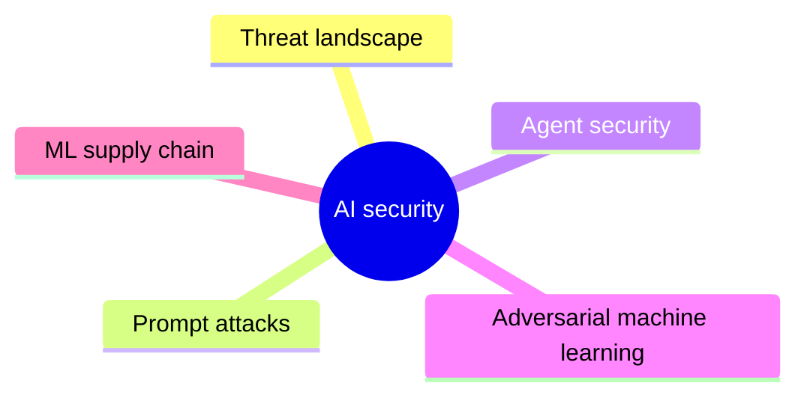

# AI security

Security of AI systems: the threat landscape, prompt attacks on language models, security of AI agents, adversarial machine learning and the ML supply chain.

This knowledge area is a supporting area outside the AI knowledge area of [Computer Science Curricula 2023](https://csed.acm.org/) (ACM, IEEE-CS and AAAI), which places security in its own Security knowledge area. It collects the security topics specific to AI systems. All notes here follow the security rules of the [GUIDELINE](../GUIDELINE.md#91-security-notes).

## Map

The map shows the sections of this knowledge area.

## Sections

- [Threat landscape](threat-landscape/README.md) (planned): Reference frameworks that catalog risks and attack techniques against AI systems.
- [Prompt attacks](prompt-attacks/README.md) (4 notes): Attacks that manipulate the input of language models: injection, leaking and jailbreaking.
- [Agent security](agent-security/README.md) (1 note): Threats, controls and secure architectures for AI agents.
- [Adversarial machine learning](adversarial-machine-learning/README.md) (planned): Attacks on models through crafted inputs, poisoned data or queries.
- [ML supply chain](ml-supply-chain/README.md) (planned): Integrity of models, datasets and dependencies.
