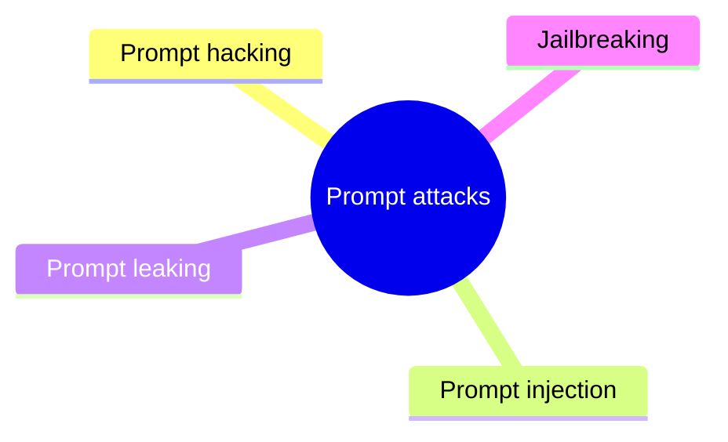

# Prompt attacks

Attacks that manipulate the input of language models: injection, leaking and jailbreaking.

This section is part of the knowledge area [AI security](../README.md). Read the notes in the order below.

## Map

The map shows the notes of this section.

## Notes

- [Prompt hacking](prompt-hacking.md): Prompt hacking is the family of attacks that manipulate the input of a language model to make it behave against the intent of its developers: *prompt injection* overrides the application's instructions, *prompt leaking* extracts the hidden system prompt, and *jailbreaking* gets the model to produce content its safety training should prevent.
- [Prompt injection](prompt-injection.md): Prompt injection is an attack in which text supplied by an attacker is interpreted by a language model as instructions, overriding the instructions of the application.
- [Prompt leaking](prompt-leaking.md): Prompt leaking is an attack that makes a language model reveal its hidden instructions: the system prompt, few-shot examples or other context that the application's developer did not intend to show.
- [Jailbreaking](jailbreaking.md): Jailbreaking is the attempt to make a language model produce output that its safety training or the provider's policy is meant to prevent.

## Planned topics

- Guardrails and moderation
- Red teaming LLM applications
