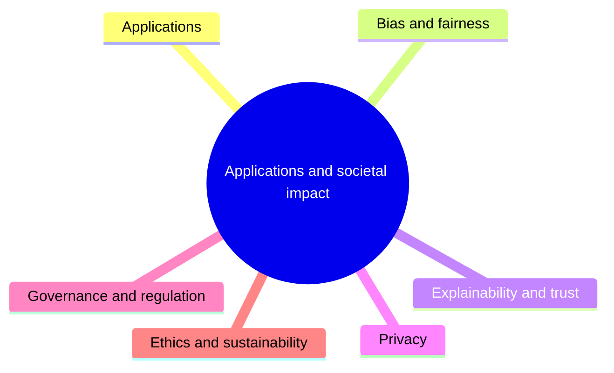

# Applications and societal impact

Applying AI to real problems and assessing its effects: bias and fairness, explainability and trust, privacy, governance and regulation, ethics and sustainability.

This knowledge area follows the knowledge unit AI-SEP (Applications and Societal Impact) of the AI knowledge area in [Computer Science Curricula 2023](https://csed.acm.org/) (ACM, IEEE-CS and AAAI).

## Map

The map shows the sections of this knowledge area.

## Sections

- [Applications](applications/README.md) (planned): Formulating and evaluating a real problem as an AI problem.
- [Bias and fairness](bias-and-fairness/README.md) (planned): How bias enters data, algorithms and evaluation, and how fairness is defined and measured.
- [Explainability and trust](explainability-and-trust/README.md) (planned): Making model decisions understandable and documenting models.
- [Privacy](privacy/README.md) (planned): Privacy of training data and of people affected by AI systems.
- [Governance and regulation](governance-and-regulation/README.md) (planned): Laws, standards and frameworks for AI risk management and human oversight.
- [Ethics and sustainability](ethics-and-sustainability/README.md) (planned): Ethical questions, intellectual property and the environmental cost of AI.

TODO: no notes yet in this knowledge area. Start with the first planned topic of the first section.
