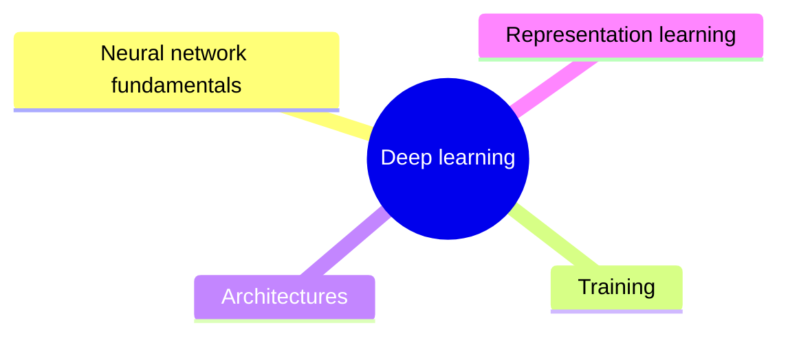

# Deep learning

Neural networks with many layers: how they compute, how they are trained, the main architectures and the representations they learn.

This knowledge area is derived from the knowledge unit AI-ML (Machine Learning) of the AI knowledge area in [Computer Science Curricula 2023](https://csed.acm.org/) (ACM, IEEE-CS and AAAI), topics basic neural networks and deep learning, and from Part V of Russell and Norvig's *Artificial Intelligence: A Modern Approach* (4th edition).

## Map

The map shows the sections of this knowledge area.

## Sections

- [Neural network fundamentals](neural-network-fundamentals/README.md) (2 notes): Neurons, layers, weights and activation functions.
- [Training](training/README.md) (2 notes): How networks learn: the training loop, backpropagation and the techniques that make deep networks trainable.
- [Architectures](architectures/README.md) (planned): The main families of network architectures and the data they suit.
- [Representation learning](representation-learning/README.md) (planned): What networks learn internally, and how learned representations transfer between tasks.
