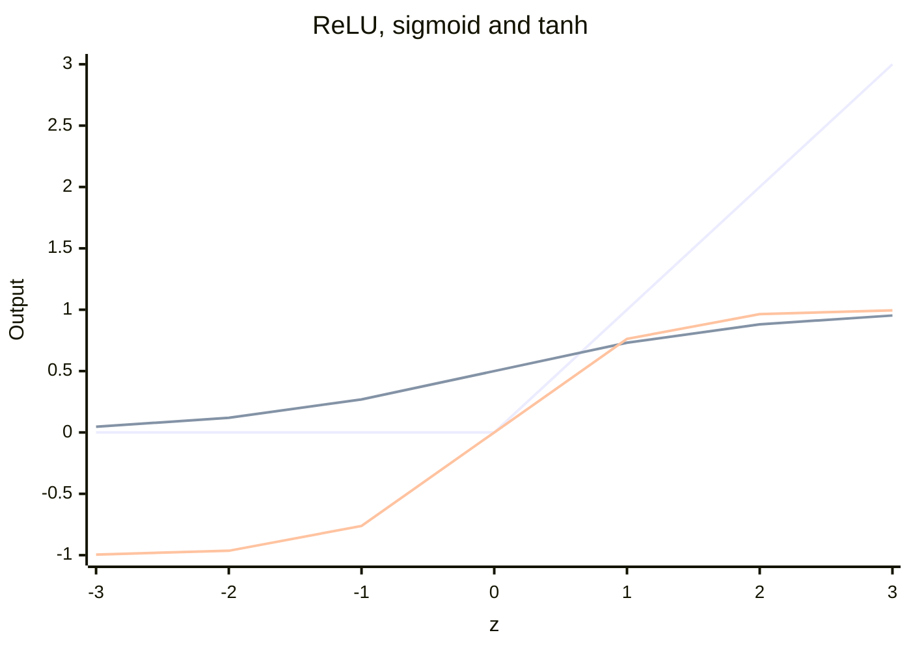

# Activation functions

## Summary

An activation function is applied to the weighted sum of a neuron and decides how strongly the neuron "fires". Its essential job is to introduce nonlinearity: without it, a neural network of any depth would be a simple linear model, unable to handle complex problems. ReLU is the default for hidden layers, sigmoid and softmax turn outputs into probabilities, and tanh scales values between -1 and 1.

## Prerequisites

- [Neural networks](neural-networks.md) for the neuron and its weighted sum.

## Core concepts

### Definition

The activation function `φ` maps the pre-activation `z = w·x + b` of a neuron to its output `a = φ(z)`. It determines whether the neuron should be "activated" (fire a signal) or not, and how strongly. Because it is nonlinear, it allows the model to learn complex relationships.

### Common activation functions

| Function | Formula | Output range | Typical use |
| --- | --- | --- | --- |
| ReLU (rectified linear unit) | `max(0, z)` | 0 to infinity | Default for hidden layers. Sets negative values to zero and keeps positive values as they are, which is useful in deep networks. |
| Sigmoid | `1 / (1 + e^(-z))` | 0 to 1 | Output of binary classification: squashes values into a probability. |
| Tanh (hyperbolic tangent) | `(e^z - e^(-z)) / (e^z + e^(-z))` | -1 to 1 | Like sigmoid but zero centered. Used in RNN gates and small networks. |
| Softmax | `e^(z_k) / Σ_j e^(z_j)` | 0 to 1, sums to 1 | Output of multi-class classification: converts a vector of scores into probabilities. |
| GELU, SiLU (Swish) | `z · Φ(z)`, `z · sigmoid(z)` | About -0.17 to infinity, about -0.28 to infinity | Smooth variants of ReLU used in transformers. |
| Leaky ReLU | `max(αz, z)` with small α, such as 0.01 | -infinity to infinity | Keeps a small gradient for negative inputs. |

Softmax differs from the others: it acts on a whole vector, not on one neuron, so each output depends on all the scores.

### Values and shape

The chart plots the three elementwise functions at integer inputs from -3 to 3, using the values from the worked example below.



### Why ReLU replaced sigmoid in hidden layers

During [backpropagation](../training/backpropagation.md), the gradient is multiplied by the derivative of the activation at every layer. The derivative of the sigmoid is at most 0.25 and close to zero for large positive or negative inputs (the function *saturates*). Across many layers these factors multiply and the gradient shrinks toward zero, the *vanishing gradient problem*, so early layers stop learning. ReLU has derivative 1 for every positive input, so gradients pass through unchanged. Its weakness is the *dying ReLU*: a neuron whose input is negative for every example has gradient zero and never recovers. Leaky ReLU and GELU reduce this.

## Worked example

Tested with Python 3.10 and NumPy 2.2.6.

```python
import numpy as np
xs = np.array([-3, -2, -1, 0, 1, 2, 3], dtype=float)
print("relu   ", np.maximum(0, xs))
print("sigmoid", (1 / (1 + np.exp(-xs))).round(3))
print("tanh   ", np.tanh(xs).round(3))
z = np.array([2.0, 1.0, 0.1])
print("softmax", (np.exp(z) / np.exp(z).sum()).round(3))
```

Output:

```text
relu    [0. 0. 0. 0. 1. 2. 3.]
sigmoid [0.047 0.119 0.269 0.5   0.731 0.881 0.953]
tanh    [-0.995 -0.964 -0.762  0.     0.762  0.964  0.995]
softmax [0.659 0.242 0.099]
```

The softmax line shows a classifier with three classes whose raw scores are 2.0, 1.0 and 0.1: the probabilities 0.659, 0.242 and 0.099 keep the order of the scores and sum to 1. The same softmax, applied over a vocabulary and divided by a temperature, is how a language model chooses the next token (see [sampling parameters](../../generative-ai/inference-and-decoding/sampling-parameters.md)).

## Trade offs and when to use it

| Layer | Recommended activation |
| --- | --- |
| Hidden layers of a feedforward or convolutional network | ReLU, or GELU and SiLU in transformers |
| Output, binary or multi-label classification | Sigmoid |
| Output, multi-class classification | Softmax |
| Output, regression | None (linear), or ReLU or softplus when outputs must be positive |
| Gates inside LSTM and GRU cells | Sigmoid for gates, tanh for state |

## Common mistakes

- **Using sigmoid in deep hidden layers.** Fix: use ReLU or GELU, which do not saturate for positive inputs.
- **Softmax for multi-label outputs.** Softmax forces the outputs to compete, so a photo cannot be both "dog" and "beach" with high probability. Fix: one sigmoid per label.
- **Computing softmax naively.** `exp(1000)` overflows. Fix: subtract the maximum score before exponentiating, which does not change the result.
- **Applying an activation before a loss that expects logits.** Fix: check whether the loss function applies sigmoid or softmax internally.

## Practice

1. What is the derivative of ReLU at z = 3 and at z = -3?
2. Why is the derivative of the sigmoid at most 0.25?
3. Scores `(1, 1, 1)` go through softmax. What are the outputs?

Answers:

1. 1 and 0.
2. The derivative is `σ(z)(1 - σ(z))`, which is largest at `σ(z) = 0.5`, giving 0.25.
3. One third each, because equal scores give equal probabilities.

## Further reading

- Goodfellow, I., Bengio, Y. and Courville, A. (2016). [*Deep Learning*](https://www.deeplearningbook.org/). MIT Press. Section 6.3 discusses hidden unit activations.
- Nair, V. and Hinton, G. (2010). [*Rectified Linear Units Improve Restricted Boltzmann Machines*](https://www.cs.toronto.edu/~hinton/absps/reluICML.pdf). ICML 2010. An early paper on ReLU in deep networks.
- Hendrycks, D. and Gimpel, K. (2016). [*Gaussian Error Linear Units (GELUs)*](https://arxiv.org/abs/1606.08415). arXiv. The GELU activation used in many transformers.

TODO: check the content of this note against the sources above and record what was verified and when.
