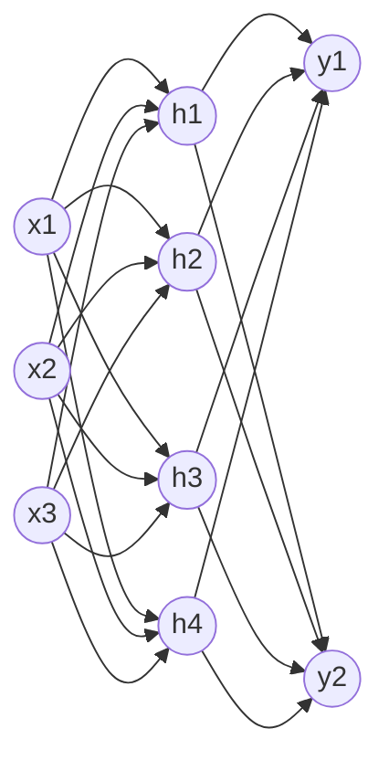

# Neural networks

## Summary

An artificial neural network (ANN) is a model built from layers of simple units called neurons. Each neuron computes a weighted sum of its inputs, adds a bias and passes the result through a nonlinear activation function. Data flows from an input layer through one or more hidden layers to an output layer, and learning means adjusting the weights so that the outputs match the targets. A network with many hidden layers is a deep neural network, and deep learning is the study of such networks.

## Prerequisites

- [Machine learning](../../machine-learning/fundamentals/machine-learning.md) for learning from data.
- [Supervised learning](../../machine-learning/learning-paradigms/supervised-learning.md) for the labeled training setting.

## Core concepts

### From the brain to the artificial neuron

Neural networks were inspired by the way the brain processes information with layers of connected neurons that learn patterns and make decisions. Machines learn by identifying patterns in data and adjusting their internal parameters (weights) to improve predictions or classifications, in a loose parallel to how experience shapes human decisions.

*Analogy.* A biological neuron receives signals through its dendrites, and fires along its axon when their combined strength passes a threshold. An artificial neuron receives numbers, weighs them, sums them and applies an activation function. The analogy is historical and loose: artificial neurons do not spike, are not trained by anything like biological learning, and a modern network is better understood as a composition of differentiable functions than as a brain model.

### The artificial neuron

Each input `xi` is multiplied by its weight `wi`, and the weighted inputs are summed:

$$
\text{Weighted Sum} = (w_1 \times x_1) + (w_2 \times x_2) + \dots + (w_n \times x_n)
$$

where `x1, x2, ..., xn` are the inputs and `w1, w2, ..., wn` their respective weights. A bias `b` is added to the sum, and an activation function `φ` produces the neuron's output:

$$
z = \sum_{i=1}^{n} w_i x_i + b \qquad a = \varphi(z)
$$

The weight of a connection represents how much influence one neuron has on another. The bias lets the neuron shift its threshold, so it can fire even when all inputs are zero. The [activation function](activation-functions.md) introduces nonlinearity.

### Layers

A neural network consists of three kinds of layers:

1. **Input layer:** takes in the data, such as the pixel values of an image, the tokens of a text or numeric features.
2. **Hidden layers:** process and transform the input using weights and activation functions. Each hidden layer computes `a = φ(W·x + b)` for its whole input vector at once, where `W` is a weight matrix.
3. **Output layer:** produces the final prediction, for example the probability that an image shows a cat or a dog.

The diagram shows a fully connected network with three inputs, one hidden layer of four neurons and two outputs. Every arrow carries one weight.

The learning process revolves around adjusting these weights to improve accuracy (see [training a neural network](../training/training-a-neural-network.md)).

### Why nonlinearity and depth matter

Without activation functions, a stack of layers collapses into a single linear function, because a product of matrices is a matrix. The network would then be a linear model, unable to represent problems such as XOR. With a nonlinear activation, even one hidden layer of sufficient width can approximate any continuous function on a bounded domain to any accuracy (the *universal approximation theorem*, Cybenko 1989, Hornik 1991). Depth adds efficiency: deep networks can represent many functions with far fewer units than shallow ones, because each layer builds features from the features of the layer below (edges, then textures, then object parts in an image network).

### Types of neural networks

| Type | Idea | Typical use |
| --- | --- | --- |
| Artificial neural network (ANN), multilayer perceptron | The simplest form: input, hidden and output layers, fully connected. | Tabular data, small classification and regression tasks. |
| Deep neural network (DNN) | A neural network with multiple hidden layers. | Any task where learned hierarchical features help. |
| Convolutional neural network (CNN) | Shares small filters across positions of a grid, so it detects a pattern wherever it appears. | Image recognition and processing, also audio spectrograms. |
| Recurrent neural network (RNN), LSTM, GRU | Keeps a hidden state that is updated step by step along a sequence. | Sequential data such as speech and time series forecasting. Largely replaced by transformers for text. |
| Transformer | Uses attention to relate every position of a sequence to every other position in parallel. | Language, vision and multimodal models. |
| Large language model (LLM) | A transformer with billions of parameters, trained on large text corpora to predict the next token. | Processing and generating human-like text, for example GPT models. |

Each type is suited to different applications, from image processing to natural language understanding. LLMs are not a separate kind of architecture: they are very large transformers, covered in [large language models](../../generative-ai/large-language-models/README.md).

## Worked example

Count the parameters of the network in the diagram (3 inputs, 4 hidden neurons, 2 outputs):

- Hidden layer: a 4 × 3 weight matrix (12 weights) and 4 biases, 16 parameters.
- Output layer: a 2 × 4 weight matrix (8 weights) and 2 biases, 10 parameters.
- Total: 26 parameters.

Forward pass for one neuron with ReLU activation, inputs `x = (1.0, 2.0, 0.5)`, weights `w = (0.4, -0.2, 0.6)` and bias `b = 0.1`:

1. Weighted sum: 0.4 × 1.0 + (-0.2) × 2.0 + 0.6 × 0.5 = 0.4 - 0.4 + 0.3 = 0.3.
2. Add the bias: z = 0.3 + 0.1 = 0.4.
3. Activation: ReLU(0.4) = 0.4. With weights `(0.4, -0.5, 0.6)` instead, z = -0.2 and ReLU outputs 0: the neuron stays silent for this input.

A network that learns XOR with this structure is trained step by step in [training a neural network](../training/training-a-neural-network.md).

## Trade offs and when to use it

- Neural networks excel on unstructured data (images, audio, text) where useful features are hard to design by hand.
- They need more data, compute and tuning than linear models or tree ensembles, and on small tabular datasets they often do not win.
- They are hard to interpret, which matters in regulated decisions. Explanation methods exist but give approximations, not the reasoning of the network.

## Common mistakes

- **Forgetting the activation function.** Stacked linear layers are one linear layer. Fix: put a nonlinearity between layers.
- **Equating more layers with better results.** Very deep plain networks are hard to train (vanishing gradients). Fix: use architectures designed for depth, such as residual connections and normalization.
- **Counting only weights.** Fix: include biases, and for memory include activations and optimizer state.

## Practice

1. How many parameters does a fully connected layer from 512 inputs to 256 outputs have?
2. Why can a network without activation functions not learn XOR?
3. Which network type would you start with for classifying chest X-ray images, and why?

Answers:

1. 512 × 256 + 256 = 131,328.
2. Without activations the whole network is a linear function, and XOR is not linearly separable.
3. A convolutional network (or a pretrained vision transformer), because convolution shares filters across positions and exploits the spatial structure of images.

## Further reading

- Goodfellow, I., Bengio, Y. and Courville, A. (2016). [*Deep Learning*](https://www.deeplearningbook.org/). MIT Press. Chapter 6 covers deep feedforward networks.
- LeCun, Y., Bengio, Y. and Hinton, G. (2015). [*Deep learning*](https://doi.org/10.1038/nature14539). Nature 521. A short review of the field by three of its founders.
- Prince, S. (2023). [*Understanding Deep Learning*](https://udlbook.github.io/udlbook/). MIT Press. A modern textbook with clear figures, free online.
- Cybenko, G. (1989). [*Approximation by superpositions of a sigmoidal function*](https://doi.org/10.1007/BF02551274). Mathematics of Control, Signals and Systems 2. The universal approximation theorem for sigmoid networks.

TODO: check the content of this note against the sources above and record what was verified and when.
