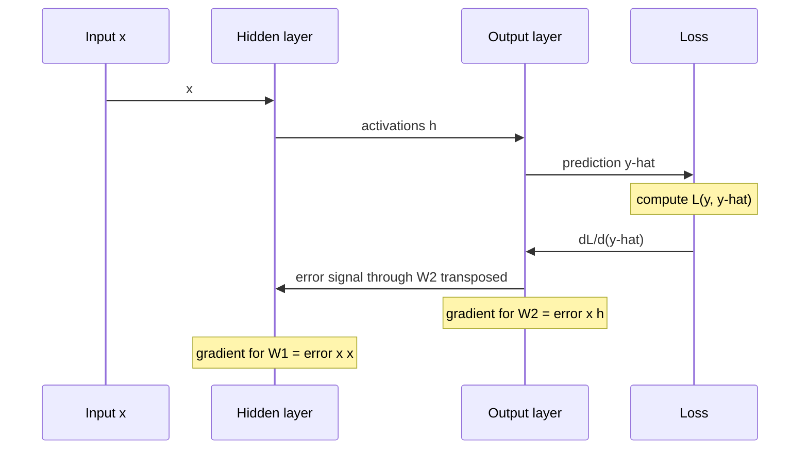

# Backpropagation

## Summary

Backpropagation is the algorithm that computes, for every weight of a neural network, how much that weight contributed to the error. It applies the chain rule of calculus backward from the loss through each layer, reusing intermediate results, so the gradients of all weights cost about as much as one extra forward pass. Gradient descent then uses these gradients to update the weights.

## Prerequisites

- [Neural networks](../neural-network-fundamentals/neural-networks.md) and [activation functions](../neural-network-fundamentals/activation-functions.md).
- [Loss functions](../../machine-learning/optimization/loss-functions.md).
- The chain rule: if `L` depends on `a` and `a` depends on `z`, then `dL/dz = dL/da · da/dz`.

## Core concepts

### Definition

If the loss function indicates a large error, the model must adjust its weights to improve accuracy. Backpropagation (Rumelhart, Hinton and Williams, 1986) works as follows:

1. **Calculate the error** using the loss function.
2. **Propagate the error backward** through the network to determine how much each weight contributed to it.
3. **Update the weights** to minimize future errors.

Strictly, backpropagation is steps 1 and 2: it computes the gradient. Step 3 is done by [gradient descent](../../machine-learning/optimization/gradient-descent.md) or another optimizer. The combination is often loosely called "training with backprop".

### Mechanism

For one neuron with input `x`, weights `w`, bias `b`, activation `σ`, output `a` and loss `L`:

$$
z = w \cdot x + b, \qquad a = \sigma(z), \qquad \frac{\partial L}{\partial w} = \frac{\partial L}{\partial a} \cdot \frac{\partial a}{\partial z} \cdot \frac{\partial z}{\partial w}
$$

In a network with layers `1..L`, define the *error signal* of layer `l` as `δ(l) = ∂L/∂z(l)`. Then:

$$
\delta^{(L)} = \nabla_{a} L \odot \varphi'(z^{(L)}), \qquad \delta^{(l)} = \big(W^{(l+1)}\big)^{\top} \delta^{(l+1)} \odot \varphi'(z^{(l)}), \qquad \frac{\partial L}{\partial W^{(l)}} = \delta^{(l)} \big(a^{(l-1)}\big)^{\top}
$$

Each layer receives the error signal from the layer above, multiplies it by the transposed weights and the derivative of its own activation, and passes it on. The gradient of a weight matrix is the outer product of the error signal and the layer's input.

The sequence diagram shows what flows between the layers in the forward and the backward pass.



### Why it is efficient

A naive approach would perturb each weight and re-run the network, costing one forward pass per weight, which is impossible for millions of weights. Backpropagation is *reverse mode automatic differentiation*: it stores the intermediate values of the forward pass and computes all gradients in one backward pass, at a cost of a small constant multiple of the forward pass. The price is memory: every activation of the forward pass must be kept until the backward pass uses it. Frameworks such as PyTorch and JAX implement this automatically on a computation graph, so practitioners rarely write it by hand.

### Vanishing and exploding gradients

The backward pass multiplies by a weight matrix and an activation derivative at every layer. If these factors are mostly smaller than 1, gradients shrink exponentially with depth (*vanishing gradients*), and if they are larger than 1 they grow exponentially (*exploding gradients*). Remedies are ReLU-like activations, careful initialization, normalization layers, residual connections and gradient clipping.

## Worked example

One sigmoid neuron, inputs `x = (1.0, 2.0)`, weights `w = (0.5, -0.3)`, bias `b = 0.1`, target `y = 1` and squared error loss `L = ½ (a - y)²`.

By hand:

1. Forward: `z = 0.5 × 1.0 + (-0.3) × 2.0 + 0.1 = 0`, `a = σ(0) = 0.5`, `L = ½ (0.5 - 1)² = 0.125`.
2. Backward: `∂L/∂a = a - y = -0.5`, `∂a/∂z = a (1 - a) = 0.25`, so `∂L/∂z = -0.125`.
3. Gradients: `∂L/∂w = -0.125 × x = (-0.125, -0.25)` and `∂L/∂b = -0.125`.

The code checks the analytic gradient against finite differences and takes one update step. Tested with Python 3.10 and NumPy 2.2.6.

```python
import numpy as np

x = np.array([1.0, 2.0]); w = np.array([0.5, -0.3]); b = 0.1; y = 1.0
sigmoid = lambda z: 1 / (1 + np.exp(-z))

def forward(w, b):
    z = w @ x + b                    # weighted sum plus bias
    a = sigmoid(z)                   # activation, this is y_hat
    return z, a, 0.5 * (a - y) ** 2  # squared error loss

z, a, L = forward(w, b)
print(f"z={z:.4f} y_hat={a:.4f} loss={L:.4f}")

# Backward pass with the chain rule: dL/dw = dL/da * da/dz * dz/dw
dL_da = a - y
da_dz = a * (1 - a)
grad_w = dL_da * da_dz * x
grad_b = dL_da * da_dz
print("analytic grad_w:", grad_w.round(5), "grad_b:", round(grad_b, 5))

# Check against finite differences
eps = 1e-6
num = [(forward(w + eps * e, b)[2] - forward(w - eps * e, b)[2]) / (2 * eps) for e in np.eye(2)]
print("numeric  grad_w:", np.round(num, 5))

w_new = w - 0.5 * grad_w; b_new = b - 0.5 * grad_b
print(f"after one step with eta=0.5: loss={forward(w_new, b_new)[2]:.4f}")
```

Output:

```text
z=0.0000 y_hat=0.5000 loss=0.1250
analytic grad_w: [-0.125 -0.25 ] grad_b: -0.125
numeric  grad_w: [-0.125 -0.25 ]
after one step with eta=0.5: loss=0.0830
```

Both gradients are negative, so gradient descent increases both weights and the bias, which raises `z` and moves `ŷ` toward the target 1. One step lowers the loss from 0.125 to 0.083. The finite difference check is the standard way to test a hand written backward pass. The multi-layer version of the same computation is the XOR example in [training a neural network](training-a-neural-network.md).

## Trade offs and when to use it

- Backpropagation needs every operation to be differentiable (almost everywhere, for ReLU). Discrete choices, such as sampling a token, need workarounds (straight-through estimators, reinforcement learning).
- Its memory cost grows with depth and batch size, because activations are stored. *Activation checkpointing* recomputes some of them in the backward pass to trade compute for memory.
- It computes exact gradients of the given loss on the given batch. It does not decide how to use them: that is the optimizer's job.

## Common mistakes

- **Thinking backpropagation updates the weights.** Fix: separate gradient computation (backpropagation) from the update rule (the optimizer).
- **Writing a backward pass without checking it.** Fix: compare with finite differences on a small input, as in the worked example.
- **Accumulating gradients by accident.** Frameworks such as PyTorch add new gradients to stored ones. Fix: zero the gradients before each backward pass, unless accumulation is intended.
- **Ignoring exploding gradients.** Fix: monitor the gradient norm and clip it.

## Practice

1. In the worked example, what is the gradient of the bias if the target is `y = 0` instead of 1?
2. Why must the forward pass store its activations?
3. A 50 layer network with sigmoid activations trains its last layers but not its first ones. What is the likely cause, and a fix?

Answers:

1. `∂L/∂a = 0.5 - 0 = 0.5`, times 0.25 gives `∂L/∂b = 0.125`.
2. The backward pass needs them to compute activation derivatives and weight gradients.
3. Vanishing gradients through many saturating sigmoids. Fix: ReLU-like activations, residual connections or normalization.

## Further reading

- Rumelhart, D., Hinton, G. and Williams, R. (1986). [*Learning representations by back-propagating errors*](https://doi.org/10.1038/323533a0). Nature 323. The paper that made backpropagation widely known.
- Goodfellow, I., Bengio, Y. and Courville, A. (2016). [*Deep Learning*](https://www.deeplearningbook.org/). MIT Press. Section 6.5 derives backpropagation on computation graphs.
- Baydin, A. et al. (2018). [*Automatic Differentiation in Machine Learning: a Survey*](https://arxiv.org/abs/1502.05767). JMLR 18. Places backpropagation within reverse mode automatic differentiation.

TODO: check the content of this note against the sources above and record what was verified and when.
