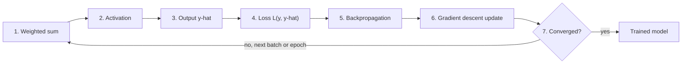
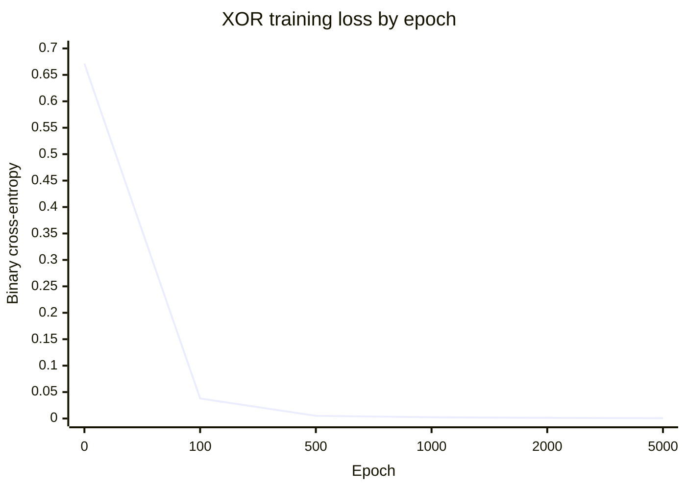

# Training a neural network

## Summary

A neural network learns by repeating one loop: compute weighted sums and activations layer by layer to produce a prediction `ŷ`, measure the error against the true value `y` with a loss function, send the error backward through the network with backpropagation to get the gradient of every weight, and update the weights with gradient descent. One pass over all training data is an epoch, and training runs for many epochs until the loss stops decreasing. This note walks through the seven steps and runs them on a small network that learns XOR.

## Prerequisites

- [Neural networks](../neural-network-fundamentals/neural-networks.md) for neurons, weights and layers.
- [Activation functions](../neural-network-fundamentals/activation-functions.md).
- [Loss functions](../../machine-learning/optimization/loss-functions.md) and [gradient descent](../../machine-learning/optimization/gradient-descent.md).

## Core concepts

### How a network learns

Machines learn by identifying patterns in data and adjusting their internal parameters (weights) to improve predictions or classifications. In supervised learning, the model is trained on labeled input and output pairs, and the goal is to minimize the difference between the model's predictions and the actual outputs.

The loop has a forward half, which computes the prediction and the loss, and a backward half, which computes gradients and updates weights. The flowchart shows the seven steps described below.



### Step 1: compute the weighted sum

Each input is multiplied by its corresponding weight, and the weighted inputs are summed:

$$
\text{Weighted Sum} = (w_1 \times x_1) + (w_2 \times x_2) + \dots + (w_n \times x_n)
$$

where `x1, x2, ..., xn` are the inputs and `w1, w2, ..., wn` the respective weights. A bias is usually added to the sum. In practice a whole layer and a whole mini-batch are computed at once as a matrix product `Z = X·W + b`, which is why GPUs, built for matrix products, train networks fast.

### Step 2: apply the activation function

The activation function determines whether, and how strongly, the neuron fires. It introduces nonlinearity, so the model can learn complex relationships. Common types:

- **ReLU (rectified linear unit):** sets negative values to zero and keeps positive values. Useful in deep networks.
- **Sigmoid:** squashes values between 0 and 1. Common for binary classification.
- **Tanh (hyperbolic tangent):** similar to sigmoid but scales output between -1 and 1.
- **Softmax:** used for multi-class classification, converts output values into probabilities.

Without activation functions the network would be a simple linear model, unable to handle complex problems. Details are in [activation functions](../neural-network-fundamentals/activation-functions.md).

### Step 3: compute the output

Once the hidden layers have processed the data, the output layer computes another weighted sum, and its activation function (for example softmax for multi-class classification) turns it into the final prediction. The predicted result is written `ŷ` (y-hat), and the actual expected result is `y`. Steps 1 to 3 together are the *forward pass*.

### Step 4: evaluate the prediction with a loss function

A loss function measures the difference between the predicted output `ŷ` and the actual output `y`:

- **Mean squared error (MSE):** for regression problems.
- **Cross-entropy loss:** for classification problems, such as detecting spam emails.

The goal is to minimize the loss, so that the predicted values are as close as possible to the actual values. See [loss functions](../../machine-learning/optimization/loss-functions.md).

### Step 5: backpropagation, computing how each weight contributed

If the loss indicates a large error, the network must adjust its weights. Backpropagation sends the error signal back through the network, layer by layer from the output, and uses the chain rule to compute the gradient of the loss with respect to every weight. That gradient says how much each weight contributed to the error. See [backpropagation](backpropagation.md).

### Step 6: gradient descent, updating the weights

Gradient descent adjusts the weights in the direction that reduces the loss:

1. **Compute the gradient:** the derivative of the loss tells the model whether to increase or decrease each weight.
2. **Update the weights:**

$$
w_{\text{new}} = w_{\text{old}} - \eta \times \text{Gradient}
$$

where `η` (eta) is the **learning rate**:

- **Too small:** the model learns too slowly.
- **Too large:** the model overshoots and fails to converge.
- **Well chosen:** the model reaches a low error efficiently.

See [gradient descent](../../machine-learning/optimization/gradient-descent.md) for variants such as mini-batch SGD and Adam.

### Step 7: iterate until convergence

An **epoch** is one full pass of the training data through the network. The network keeps updating its weights over many epochs until it reaches a stable solution where the loss stops decreasing significantly. With mini-batches, steps 1 to 6 run once per batch, so one epoch contains many updates. In practice training stops by *early stopping*: when the loss on [validation data](../../machine-learning/model-evaluation/training-validation-and-test-data.md) has not improved for a set number of epochs, because the training loss alone keeps falling even when the model starts to overfit.

### Key terminology

| Term | Meaning |
| --- | --- |
| Weights and biases | The adjustable parameters that the model learns. |
| Activation function | Introduces nonlinearity into the network. |
| Loss function | Measures the prediction error. |
| Backpropagation | Computes how much each weight contributed to the error. |
| Gradient descent | Uses those gradients to update the weights. |
| Learning rate | The size of each update step. |
| Epoch | One full pass over the training data. The model trains for many epochs. |
| Batch and step | A subset of training examples, and one update computed on it. |

## Worked example

A network with 2 inputs, 4 hidden tanh neurons and 1 sigmoid output learns XOR, which no linear model can represent. The comments mark the seven steps. Tested with Python 3.10 and NumPy 2.2.6.

```python
import numpy as np

rng = np.random.default_rng(1)
X = np.array([[0, 0], [0, 1], [1, 0], [1, 1]], dtype=float)
y = np.array([[0], [1], [1], [0]], dtype=float)          # XOR is not linearly separable

W1, b1 = rng.normal(0, 1, (2, 4)), np.zeros((1, 4))      # input -> 4 hidden neurons
W2, b2 = rng.normal(0, 1, (4, 1)), np.zeros((1, 1))      # hidden -> 1 output neuron
sigmoid = lambda z: 1 / (1 + np.exp(-z))
lr = 1.0

for epoch in range(5001):
    # Steps 1 to 3: weighted sums, activations, output y_hat
    h = np.tanh(X @ W1 + b1)
    y_hat = sigmoid(h @ W2 + b2)
    # Step 4: binary cross-entropy loss
    loss = -np.mean(y * np.log(y_hat) + (1 - y) * np.log(1 - y_hat))
    # Step 5: backpropagation (chain rule, layer by layer from the output)
    d_out = (y_hat - y) / len(X)                 # dL/dz2 for sigmoid + cross-entropy
    dW2, db2 = h.T @ d_out, d_out.sum(0, keepdims=True)
    d_h = (d_out @ W2.T) * (1 - h ** 2)          # tanh'(z) = 1 - tanh(z)^2
    dW1, db1 = X.T @ d_h, d_h.sum(0, keepdims=True)
    # Step 6: gradient descent update
    W1 -= lr * dW1; b1 -= lr * db1; W2 -= lr * dW2; b2 -= lr * db2
    # Step 7: repeat for many epochs
    if epoch in (0, 100, 500, 1000, 2000, 5000):
        print(f"epoch {epoch:4d} loss {loss:.4f}")

print("predictions:", y_hat.ravel().round(3))
```

Output:

```text
epoch    0 loss 0.6712
epoch  100 loss 0.0379
epoch  500 loss 0.0051
epoch 1000 loss 0.0024
epoch 2000 loss 0.0012
epoch 5000 loss 0.0005
predictions: [0.    0.999 0.999 0.001]
```

The chart shows the loss at the logged epochs from the output above.



The loss starts near `ln 2 ≈ 0.693`, the loss of a model that predicts 0.5 for everything, and falls fast in the first 100 epochs, then slowly. The predictions match XOR (0, 1, 1, 0). Each "epoch" here is one step, because the whole dataset of four examples is one batch.

## Trade offs and when to use it

- Full batch training (as above) is exact but impossible for large datasets. Mini-batches trade gradient noise for speed and memory.
- More epochs reduce training loss but eventually overfit. Early stopping on validation loss is the usual guard.
- A high learning rate trains faster until it diverges. Schedules with warm-up and decay are standard for large models.
- The result depends on the random initialization: a different seed can give a different solution, or in small networks a failed run. Report results over several seeds.

## Common mistakes

- **Not shuffling the data between epochs.** Mini-batches with a fixed order can bias the updates. Fix: shuffle every epoch.
- **Watching only the training loss.** Fix: plot training and validation loss together, and stop when the validation loss rises.
- **Initializing all weights to the same value.** All neurons then compute the same thing and receive the same gradient, forever. Fix: random initialization scaled to the layer size (Xavier or He initialization).
- **Forgetting to switch modes.** Layers such as dropout and batch normalization behave differently in training and inference. Fix: put the model in evaluation mode for validation and inference.

## Practice

1. What is the loss at epoch 0 in the worked example close to, and why?
2. A dataset has 10,000 examples and a batch size of 50. How many weight updates happen in 20 epochs?
3. Why does the backward pass start at the output layer?

Answers:

1. About ln 2 ≈ 0.693, the binary cross-entropy of predicting 0.5 for every example, which is roughly what a randomly initialized network does.
2. 200 steps per epoch, 4,000 updates.
3. The loss is computed at the output, and the chain rule propagates its derivative backward through each layer in turn.

## Further reading

- Goodfellow, I., Bengio, Y. and Courville, A. (2016). [*Deep Learning*](https://www.deeplearningbook.org/). MIT Press. Chapters 6 and 8 cover the forward pass, backpropagation and optimization for training.
- Prince, S. (2023). [*Understanding Deep Learning*](https://udlbook.github.io/udlbook/). MIT Press. Chapters 6 and 7 explain fitting and gradients with clear figures.
- Karpathy, A. (2019). [*A Recipe for Training Neural Networks*](https://karpathy.github.io/2019/04/25/recipe/). A practitioner's checklist for debugging training runs.

TODO: check the content of this note against the sources above and record what was verified and when.
