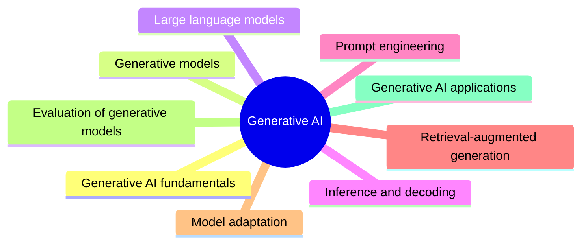

# Generative AI

Models that generate new content: generative model families, large language models, decoding, prompt engineering, retrieval-augmented generation, model adaptation, evaluation and applications.

This knowledge area is derived from the AI knowledge area in [Computer Science Curricula 2023](https://csed.acm.org/) (ACM, IEEE-CS and AAAI): generative neural networks in AI-ML, deployed deep generative models and foundation models in AI-SEP, and generative language models in AI-NLP.

## Map

The map shows the sections of this knowledge area.

## Sections

- [Generative AI fundamentals](fundamentals/README.md) (1 note): What generative AI is, its vocabulary and a learning path through the area.
- [Generative models](generative-models/README.md) (planned): The model families that generate content: autoregressive, diffusion, adversarial and variational.
- [Large language models](large-language-models/README.md) (1 note): How large language models work, are trained and are chosen.
- [Inference and decoding](inference-and-decoding/README.md) (1 note): How a model's output distribution becomes text: sampling and decoding settings.
- [Prompt engineering](prompt-engineering/README.md) (8 notes): Designing prompts that make a model produce the desired output reliably.
- [Retrieval-augmented generation](retrieval-augmented-generation/README.md) (1 note): Grounding generation in documents retrieved at request time.
- [Model adaptation](model-adaptation/README.md) (planned): Making a pretrained model your own: fine-tuning and related methods.
- [Evaluation of generative models](evaluation/README.md) (planned): Measuring the quality and safety of generated output.
- [Generative AI applications](applications/README.md) (planned): Generative AI applied to domains.
