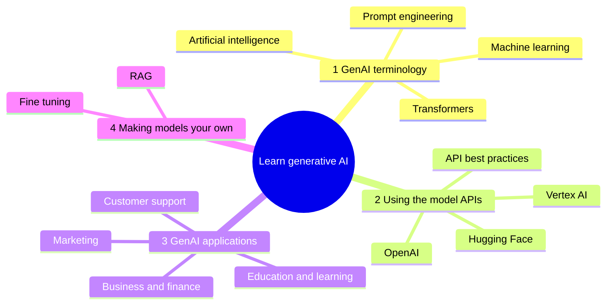

# Generative AI

## Summary

Generative artificial intelligence (GenAI) is the kind of AI that produces new content, such as text, images, audio, code or data, that did not exist before, based on patterns learned from training data. Technically, a generative model learns the probability distribution of its training data and draws new samples from it, usually conditioned on an input called a prompt. It works like a creative assistant that produces unique outputs from what it has learned, but its outputs are samples from a learned distribution, not retrieved facts, so they can be fluent and wrong.

## Prerequisites

- [Artificial intelligence](../../ai-foundations/what-is-ai/artificial-intelligence.md) for the nesting of AI, ML, deep learning and GenAI.
- [Neural networks](../../deep-learning/neural-network-fundamentals/neural-networks.md), since current generative models are deep networks.

## Core concepts

### Definition

GenAI, short for generative artificial intelligence, refers to AI that generates new content, ideas or data. In the nesting of the field, generative AI is a subset of deep learning that generates content like text, images or code based on input (see the figure in [artificial intelligence](../../ai-foundations/what-is-ai/artificial-intelligence.md#ai-machine-learning-deep-learning-and-generative-ai)).

The precise distinction is between two kinds of models:

- A **discriminative model** learns `p(y | x)`: given an email, the probability that it is spam. It separates classes.
- A **generative model** learns `p(x)` or `p(x | c)`: the distribution of the data itself, optionally conditioned on a context `c` such as a prompt. It can *sample* new examples, such as a new email that looks like the training emails.

### Important terminology

| Term | Meaning | Home note |
| --- | --- | --- |
| Machine learning (ML) | A method of teaching computers to learn from data and improve over time without being explicitly programmed. | [Machine learning](../../machine-learning/fundamentals/machine-learning.md) |
| Deep learning | A subset of ML that uses neural networks with many layers to learn from large amounts of data. | [Neural networks](../../deep-learning/neural-network-fundamentals/neural-networks.md) |
| Neural networks | Algorithms loosely modeled after the brain that help computers recognize patterns and solve complex problems. | [Neural networks](../../deep-learning/neural-network-fundamentals/neural-networks.md) |
| Natural language processing (NLP) | Technology that helps computers understand, interpret and respond to human language. | [Natural language processing](../../natural-language-processing/README.md) |
| Generative adversarial networks (GANs) | A system of two neural networks competing against each other to improve, often used in image generation. | [Generative models](../generative-models/README.md) |
| Reinforcement learning | A type of ML where an algorithm learns to make decisions by performing actions and assessing the results. | [Reinforcement learning](../../machine-learning/learning-paradigms/reinforcement-learning.md) |
| Transformer | The neural network architecture, based on attention, behind current large language models. | [Architectures](../../deep-learning/architectures/README.md) |
| Prompt | The input that conditions what a generative model produces. | [Prompt engineering](../prompt-engineering/prompt-engineering.md) |

### Families of generative models

| Family | How it generates | Typical outputs |
| --- | --- | --- |
| Autoregressive models | Predict the next element (token, pixel patch) given all previous ones, and repeat. | Text (large language models), code, audio. |
| Diffusion models | Start from noise and remove it step by step, guided by the prompt. | Images, video, audio. |
| Generative adversarial networks (GANs) | A generator produces samples and a discriminator learns to tell them from real data. Both improve by competing. | Images, especially faces and style transfer. |
| Variational autoencoders (VAEs) | Encode data into a distribution over a latent space and decode samples from it. | Images, and latent spaces used inside diffusion models. |

A large language model (LLM) generates text one token at a time: it computes a probability for every token of its vocabulary, picks one according to the [sampling parameters](../inference-and-decoding/sampling-parameters.md), appends it to the input and repeats. Everything it "knows" is stored in its parameters, fixed at its training cutoff, unless the prompt adds information, for example through [retrieval-augmented generation](../retrieval-augmented-generation/retrieval-augmented-generation.md).

### A learning path for generative AI

The mind map shows a learning path in four stages, which this library follows. Stage 1 builds the vocabulary, stage 2 uses models through their APIs, stage 3 applies them to domains, and stage 4 adapts models with your own data. The same path is available as the Librarian OS roadmap `generative-ai` in [`_roadmaps/generative-ai.json`](../../_roadmaps/generative-ai.json).

### Usage examples

1. **Content creation:** GenAI writes articles, composes music and creates graphic designs, saving time for creative professionals.
2. **Data augmentation:** GenAI generates additional synthetic data for training machine learning models when real data is scarce.
3. **Personalization:** GenAI tailors digital experiences by generating personalized content for users, such as recommendations or messages on streaming platforms.
4. **Simulation:** GenAI simulates scenarios for training and planning, such as virtual environments for testing autonomous vehicles.

Further common uses are code generation, question answering over documents, translation, summarization and conversational assistants, and, combined with tools, the [AI agents](../../agents-and-cognitive-systems/agent-fundamentals/ai-agent.md) of the agents area.

## Worked example

The same request handled by a discriminative and a generative model shows the difference in output.

- **Task:** a support team receives the email "My invoice for March shows the wrong VAT number."
- **Discriminative model** (a trained classifier): outputs `category = billing, p = 0.94`. It can only choose among the categories it was trained on.
- **Generative model** (an LLM with the prompt "Draft a reply to this customer email"): outputs a new paragraph, for example an apology, a request for the correct VAT number and a promise of a corrected invoice. The text did not exist before, and it may also contain a confident promise (such as "within 24 hours") that the company never made. That second property is why generated output needs validation before it reaches a customer.

A production system often uses both: the classifier routes the email and the generative model drafts a reply for a human to approve.

## Trade offs and when to use it

- **Strengths:** no task specific training for many tasks, natural language interfaces, fast prototyping, handling of open ended outputs.
- **Costs:** per request inference cost and latency, probabilistic outputs, sensitivity to prompt wording.
- **Risks:** *hallucination* (fluent but false content), leakage of sensitive data placed in prompts, intellectual property questions about training data and outputs, misuse such as generated disinformation, and new attack surfaces such as [prompt injection](../../ai-security/prompt-attacks/prompt-injection.md).
- **When not to use it:** when a deterministic, verifiable answer is required and can be computed (a tax amount, an account balance), or when a small discriminative model solves a fixed classification at a fraction of the cost.

## Common mistakes

- **Treating generated text as retrieved fact.** Fix: ground answers in sources (retrieval), ask for citations and verify critical claims.
- **Using GenAI where a classifier suffices.** Fix: compare cost, latency and accuracy against a simple supervised model.
- **Sending confidential data to an external model API without checking the terms.** Fix: classify data first and use providers and settings that meet data protection requirements.
- **Calling every AI system "generative".** Fix: a model is generative only if it samples new content from a learned distribution.

## Practice

1. Is a model that outputs "spam" or "not spam" generative or discriminative? What about a model that writes a new spam email?
2. Why can an LLM state a false fact with full confidence?
3. Which family of generative models is behind most current image generators?
4. Give one use of generative AI that supports training other models.

Answers:

1. Discriminative, then generative.
2. It samples likely text from a learned distribution, and fluency is not the same as truth. Nothing in plain generation checks the claim against a source.
3. Diffusion models.
4. Data augmentation: generating synthetic examples when real data is scarce.

## Further reading

- Bommasani, R. et al. (2021). [*On the Opportunities and Risks of Foundation Models*](https://arxiv.org/abs/2108.07258). Stanford CRFM. A broad survey of capabilities, applications and risks.
- Goodfellow, I. et al. (2014). [*Generative Adversarial Networks*](https://arxiv.org/abs/1406.2661). NeurIPS 2014. The original GAN paper.
- Ho, J., Jain, A. and Abbeel, P. (2020). [*Denoising Diffusion Probabilistic Models*](https://arxiv.org/abs/2006.11239). NeurIPS 2020. The paper that made diffusion models practical.
- Brown, T. et al. (2020). [*Language Models are Few-Shot Learners*](https://arxiv.org/abs/2005.14165). NeurIPS 2020. GPT-3, which showed that a large autoregressive model can perform many tasks from a prompt alone.

TODO: check the content of this note against the sources above and record what was verified and when.
