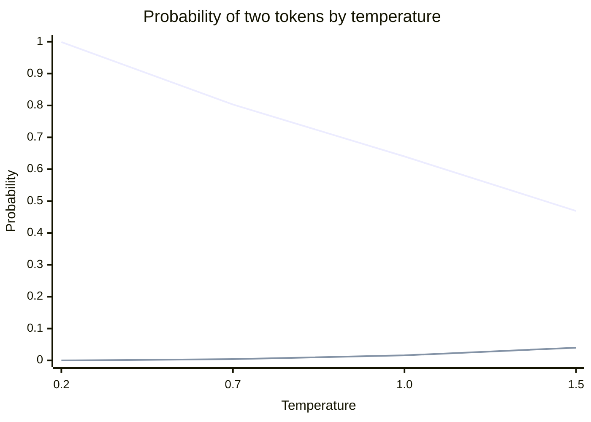

# Sampling parameters

## Summary

A language model does not output words directly. At each step it outputs a probability for every token of its vocabulary, and a *decoding* procedure picks one token, appends it and repeats. Sampling parameters control that pick: *temperature* sharpens or flattens the distribution, *top-k* keeps only the k most likely tokens, and *top-p* (nucleus sampling) keeps the smallest set of tokens whose probabilities add up to p. Low values give predictable, focused text for factual tasks, and higher values give varied text for creative tasks, at the price of more errors.

## Prerequisites

- [Generative AI](../fundamentals/generative-ai.md) for token by token generation.
- [Activation functions](../../deep-learning/neural-network-fundamentals/activation-functions.md) for the softmax function.
- [AI model](../../ai-foundations/what-is-ai/ai-model.md#parameters-and-hyperparameters) for why these are inference settings, not model parameters.

## Core concepts

### Introduction

Large language models (LLMs) rely on several settings when they generate responses. These settings control how the model selects words, how random or deterministic its outputs are, and how creative or structured the response is. Adjusting them adapts the model's behavior to a use case such as answering factual questions, generating creative content or keeping long texts coherent. Adjusting them changes no weight of the model, so it is not fine-tuning in the training sense.

The most commonly used settings are:

- **Model type**, the choice of the model itself (covered in [choosing a model](../large-language-models/choosing-a-model.md), because it is not a sampling setting),
- **temperature**,
- **top-k sampling**,
- **top-p sampling (nucleus sampling)**.

Each plays a distinct role in shaping the quality, randomness and relevance of generated responses. Two more settings are always present: the **maximum number of output tokens**, which cuts generation off, and **stop sequences**, which end it when a given string appears.

### From logits to a token

For each position the model produces a score, a *logit* `z_i`, for every token `i` of a vocabulary that typically has 30,000 to 250,000 tokens. Softmax turns the logits into probabilities. The decoding pipeline then reshapes this distribution and samples from it. The flowchart shows the usual order, which is for example the order of the logits processors in Hugging Face Transformers.


A token is a piece of a word, not a word. "Unbelievable" may be three tokens. The examples below say "word" where the source examples did, but every setting acts on tokens.

### Temperature: controlling randomness

Temperature `T` divides the logits before the softmax:

$$
p_i = \frac{\exp(z_i / T)}{\sum_j \exp(z_j / T)}
$$

It controls the degree of randomness: whether the model always chooses the most probable next token or explores less likely but potentially more creative options.

- **Low temperature (for example 0.1 to 0.3):** the distribution becomes sharp, and the model favors highly probable tokens, giving deterministic and predictable responses. Best for fact-based tasks such as question answering, summarization and structured content. Example, prompt "What is the capital of France?": "The capital of France is Paris."
- **High temperature (for example 0.7 to 1.2):** the distribution becomes flatter, and the model explores less probable tokens, giving more varied and creative output. Suited to poetry, storytelling and brainstorming. Example, prompt "Describe Paris in a creative way.": "Paris, the city of light, where golden sunsets kiss cobblestone streets, whispering tales of art, love, and revolution."
- **Very high temperature (above 1.5):** the output becomes chaotic and unpredictable, often nonsensical. Usually not recommended unless extreme randomness is the goal.

At `T = 1` the model's own distribution is used unchanged. As `T` approaches 0, sampling becomes *greedy decoding*: always the single most likely token. Many APIs treat `T = 0` as greedy, but outputs can still differ between runs because of nondeterministic floating point arithmetic on GPUs and batching on the server.

Recommended temperature by task (common heuristics, not vendor guidance):

| Task | Recommended temperature |
| --- | --- |
| Factual question answering | 0.1-0.3 |
| Summarization | 0.3-0.5 |
| Conversational chatbots | 0.5-0.7 |
| Creative writing | 0.7-1.0 |
| Storytelling, poetry | 1.0-1.2 |

### Top-k sampling: controlling diversity

Top-k sampling keeps only the k most probable tokens at each step, sets the probability of all others to zero, renormalizes and samples from the k that remain.

- **K = 1:** the model always picks the most probable token (greedy decoding), giving predictable and often repetitive responses.
- **K = 5:** the model picks from the top 5 tokens, adding some variety while keeping coherence.
- **K = 50:** a larger candidate set, increasing randomness and creativity.

Example, prompt "The sky is...". The lists show the *candidate set* for the next token at each k. The model still emits one token per step, chosen from the set:

- **K = 1:** blue.
- **K = 3:** blue, clear, bright.
- **K = 10:** blue, clear, radiant, vast, endless, bright, soft, dreamy, shifting, golden.

Lower k makes responses more predictable, and higher k allows more variability.

| Task | Recommended top-k |
| --- | --- |
| Factual question answering | 1-5 |
| Summarization | 3-10 |
| Conversational chatbots | 10-20 |
| Creative writing | 20-50 |
| Poetry, storytelling | 50-100 |

The weakness of top-k is that k is fixed. When the model is confident (one token has 95 % of the mass), k = 50 still admits 49 unlikely tokens. When the model is unsure (probability spread over hundreds of plausible tokens), k = 5 cuts off good options.

### Top-p sampling (nucleus sampling): dynamic control

Top-p sampling (Holtzman et al., 2020) keeps the smallest set of most probable tokens whose cumulative probability reaches the threshold p, renormalizes and samples from that *nucleus*.

- Instead of a fixed number of tokens, top-p uses a probability threshold.
- With p = 0.75, the model adds tokens in order of probability until their combined probability reaches 75 %, so the size of the candidate set adapts to the model's confidence.
- High probability tokens are always included, and less common tokens get a chance only when the distribution is spread out.

Example, prompt "The ocean is...". The texts illustrate the style of completion that each setting tends to produce over many steps:

- **P = 0.3:** "The ocean is blue."
- **P = 0.75:** "The ocean is vast, blue, and endless."
- **P = 0.95:** "The ocean is a shimmering abyss, filled with secrets of the deep, stretching beyond the horizon."

| Parameter | Fixed or dynamic | Effect |
| --- | --- | --- |
| Top-k | Fixed number of tokens | A simple balance between predictability and randomness. |
| Top-p | Candidate set adapts to the distribution | More natural variation, because the cut follows the model's confidence. |

| Task | Recommended top-p |
| --- | --- |
| Factual question answering | 0.3-0.5 |
| Summarization | 0.5-0.7 |
| Conversational chatbots | 0.7-0.9 |
| Creative writing | 0.9-0.95 |

A newer variant, *min-p sampling*, keeps every token whose probability is at least a fraction of the top token's probability, which adapts even better at high temperatures.

### Combining parameters

Practitioners often combine temperature, top-k and top-p. Example combinations (heuristics, not vendor guidance):

| Use case | Temperature | Top-k | Top-p |
| --- | --- | --- | --- |
| Fact-based question answering | 0.2 | 5 | 0.5 |
| News summarization | 0.3 | 10 | 0.7 |
| Conversational AI | 0.7 | 20 | 0.85 |
| Storytelling | 1.0 | 50 | 0.9 |
| Creative poetry generation | 1.2 | 100 | 0.95 |

Because the filters are applied in sequence, they interact. At temperature 0.2 the distribution is already so sharp that top-k and top-p rarely change anything. A common recommendation in vendor documentation is to adjust temperature or top-p, but not both at once, so that the effect of each change is clear.

### Vendor differences

Not every API exposes every setting, and ranges differ. As documented by the vendors in 2025: the OpenAI Chat Completions API offers temperature (0 to 2) and top-p, but not top-k. The Anthropic Messages API offers temperature (0 to 1), top-p and top-k. The Google Gemini API offers temperature (0 to 2), top-p and top-k. Some reasoning models accept no sampling settings at all. Check the current documentation before relying on these values.

### Key takeaways

- Use **low temperature** for structured, factual and predictable responses.
- **Increase top-k** to allow more variation in token selection.
- Use **top-p** for a dynamic balance between predictability and creativity.
- Experiment with these settings on real prompts, and judge by the quality of the outputs, not by intuition about the numbers.

## Worked example

Seven candidate tokens for "The sky is ..." with made-up logits. The code applies temperature, top-k and top-p exactly as described above and draws ten samples at three temperatures. Tested with Python 3.10 and NumPy 2.2.6.

```python
import numpy as np

tokens = ["blue", "clear", "bright", "vast", "grey", "falling", "green"]
logits = np.array([4.0, 2.5, 2.2, 1.5, 1.2, 0.3, -1.0])

def softmax(z):
    z = z - z.max()          # subtract the max for numerical stability
    e = np.exp(z)
    return e / e.sum()

def apply_temperature(logits, t):
    return softmax(logits / t)

def apply_top_k(probs, k):
    keep = np.argsort(probs)[::-1][:k]
    out = np.zeros_like(probs)
    out[keep] = probs[keep]
    return out / out.sum()   # renormalize over the kept tokens

def apply_top_p(probs, p):
    order = np.argsort(probs)[::-1]
    cumulative = np.cumsum(probs[order])
    # keep the smallest prefix whose cumulative probability reaches p
    cutoff = np.searchsorted(cumulative, p) + 1
    out = np.zeros_like(probs)
    out[order[:cutoff]] = probs[order[:cutoff]]
    return out / out.sum()

np.set_printoptions(precision=3, suppress=True)
for t in (0.2, 0.7, 1.0, 1.5):
    print(f"T={t}:", apply_temperature(logits, t))
base = apply_temperature(logits, 1.0)
print("top-k=3:", apply_top_k(base, 3))
for p in (0.3, 0.75, 0.9):
    kept = [tok for tok, q in zip(tokens, apply_top_p(base, p)) if q > 0]
    print(f"top-p={p}:", kept)
rng = np.random.default_rng(0)
for t in (0.2, 1.0, 1.5):
    draws = rng.choice(tokens, size=10, p=apply_temperature(logits, t))
    print(f"10 draws at T={t}:", " ".join(draws))
```

Output:

```text
T=0.2: [0.999 0.001 0.    0.    0.    0.    0.   ]
T=0.7: [0.803 0.094 0.061 0.023 0.015 0.004 0.001]
T=1.0: [0.64  0.143 0.106 0.053 0.039 0.016 0.004]
T=1.5: [0.469 0.172 0.141 0.089 0.072 0.04  0.017]
top-k=3: [0.72  0.161 0.119 0.    0.    0.    0.   ]
top-p=0.3: ['blue']
top-p=0.75: ['blue', 'clear']
top-p=0.9: ['blue', 'clear', 'bright', 'vast']
10 draws at T=0.2: blue blue blue blue blue blue blue blue blue blue
10 draws at T=1.0: bright blue bright blue clear blue bright blue blue blue
10 draws at T=1.5: blue blue bright bright clear blue green falling bright bright
```

The chart shows the probability of the top token "blue" and of the unlikely token "falling" at each temperature, from the output above.



Reading the output:

- At T = 0.2 "blue" takes 99.9 % of the mass, and all ten draws are "blue".
- At T = 1.5 the unlikely "falling" rises from 1.6 % to 4 %, and "green" and "falling" appear within ten draws. Over a 500 token answer, such low probability choices add up to drift and errors.
- Top-p = 0.75 keeps two tokens here, because "blue" and "clear" together reach 78.3 %. For a flatter distribution the same p would keep many more tokens, which is the "dynamic" property.
- Top-k = 3 keeps "blue", "clear" and "bright" whatever the shape of the distribution.

## Trade offs and when to use it

- Lower randomness improves consistency and factual reliability but can produce repetitive, generic text, and in long generations greedy decoding is known to fall into repetition loops.
- Higher randomness improves diversity, which helps brainstorming and generating several candidates to choose from, but increases factual errors and incoherence.
- For tasks with one correct answer (extraction, classification, code), prefer low temperature and validate the output. For diversity, consider generating several samples at moderate temperature and selecting the best with a verifier rather than raising temperature further.
- Sampling settings cannot fix a model that lacks knowledge or a prompt that is unclear. Change the model, the prompt or the context first.

## Common mistakes

- **Calling these "model parameters".** They are inference settings. The model's parameters are its learned weights. Fix: use the term sampling or decoding parameters.
- **Expecting temperature 0 to be perfectly reproducible.** Fix: for reproducibility, also fix the model version, the prompt and, where offered, a seed, and still test for variation.
- **Tuning top-k and top-p and temperature at the same time.** Fix: change one setting at a time and evaluate on a fixed set of prompts.
- **Using high temperature to make a factual answer "less boring".** Fix: ask for a different style in the prompt and keep temperature low.

## Practice

1. What happens to the probabilities when temperature goes toward 0, and when it grows very large?
2. Given probabilities 0.5, 0.2, 0.15, 0.1, 0.05, which tokens are kept by top-p = 0.8? By top-k = 2?
3. Why does top-p adapt better than top-k to the model's confidence?
4. A customer support bot sometimes invents refund policies. Is raising or lowering temperature the right first fix?

Answers:

1. Toward 0 all mass goes to the most likely token (greedy decoding). Very large temperatures push the distribution toward uniform, where every token is equally likely.
2. Top-p = 0.8 keeps the first three (0.5 + 0.2 + 0.15 = 0.85 reaches 0.8). Top-k = 2 keeps the first two.
3. The size of the nucleus depends on how the probability mass is spread: few tokens when the model is confident, many when it is not. Top-k always keeps k.
4. Neither is the real fix. Lowering temperature may reduce variation, but invented policies come from missing knowledge. Ground the answers in the actual policy documents (retrieval) and instruct the model to say when the answer is not in them.

## Further reading

- Holtzman, A., Buys, J., Du, L., Forbes, M. and Choi, Y. (2020). [*The Curious Case of Neural Text Degeneration*](https://arxiv.org/abs/1904.09751). ICLR 2020. Introduces nucleus (top-p) sampling and analyzes why greedy and top-k decoding degrade.
- Fan, A., Lewis, M. and Dauphin, Y. (2018). [*Hierarchical Neural Story Generation*](https://arxiv.org/abs/1805.04833). ACL 2018. An early use of top-k sampling for open ended generation.
- Hugging Face (2020, updated). [*How to generate text: using different decoding methods for language generation with Transformers*](https://huggingface.co/blog/how-to-generate). A practical comparison of greedy, beam, top-k and top-p decoding.
- Nguyen, M. et al. (2024). [*Turning Up the Heat: Min-p Sampling for Creative and Coherent LLM Outputs*](https://arxiv.org/abs/2407.01082). arXiv. The min-p sampling method.

TODO: check the content of this note against the sources above and record what was verified and when.
