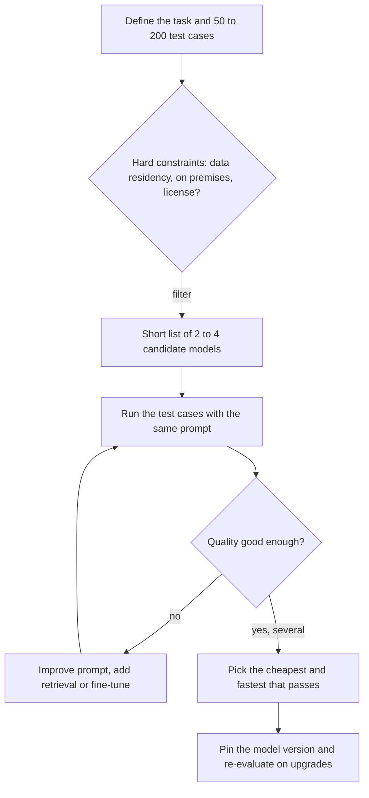

# Choosing a model

## Summary

The model is the first and most consequential setting of a generative AI system: no choice of temperature or prompt makes a model good at a task it was not trained for. Models differ in what they were trained and fine-tuned for (general chat, code, summarization), in size, context window, supported modalities, latency, cost and licensing. Choose by evaluating a short list of candidates on your own task data, and record the exact model version, because model names are moving targets.

## Prerequisites

- [Generative AI](../fundamentals/generative-ai.md) for what a generative model is.
- [AI model](../../ai-foundations/what-is-ai/ai-model.md) for parameters and model size.

## Core concepts

### Model type

Every model is trained, and usually fine-tuned, with particular tasks in mind. Some specialize in summarization, some excel in creative writing, and others are optimized for code generation or question answering. Selecting the right *model type* makes the output align with the use case. Examples as of 2023:

- **GPT-4** (OpenAI) and **Gemini** (Google) are general purpose models suitable for a wide range of tasks.
- **Codex** (OpenAI) was fine-tuned specifically for code generation. OpenAI deprecated the Codex API models in 2023 and general purpose models took over code generation. The name was later reused for an OpenAI coding agent product.
- **T5** (Text-to-Text Transfer Transformer, Google, 2019) performs well in text summarization and other text-to-text tasks after fine-tuning.

Model names in this list are examples with a date, not recommendations. Since 2023 the trend has moved from many specialized models to a few general models, each offered in several sizes, with specialization added by prompting, retrieval or fine-tuning.

### Selection criteria

| Criterion | Question to ask | Why it matters |
| --- | --- | --- |
| Task fit | Was the model trained or tuned for this kind of task and language? | A general chat model may underperform a smaller model tuned for code or a given language. |
| Quality on your data | How does it score on 50 to 200 real examples of your task? | Public benchmarks rarely match a specific task and may be contaminated by training data. |
| Context window | How many tokens of input and output does it accept? | Long documents and retrieval need room. Quality can drop for information in the middle of very long contexts. |
| Modalities | Does it accept images, audio or files, and produce them? | A text-only model cannot read a scanned invoice. |
| Reasoning mode | Does it offer an extended reasoning mode, and at what cost? | Reasoning models are stronger on multi-step problems but slower and more expensive per answer. |
| Tool use and structured output | Does it support function calling and JSON schemas reliably? | Needed for [agents](../../agents-and-cognitive-systems/llm-agents/llm-based-agents.md) and for machine-readable output. |
| Latency and throughput | Time to first token, tokens per second, rate limits. | Interactive use needs low latency, batch jobs need throughput. |
| Cost | Price per million input and output tokens, or hosting cost. | Cost scales with traffic, prompt length and output length. |
| Deployment and data | API, cloud region, on premises or open weights? Where does data go and is it retained? | Regulatory and contractual limits often decide before quality does. |
| License | May the model be used commercially, and may its outputs be used to train other models? | Open weight licenses differ widely. |

### A decision process

The flowchart shows a practical order for the decision: hard constraints first, then quality, then cost.

## Worked example

A team builds three features and evaluates candidates on their own test sets. The model names are placeholders, and the prices are illustrative round numbers, not quotes from any provider.

| Feature | Constraint | Candidates | Outcome |
| --- | --- | --- | --- |
| Summarize support tickets (about 800 tokens in, 120 out) | High volume: 200,000 per day | Large general model, small general model | Both pass the quality bar on 150 tickets. The small model is chosen. |
| Generate SQL from questions about the warehouse schema | Must produce valid SQL | Large general model, code-tuned model | The large model with the schema in the prompt passes 92 % of 100 test questions, the code model 81 %. The large model is chosen. |
| Answer HR policy questions | Personal data must stay in the company's cloud region | Only models available in that region | Region filter leaves two models. Retrieval over the policy documents is added. |

Cost check for the first feature, with an illustrative price of 0.15 dollars per million input tokens and 0.60 dollars per million output tokens for the small model:

- Input: 200,000 × 800 = 160 million tokens per day, 24 dollars.
- Output: 200,000 × 120 = 24 million tokens per day, 14.40 dollars.
- About 38 dollars per day. A model costing 20 times as much per token would cost about 770 dollars per day for the same work, which is why "the cheapest model that passes" is the default rule.

## Trade offs and when to use it

- **Larger models** handle harder and more varied tasks, at higher cost and latency.
- **Smaller models** are cheaper and faster and are often good enough for narrow, well specified tasks, especially with good prompts or fine-tuning.
- **Open weight models** give control over deployment and data, and allow fine-tuning, but require serving infrastructure (see [ML systems](../../ml-systems/README.md)).
- **Routing** (sending easy requests to a small model and hard ones to a large model) combines both, at the cost of a routing component that must itself be evaluated.

## Common mistakes

- **Choosing by leaderboard.** Fix: evaluate on your own examples. Public benchmark scores do not transfer reliably to a specific task.
- **Using an unpinned model alias.** An alias such as "latest" can change behavior overnight. Fix: pin a dated model version, and re-run the evaluation before upgrading.
- **Tuning sampling parameters to fix a weak model.** Fix: change the model, the prompt or the context first.
- **Forgetting output tokens in cost estimates.** Output tokens are usually priced higher than input tokens. Fix: estimate both from real traffic.

## Practice

1. Why should model selection start from hard constraints rather than from quality?
2. A team says "we use GPT-4". What information is missing for reproducibility?
3. When does routing between two models pay off?

Answers:

1. Constraints such as data residency or licensing eliminate candidates regardless of quality, so evaluating them first wastes no effort.
2. The exact model version or snapshot date, the provider and region, and the sampling settings.
3. When a large share of requests is easy enough for the cheap model, and a reliable router can tell easy from hard requests.

## Further reading

- Raffel, C. et al. (2020). [*Exploring the Limits of Transfer Learning with a Unified Text-to-Text Transformer*](https://arxiv.org/abs/1910.10683). JMLR 21. The T5 paper.
- Chen, M. et al. (2021). [*Evaluating Large Language Models Trained on Code*](https://arxiv.org/abs/2107.03374). arXiv. The Codex paper and the HumanEval benchmark.
- Liang, P. et al. (2022). [*Holistic Evaluation of Language Models*](https://arxiv.org/abs/2211.09110). arXiv. HELM, a framework that evaluates models across many scenarios and metrics.
- Liu, N. et al. (2023). [*Lost in the Middle: How Language Models Use Long Contexts*](https://arxiv.org/abs/2307.03172). TACL. Evidence that information in the middle of long contexts is used less well.

TODO: check the content of this note against the sources above and record what was verified and when.
