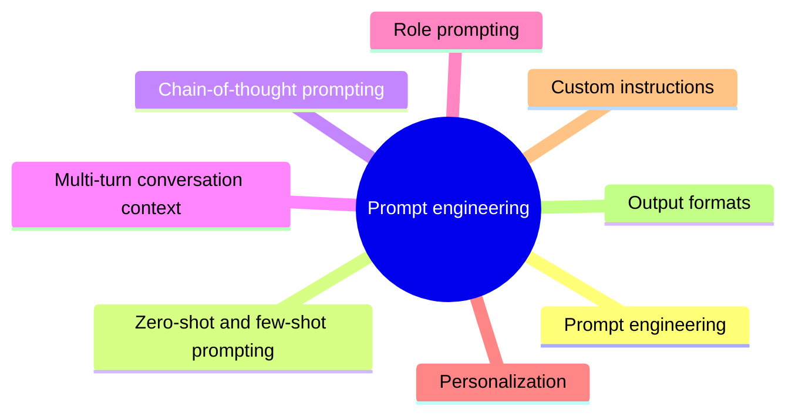

# Prompt engineering

Designing prompts that make a model produce the desired output reliably.

This section is part of the knowledge area [Generative AI](../README.md). Read the notes in the order below.

## Map

The map shows the notes of this section.

## Notes

- [Prompt engineering](prompt-engineering.md): Prompt engineering is the practice of designing the input text (the prompt) of a language model so that it produces the desired output reliably.
- [Zero-shot and few-shot prompting](zero-shot-and-few-shot-prompting.md): Zero-shot, one-shot and few-shot prompting differ in how many worked examples the prompt contains: none, one or several.
- [Chain-of-thought prompting](chain-of-thought-prompting.md): Chain-of-thought (CoT) prompting asks a language model to write out intermediate reasoning steps before its final answer.
- [Multi-turn conversation context](multi-turn-conversation-context.md): In a multi-turn conversation, each new prompt builds on the earlier turns: the user refers back to information already given, and the model answers in the established context.
- [Role prompting](role-prompting.md): Role prompting assigns the model a role, persona or point of view, such as "a senior tax advisor", "a skeptical reviewer" or two characters in a dialogue, so that its answers take that perspective, vocabulary and level of detail.
- [Personalization](personalization.md): Personalizing the output of a chat model means giving it specific information about the user's preferences, situation, experience or style, so that the answer fits that person instead of an average reader.
- [Custom instructions](custom-instructions.md): Custom instructions are explicit guidance about the task, format, context and constraints that the user gives a language model to improve the quality and relevance of its responses.
- [Output formats](output-formats.md): A language model can produce many kinds of output: natural language answers, code, tables and lists, summaries, translations, answers to questions, creative writing, edited text and task-specific outputs.

## Planned topics

- Prompt chaining
- Prompt evaluation and versioning
