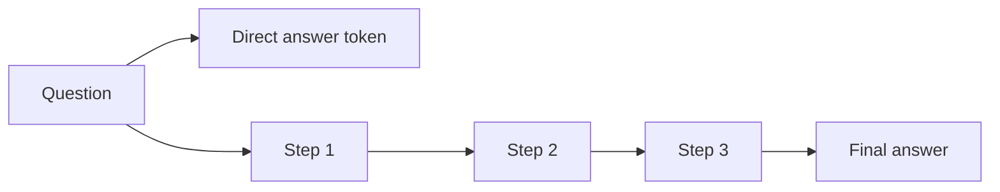

# Chain-of-thought prompting

## Summary

Chain-of-thought (CoT) prompting asks a language model to write out intermediate reasoning steps before its final answer. Because each generated step becomes input for the next, the model can break a multi-step problem into smaller steps, which raises accuracy on arithmetic, logic and planning tasks. The term is often confused with keeping context across a conversation, which is a different technique described in [multi-turn conversation context](multi-turn-conversation-context.md).

## Prerequisites

- [Prompt engineering](prompt-engineering.md).
- [Zero-shot and few-shot prompting](zero-shot-and-few-shot-prompting.md), since CoT exists in both forms.

## Core concepts

### Definition

Wei et al. (2022) defined a *chain of thought* as "a series of intermediate natural language reasoning steps that lead to the final output". In *few-shot CoT*, the examples in the prompt include worked reasoning, not only answers. In *zero-shot CoT* (Kojima et al., 2022), a phrase such as "Let's think step by step" is added to the question.

*Analogy.* A student who writes out the steps of a long division makes fewer mistakes than one who tries to produce the answer in their head. The analogy holds in that written steps act as external working memory. It breaks in one important way: a model's written reasoning is not guaranteed to be the process that actually produced its answer, so a plausible chain can accompany a wrong answer, and the reverse.

### Why it works

A transformer performs a fixed amount of computation per generated token. A question whose answer requires several dependent steps cannot always be solved in the computation available for one token. Generating the steps as text spreads the computation over many tokens, and each step is conditioned on the previous ones. The effect grows with model scale: in the original experiments, CoT helped large models substantially and gave little or no benefit for small ones.

The flowchart contrasts a direct answer with a chain of thought for the same question.



### Variants

| Variant | Idea |
| --- | --- |
| Few-shot CoT | Examples show the reasoning steps before each answer. |
| Zero-shot CoT | A trigger phrase such as "Let's think step by step." |
| Self-consistency | Sample several chains at nonzero temperature and take the majority answer (Wang et al., 2023). |
| Tree of thoughts | Explore and evaluate several branches of reasoning (see [planning strategies](../../agents-and-cognitive-systems/llm-agents/planning-strategies.md)). |
| Reasoning models | Models trained with reinforcement learning to produce long internal reasoning before answering, so CoT is built in. |

## Worked example

Question: "A cafe sold 23 coffees in the morning. In the afternoon it sold twice as many as in the morning, and 9 coffees were returned. How many coffees were sold in total, net of returns?"

**Direct prompt:** "Answer with a number only." A model may answer 46 (the afternoon figure) or 69, because it must combine three facts in one step.

**Zero-shot CoT prompt:** the same question followed by "Think step by step, then give the final answer on a line starting with 'Answer:'."

Expected chain:

```text
Morning: 23 coffees.
Afternoon: twice the morning, 2 × 23 = 46 coffees.
Total sold: 23 + 46 = 69.
Returns: 69 - 9 = 60.
Answer: 60
```

The explicit "Answer:" line makes the final result easy to extract and check by code, while the steps make an error visible when one occurs.

## Trade offs and when to use it

- **Use it** for multi-step arithmetic, logic, word problems and planning, and when a visible rationale helps a person review the answer.
- **Skip it** for simple lookups, classification and extraction, where it adds tokens, latency and cost without improving accuracy.
- **Reasoning models** already reason internally. Asking them to "think step by step" adds little, and some providers advise against it.
- **Faithfulness:** written reasoning can be a post hoc story. Do not treat it as an audit trail of the model's actual computation.

## Common mistakes

- **Confusing chain of thought with conversation context.** Building on earlier turns of a dialogue is multi-turn context, not CoT. Fix: use "chain of thought" only for intermediate reasoning steps within an answer.
- **Parsing the answer out of free text.** Fix: ask for the final answer in a fixed, machine-readable place.
- **Showing raw reasoning to end users.** It can be long, confusing or contain discarded wrong steps. Fix: show the final answer and keep the reasoning for logs or review.

## Practice

1. What is the difference between few-shot CoT and zero-shot CoT?
2. Why does CoT help large models more than small ones?
3. How does self-consistency use temperature?

Answers:

1. Few-shot CoT includes worked reasoning in the examples. Zero-shot CoT adds only a trigger phrase such as "Let's think step by step".
2. Small models produce chains with errors that propagate, while large models produce chains good enough to improve the final answer. The benefit emerged with scale in the original experiments.
3. It samples several reasoning chains at nonzero temperature, so they differ, and takes the most common final answer.

## Further reading

- Wei, J. et al. (2022). [*Chain-of-Thought Prompting Elicits Reasoning in Large Language Models*](https://arxiv.org/abs/2201.11903). NeurIPS 2022. The paper that introduced and named the technique.
- Kojima, T. et al. (2022). [*Large Language Models are Zero-Shot Reasoners*](https://arxiv.org/abs/2205.11916). NeurIPS 2022. Zero-shot CoT with "Let's think step by step".
- Wang, X. et al. (2023). [*Self-Consistency Improves Chain of Thought Reasoning in Language Models*](https://arxiv.org/abs/2203.11171). ICLR 2023. Majority voting over sampled chains.
- Turpin, M. et al. (2023). [*Language Models Don't Always Say What They Think: Unfaithful Explanations in Chain-of-Thought Prompting*](https://arxiv.org/abs/2305.04388). NeurIPS 2023. Evidence that stated reasoning can differ from the cause of the answer.

TODO: check the content of this note against the sources above and record what was verified and when.
