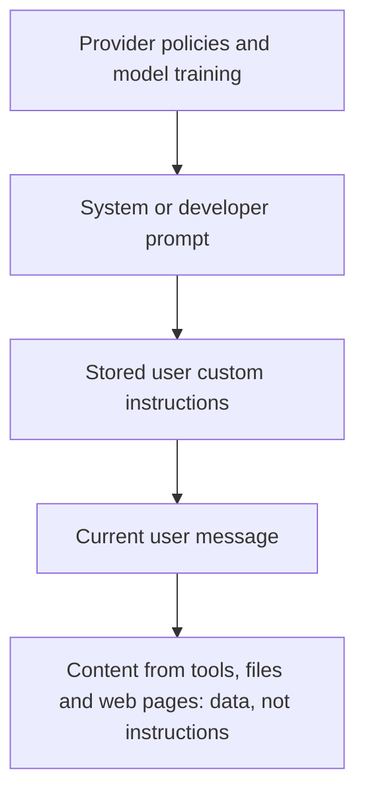

# Custom instructions

## Summary

Custom instructions are explicit guidance about the task, format, context and constraints that the user gives a language model to improve the quality and relevance of its responses. They can be written into a single prompt, refined over several turns, or stored once and applied to every conversation, as a system prompt in an API or as the "custom instructions" feature of a chat product. Clear and specific instructions are the single largest lever on output quality.

## Prerequisites

- [Prompt engineering](prompt-engineering.md) for system and user messages.

## Core concepts

### Definition

Custom instructions in prompt engineering are explicit guidance or specifications given to the model to improve the quality and relevance of its responses. They shape the model's behavior and tailor the output to the user's requirements. The clearer and more specific they are, the more accurate the result.

The term has two common meanings:

- **Instructions within a prompt:** any explicit guidance in the request itself.
- **Stored instructions:** text that a product or application adds to every conversation. ChatGPT introduced a "Custom instructions" feature in July 2023, and in APIs the same role is played by the *system prompt* (or developer message). Stored instructions are the right place for stable preferences: who the user is, the preferred language, format and tone.

### Four practices

- **Clarity in instructions.** Specify the task, format or type of response. The more explicit and detailed the instructions, the better the model can fulfil the request.
- **Examples and templates.** Provide examples or template phrases that show the desired style, structure or content (see [zero-shot and few-shot prompting](zero-shot-and-few-shot-prompting.md)).
- **Contextual information.** Include relevant context or constraints: set the scene, state preferences or refer to earlier turns.
- **Iterative refinement.** If the first response is not satisfactory, refine the instructions in the next prompt: try different wording or add context.

### Precedence of instructions

When stored instructions, system prompts and user prompts disagree, models are trained to follow an *instruction hierarchy*: platform and developer instructions outrank user instructions, and those outrank text found in tool outputs or documents (Wallace et al., 2024). The diagram shows the layers from highest to lowest priority. The hierarchy is a trained tendency, not a guarantee, which is why [prompt injection](../../ai-security/prompt-attacks/prompt-injection.md) remains possible.



## Worked example

The example shows how adding specific instructions in a second prompt changes the response.

**User prompt 1:**

```text
User: "Compose a paragraph describing the benefits of adopting solar energy for residential use."
```

**Model response 1:**

```text
Model: "Solar energy for residential use has several advantages. It is a clean and sustainable source of power, reducing reliance on non-renewable resources. Additionally, solar panels can lower electricity bills over time and contribute to a greener environment."
```

**User prompt 2 with custom instructions:**

```text
User: "Provide a detailed response with specific examples about the environmental impact of residential solar energy adoption. Include information on cost savings and any notable innovations in solar technology."
```

**Model response 2:**

```text
Model: "The adoption of residential solar energy has a profound environmental impact. For instance, households leveraging solar panels experience a notable reduction in carbon emissions, contributing to cleaner air and a smaller carbon footprint. In terms of cost savings, innovative financing options, such as solar leasing programs, make solar technology more accessible to homeowners, leading to long-term financial benefits."
```

The second prompt specifies the content (environmental impact with examples, cost savings, innovations), and the response follows it. Response 2 is still vague ("a notable reduction"): the instructions asked for specific examples but did not demand numbers or sources. A further refinement, "Include at least two quantified figures and name the source of each", would make the gap visible, because the model then has to produce checkable claims, which must be verified.

As a stored instruction, the same preferences would be written once, for example: "I write for homeowners in Germany. Prefer concrete numbers with sources, metric units and euros. Keep paragraphs under 120 words."

## Trade offs and when to use it

- Stored instructions save repetition and keep answers consistent, but they apply to every conversation, including ones where they do not fit. Keep them general and override them in the prompt when needed.
- Long system prompts cost tokens on every call and can contain conflicting rules. Review them like code.
- Instructions improve compliance but do not enforce it. Requirements that must hold (valid JSON, no personal data in output) need validation in code.

## Common mistakes

- **Ambiguous wording.** "Be detailed but concise" conflicts. Fix: quantify (length, number of items, sections).
- **Instructions hidden in the middle of long data.** Fix: put instructions before or after clearly delimited data, and repeat critical ones at the end of very long prompts.
- **Contradicting stored instructions without noticing.** Fix: check what the stored instructions say before debugging a strange answer.

## Practice

1. What is the difference between an instruction inside a prompt and a system prompt?
2. Rewrite "Write about solar energy" with four explicit instructions.
3. Why do instructions not guarantee a valid output format?

Answers:

1. An instruction in a prompt applies to that request. A system prompt (or stored custom instruction) applies to every request in the conversation or product, and has higher priority in the instruction hierarchy.
2. For example: "Write 150 words on residential solar in Spain for first-time buyers. Include the typical payback period with a source, two maintenance tips, and end with one question the reader should ask an installer."
3. The model samples text and can deviate. Only validation in code, or an API feature that constrains decoding to a schema, guarantees the format.

## Further reading

- OpenAI (2023). [*Custom instructions for ChatGPT*](https://openai.com/index/custom-instructions-for-chatgpt/). OpenAI. The announcement of the stored instructions feature.
- Wallace, E. et al. (2024). [*The Instruction Hierarchy: Training LLMs to Prioritize Privileged Instructions*](https://arxiv.org/abs/2404.13208). arXiv. How models are trained to rank system, user and tool instructions.

TODO: check the content of this note against the sources above and record what was verified and when.
