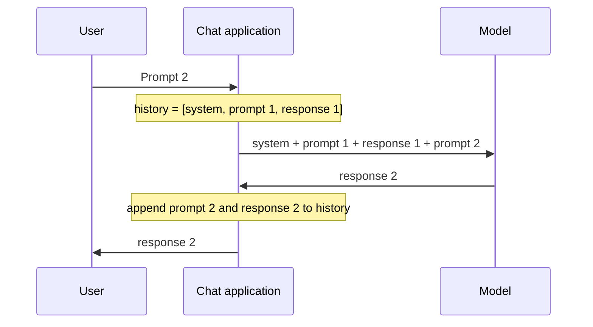

# Multi-turn conversation context

## Summary

In a multi-turn conversation, each new prompt builds on the earlier turns: the user refers back to information already given, and the model answers in the established context. This works because the application sends the whole conversation history to the model with every request, inside the model's context window. Guiding a conversation so that each turn references and extends the previous ones produces a coherent dialogue, but the model "remembers" only what still fits in the window.

## Prerequisites

- [Prompt engineering](prompt-engineering.md) for the message roles of chat models.

## Core concepts

### Definition

This technique is sometimes informally called a "chain of thought": maintaining a coherent and contextual conversation across several turns with a language model, guiding the model to build on and refer to information from earlier interactions so that the dialogue stays natural and connected. In current terminology this is *multi-turn conversation context* or *conversation state*. "Chain of thought" now means something else, intermediate reasoning steps within a single answer (see [chain-of-thought prompting](chain-of-thought-prompting.md)).

### How it works

Four aspects:

- **Context retention.** The model uses the context of the ongoing conversation: each prompt adds to it, and responses stay aligned with the information already established.
- **Referencing previous turns.** The user can refer to or build on information from earlier turns, by naming key points or asking follow-up questions.
- **Continuity in conversation.** Each prompt continues the conversation, which avoids abrupt topic changes and lets responses follow logically from one turn to the next.
- **Task-specific chains.** The chain can follow the task. In a dialogue about a historical event, each prompt can refer to the period, the key figures or the events discussed earlier.

The mechanism behind context retention is simple and often misunderstood: the model itself is stateless between requests. The application stores the messages and resends all of them with every new turn. The sequence diagram shows the second turn of a conversation.



### Limits of the context window

Every model has a maximum *context window*, measured in tokens, that must hold the system prompt, the full history and the new answer. When a conversation grows past it, the application must drop or compress old turns, for example by keeping the first and the most recent messages or by replacing old turns with a summary. Information that is dropped is gone for the model. Long contexts also cost more per request, since all input tokens are billed and processed every turn. Long-term memory beyond the window needs explicit storage and retrieval, as described in [agent memory](../../agents-and-cognitive-systems/llm-agents/agent-memory.md).

## Worked example

A conversation about the American Revolution:

**User prompt 1:**

```text
User: "Who were the key figures in the American Revolution?"
```

**Model response 1:**

```text
Model: "The American Revolution involved several key figures, including George Washington, Thomas Jefferson, and Benjamin Franklin. Each played a crucial role in shaping the nation's founding principles and securing independence from British rule."
```

**User prompt 2:**

```text
User: "Tell me more about George Washington's military leadership during the Revolutionary War."
```

**Model response 2:**

```text
Model: "George Washington's leadership during the Revolutionary War was pivotal. He served as the Commander-in-Chief of the Continental Army, navigating challenges such as the harsh winter at Valley Forge. Washington's strategic acumen and resilience played a vital role in the eventual success of the American forces."
```

The second prompt refers to George Washington, who was introduced in the first response. The model builds on the established context, which gives the conversation continuity and depth. Prompt 2 here is self-contained, so it would also work alone. A prompt such as "Tell me more about the second one" depends entirely on the history: it works only if the first response is still in the context window.

## Trade offs and when to use it

- Multi-turn context lets users refine a request step by step, which is natural for exploration and drafting.
- Long conversations accumulate cost, latency and noise: early mistakes or abandoned directions stay in the context and keep influencing answers. Starting a fresh conversation with a short summary of what matters is often better.
- For automated pipelines, independent single-turn prompts are easier to test and reproduce than long conversations.

## Common mistakes

- **Assuming the model remembers.** Without the history in the request, the model knows nothing of earlier turns. Fix: check what the application actually sends.
- **Letting the history grow without limit.** Fix: set a token budget and summarize or trim old turns.
- **Ambiguous references.** "Do the same for the other one" fails when several candidates exist. Fix: name the entity explicitly in follow-up prompts.
- **Carrying errors forward.** Fix: correct a wrong answer explicitly ("Your figure for 1777 was wrong, it is ...") or restart with a clean context.

## Practice

1. Where is the conversation history stored when a user chats with a model through an API?
2. Why can a model contradict something it said 200 turns earlier?
3. What is the difference between this technique and chain-of-thought prompting?

Answers:

1. In the application, which resends it with every request. The model itself keeps no state between requests.
2. The earlier turn may have been trimmed from the context window, or diluted in a very long context.
3. Multi-turn context links several prompts and answers in a dialogue. Chain-of-thought prompting asks for intermediate reasoning steps inside a single answer.

## Further reading

- OpenAI (2025). [*Conversation state*](https://platform.openai.com/docs/guides/conversation-state). OpenAI platform documentation. How chat history is passed and managed in API requests.
- Liu, N. et al. (2023). [*Lost in the Middle: How Language Models Use Long Contexts*](https://arxiv.org/abs/2307.03172). TACL. Shows that information in the middle of a long context is used less reliably.

TODO: check the content of this note against the sources above and record what was verified and when.
