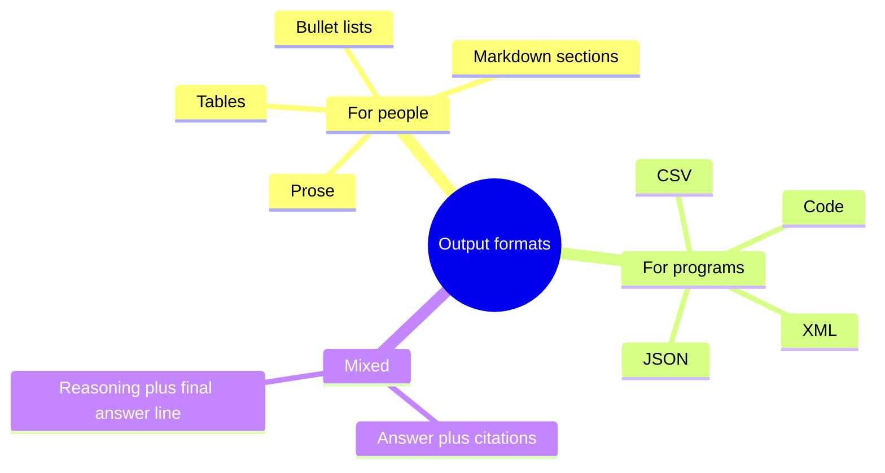

# Output formats

## Summary

A language model can produce many kinds of output: natural language answers, code, tables and lists, summaries, translations, answers to questions, creative writing, edited text and task-specific outputs. Telling the model which format to use, and for machine consumption enforcing it with a schema, is what turns free text into something a person or a program can use directly. Current multimodal models also accept images, audio and files as input, and some generate them.

## Prerequisites

- [Prompt engineering](prompt-engineering.md).

## Core concepts

### Types of output

The textual output types that a model such as ChatGPT handles:

1. **Natural language responses:** human-like answers to prompts and queries.
2. **Code generation:** code snippets in many programming languages from a specification.
3. **Data formatting:** data structured as tables, lists or other organized formats.
4. **Summarization:** concise summaries of longer texts that distill the key information.
5. **Translation:** text translated from one language to another.
6. **Question answering:** answers based on the information in the prompt.
7. **Poetry and creative writing:** poems, stories and other imaginative content.
8. **Text editing and revision:** editing or revising text according to instructions.
9. **Task-specific outputs:** depending on prompt and context, outputs such as image descriptions or recommendations.

A common statement is that such a model handles no non-textual data such as images, audio or video. That was true of the text-only ChatGPT of 2023 and is no longer true in general: multimodal models since then accept images, audio and documents as input, and some generate images or speech. Which modalities are available depends on the model (see [choosing a model](../large-language-models/choosing-a-model.md)).

### Output templates

An *output template* is a skeleton of the desired output given in the prompt, which the model fills in. The diagram groups formats by who consumes the output.



For outputs read by programs there are three levels of reliability:

| Level | Mechanism | Guarantee |
| --- | --- | --- |
| Instruction | "Return JSON with keys name and date." | None. The model usually complies, sometimes adds prose or invalid syntax. |
| JSON mode | An API option that forces syntactically valid JSON. | Valid JSON, but not the expected keys or types. |
| Structured output (schema) | The API constrains decoding to a JSON Schema supplied with the request. | Output matches the schema. Values can still be wrong. |

*Constrained decoding* works by masking, at each step, every token that would make the output violate the schema or grammar, so the model can only sample valid continuations.

## Worked example

A prompt with an output template for a meeting summary:

```text
Summarize the meeting transcript below using exactly this template:

## Decisions
- <decision> (owner: <name>)

## Open questions
- <question>

## Next meeting
<date or "not set">

Transcript:
"""
{transcript}
"""
```

For a program that stores action items, the same request would use a JSON Schema with structured output:

```json
{
  "type": "object",
  "properties": {
    "decisions": {
      "type": "array",
      "items": {
        "type": "object",
        "properties": { "decision": { "type": "string" }, "owner": { "type": "string" } },
        "required": ["decision", "owner"],
        "additionalProperties": false
      }
    },
    "next_meeting": { "type": ["string", "null"], "description": "ISO 8601 date or null" }
  },
  "required": ["decisions", "next_meeting"],
  "additionalProperties": false
}
```

The schema guarantees a parsable object with these keys. It does not guarantee that each owner was really named in the meeting, so a check against the transcript is still needed for critical data.

## Trade offs and when to use it

- Templates for people improve scannability and consistency. Keep them light, because rigid templates can force content into sections where it does not belong.
- Structured output is the right default whenever code consumes the result. It costs some flexibility and is supported only by some models and APIs.
- Very strict formats can lower answer quality on reasoning tasks. A common pattern is to let the model reason in free text and put the structured result at the end, or to use two calls.

## Common mistakes

- **Parsing free text with regular expressions.** Fix: use structured output or JSON mode with validation.
- **Trusting schema-valid output as correct.** Fix: validate values (ranges, references, existence) in code.
- **Leaving the "missing value" case undefined.** Fix: state what to output when information is absent, for example `null`.

## Practice

1. Which of instruction, JSON mode and structured output guarantees the presence of a required key?
2. Why might a strict JSON format reduce the accuracy of a math answer?
3. Design an output template for a code review comment.

Answers:

1. Only structured output with a schema that marks the key as required.
2. The model has less room to reason step by step before committing to the answer, unless reasoning is allowed before or outside the JSON.
3. For example: "Severity: <low|medium|high>. Location: <file:line>. Problem: <one sentence>. Suggested fix: <code or one sentence>."

## Further reading

- OpenAI (2024). [*Introducing Structured Outputs in the API*](https://openai.com/index/introducing-structured-outputs-in-the-api/). OpenAI. Describes schema-constrained decoding in a production API.
- Willard, B. and Louf, R. (2023). [*Efficient Guided Generation for Large Language Models*](https://arxiv.org/abs/2307.09702). arXiv. The method behind grammar and schema constrained decoding in the Outlines library.
- JSON Schema (2022). [*JSON Schema specification, draft 2020-12*](https://json-schema.org/specification). The schema language used by structured output features.

TODO: check the content of this note against the sources above and record what was verified and when.
