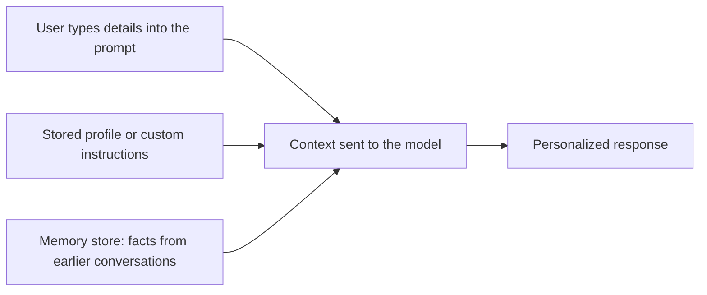

# Personalization

## Summary

Personalizing the output of a chat model means giving it specific information about the user's preferences, situation, experience or style, so that the answer fits that person instead of an average reader. The model knows about the user only what is in its context, either typed into the prompt or inserted by the application from stored preferences or memory. Personalization improves relevance, but every personal detail sent to a model is data that must be handled under privacy rules.

## Prerequisites

- [Prompt engineering](prompt-engineering.md).
- [Multi-turn conversation context](multi-turn-conversation-context.md) for how context reaches the model.

## Core concepts

### Definition

Personalization guides the output with specific information, context or examples that reflect individual preferences, experiences or style. Until 2024 ChatGPT had no memory feature and could not recall personal data about users, so all personalization had to come from the prompt. Since 2024 several assistants offer optional memory features that store facts about the user and insert them into later prompts. Mechanically this is still the same thing: information placed in the context by the application. A model's weights do not learn about individual users from conversations.

### Techniques

Five techniques, each with an example prompt:

**Provide context.** Start the prompt by introducing the setting: preferences, experiences or other personal details relevant to the request.

```text
"As someone who loves hiking, tell me about the best trails in the Pacific Northwest. Include scenic spots and any hidden gems you recommend."
```

**Use personal pronouns.** Phrasing with "I", "my" or "me" guides the model to answer from the user's perspective or situation.

```text
"If I were planning a vacation to Paris, what are some off-the-beaten-path attractions I should consider visiting? Provide local insights and recommendations."
```

**Reference previous interactions.** Refer back to earlier statements to keep continuity. This works only if those statements are in the current context, either earlier in the same conversation or inserted by a memory feature.

```text
User: "In our last conversation, we discussed favorite book genres. Now, as someone who enjoys science fiction, recommend a recent release that you think I would love."
```

**Specify preferences or details.** State the criteria the answer must meet.

```text
"As a fitness enthusiast with a preference for at-home workouts, suggest a 30-minute exercise routine that combines cardio and strength training. Include variations for different fitness levels."
```

**Provide examples or templates.** Show the type of output wanted, so the model understands the structure or style the user prefers.

```text
"Generate a short poem in the style of [favorite poet]. Use themes of [specific topic or emotion] and make it resonate with a personal touch."
```

Experimentation and refining prompts based on the results are essential for reaching the desired level of personalization.

### Where personal context comes from

The flowchart shows the three sources that can put personal information into a request.



## Worked example

A generic prompt and a personalized one for the same need:

- Generic: "Suggest a workout plan."
- Personalized: "I am 45, recovering from a knee injury (cleared by my physiotherapist for low-impact exercise), have 30 minutes on weekdays, and only own resistance bands. Suggest a 4-week plan that progresses gradually. Format it as a table with day, exercise, sets and reps."

The personalized prompt supplies the constraints (age, injury, time, equipment), the goal (gradual progression) and the format. A model cannot infer any of these, and without them it will produce a plan that is likely unsuitable, for example with jumping exercises.

## Trade offs and when to use it

- More personal context gives more relevant answers, but also sends more personal data to the model provider. Share only what the task needs, and check the provider's data retention and training terms.
- Memory features save retyping but can surface outdated or wrong facts in later answers. Users should be able to see and delete what is stored.
- For products, personalization based on stored profiles must follow data protection law, such as the EU General Data Protection Regulation (GDPR), including purpose limitation and the right to erasure.

## Common mistakes

- **Expecting the model to know you.** Fix: put the relevant details into the prompt or a stored profile.
- **Oversharing sensitive data.** Health, financial or identity details are rarely necessary in full. Fix: generalize ("a knee injury" instead of medical records) and avoid identifiers.
- **Stale memory.** Fix: review stored memories and custom instructions periodically.

## Practice

1. Where does a chat model get personal information about a user from?
2. Turn "Recommend a book" into a personalized prompt.
3. Why is the instruction "remember that I am vegetarian" different from training the model?

Answers:

1. Only from its context: what the user types, and what the application inserts from profiles, custom instructions or memory stores.
2. For example: "I enjoyed The Martian and Project Hail Mary for their problem solving and humor. Recommend three science fiction novels from the last five years with a similar tone, one sentence each on why."
3. The fact is stored by the application and inserted into future prompts. The model's weights do not change.

## Further reading

- OpenAI (2024). [*Memory and new controls for ChatGPT*](https://openai.com/index/memory-and-new-controls-for-chatgpt/). OpenAI. Describes a product memory feature and its user controls.
- European Union (2016). [*General Data Protection Regulation (Regulation (EU) 2016/679)*](https://eur-lex.europa.eu/eli/reg/2016/679/oj). The legal framework for processing personal data in the EU.

TODO: check the content of this note against the sources above and record what was verified and when.
