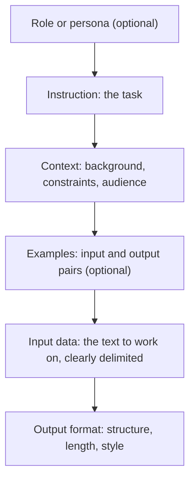
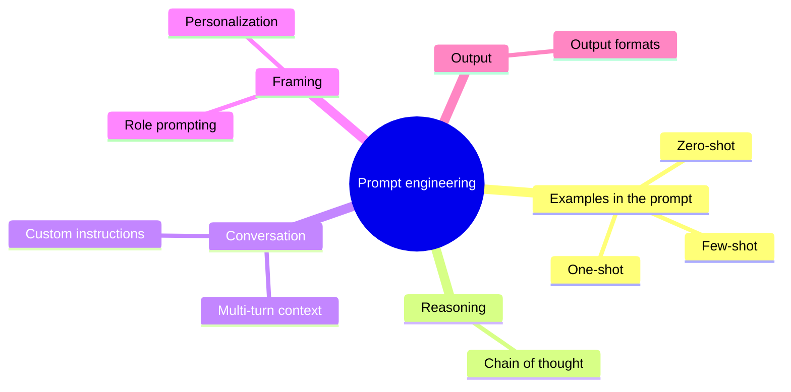
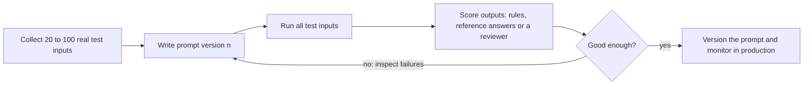

# Prompt engineering

## Summary

Prompt engineering is the practice of designing the input text (the prompt) of a language model so that it produces the desired output reliably. A prompt states the task, gives the context and the input data, may include examples, and specifies the output format. Because it changes no model weights, it is the cheapest way to adapt a model, but its results must be measured on test cases, since small wording changes can change outputs.

## Prerequisites

- [Generative AI](../fundamentals/generative-ai.md) for how a model generates text from a prompt.
- [Sampling parameters](../inference-and-decoding/sampling-parameters.md) for the settings that work alongside the prompt.

## Core concepts

### Definition

Prompt engineering is a technique for steering the behavior of language models such as ChatGPT by giving specific instructions or examples in the prompt. The model's parameters stay unchanged: the prompt only conditions the probability distribution from which the output is sampled. Prompt engineering is therefore distinct from *fine-tuning*, which changes the weights.

### Anatomy of a prompt

Most effective prompts are built from the same parts, in roughly this order. The diagram shows the parts and which ones are optional.



Chat models receive the prompt as a list of messages with roles. The **system** message (also called developer message) holds stable instructions such as role, rules and format. The **user** messages hold the request and data. **Assistant** messages hold earlier model answers. See [custom instructions](custom-instructions.md) for stable instructions and [multi-turn conversation context](multi-turn-conversation-context.md) for the conversation history.

### Key principles

Ten points about prompt engineering, in particular for ChatGPT:

1. **Input prompts.** Prompt engineering means carefully crafting the input to elicit the desired response. Experiment with wording, phrasing and structure to guide the model toward specific outputs.
2. **Example-based guidance.** Explicit examples in the prompt help the model understand the desired output format or content. Examples demonstrate the expected behavior and set the tone (see [zero-shot and few-shot prompting](zero-shot-and-few-shot-prompting.md)).
3. **Clarification and iteration.** Prompts often need several rounds of clarification to reach the desired specificity. Gradual refinement makes the interaction more targeted.
4. **Control tokens and task prefixes.** Some techniques use special keywords that influence the model's behavior. A task prefix such as "Translate the following English text to French: " tells the model which task to perform. (Strictly, *control tokens* are special tokens of a model's vocabulary, such as the markers that separate chat roles, while a plain text prefix like this is a *task prefix*, a convention used to train models such as T5.)
5. **Temperature and max tokens.** Adjusting temperature and the maximum number of tokens influences the randomness and length of responses. Lower temperatures give more deterministic outputs, and higher temperatures more randomness (see [sampling parameters](../inference-and-decoding/sampling-parameters.md)).
6. **Prompt safety.** Prompts should not lead to biased or harmful outputs, and should not reinforce undesirable behavior. Prompts that include untrusted text must also be designed against [prompt injection](../../ai-security/prompt-attacks/prompt-injection.md).
7. **Experimentation.** Finding the most effective prompt for a task is an empirical process: iterate and observe how the model responds.
8. **Task-specific prompts.** Tailoring prompts to the specific task and context improves performance. Explicit task instructions make relevant and accurate responses more likely.
9. **Monitoring and evaluation.** Continuously monitor and evaluate outputs to make sure the prompts meet the goals, and adjust them when requirements change or problems appear.
10. **Ethical considerations.** Avoid language that promotes harm, discrimination or bias. Ethical prompt engineering contributes to responsible AI use.

### Basic prompts

The simplest prompts state one task directly. Five basic patterns:

1. **Translation task.** Prompt: "Translate the following English text to French: 'Hello, how are you?'"
2. **Question answering.** Prompt: "Can you provide a brief summary of the main points in the following passage about climate change?"
3. **Control of the output through the task statement.** Prompt: "Generate a poem with the title 'Moonlight Serenade.'"
4. **Clarification in the prompt.** Prompt: "In the context of the story, who is the mysterious character referred to as 'The Wanderer'?" The phrase "in the context of the story" tells the model where to look for the answer.
5. **Experimentation with phrasing.** Prompt 1: "Summarize the key findings of the research paper." Prompt 2: "Give me a concise overview of the main discoveries in the academic article." The two ask for the same thing in different words, and comparing their outputs shows how sensitive the model is to wording.

### Techniques in this section

The mind map shows the techniques covered by the notes of this section.



### The iteration loop

Prompt engineering is closer to software development than to writing: a prompt is a program in natural language, and like a program it needs tests. The loop below is the reliable way to improve a prompt.



## Worked example

Task: extract the order number and the problem from customer emails.

**Version 1:** "Get the order number and problem from this email: {email}"

Failure: the answers come back as prose ("The order number seems to be 4471 and the customer is unhappy because...") in a different shape each time, and one email that mentions two orders produces a guess.

**Version 2:**

```text
You extract data from customer support emails.

Return JSON with exactly these keys:
- "order_number": the order number as a string, or null if none is given
- "problem": one sentence describing the customer's problem

If the email mentions several orders, use the one the problem refers to.
Do not add any text outside the JSON.

Email:
"""
{email}
"""
```

What changed and why:

- a role and a precise instruction replace the vague verb "get",
- the output format is specified, including what to do when data is missing,
- an ambiguous case found in testing is handled explicitly,
- the email is delimited with triple quotes, so the model can tell instructions from data.

Version 2 is then run on the full test set. The failures that remain are the input for version 3, for example adding one example of a tricky email (few-shot) or using the API's structured output feature to enforce the JSON schema.

## Trade offs and when to use it

- **Prompting** is fast and cheap and needs no training data, but long prompts add cost and latency on every call, and results can shift when the model version changes.
- **Retrieval-augmented generation** is better when the model lacks knowledge (see [retrieval-augmented generation](../retrieval-augmented-generation/retrieval-augmented-generation.md)).
- **Fine-tuning** is better when a consistent style or format must be learned from many examples, or when a long prompt should be replaced by learned behavior.
- Many published "prompt tricks" were found on one model and do not transfer. Treat them as hypotheses to test, not as rules.

## Common mistakes

- **Vague instructions.** "Make it better" leaves the model to guess. Fix: state the goal, the audience, the length and the format.
- **Mixing instructions and data.** Untrusted data can then override instructions. Fix: delimit data clearly and keep instructions in the system message.
- **Evaluating on one example.** Fix: keep a test set and compare versions on all of it.
- **Asking for several unrelated tasks in one prompt.** Fix: split the work into a chain of focused prompts.
- **Negative-only instructions.** "Don't be verbose" is weaker than "Answer in at most three sentences." Fix: say what to do.

## Practice

1. Name the parts of a well structured prompt.
2. Why is delimiting the input data with quotes or tags useful?
3. When should you stop improving a prompt and fine-tune instead?

Answers:

1. Role (optional), instruction, context, examples (optional), delimited input data and output format.
2. It separates the data from the instructions, which reduces misinterpretation and makes prompt injection harder (though not impossible).
3. When the prompt has become very long or examples-heavy, results stay inconsistent across a large test set, and enough labeled examples exist to train on.

## Further reading

- Schulhoff, S. et al. (2024). [*The Prompt Report: A Systematic Survey of Prompting Techniques*](https://arxiv.org/abs/2406.06608). arXiv. A taxonomy of 58 text prompting techniques with definitions.
- OpenAI (2025). [*Prompt engineering*](https://platform.openai.com/docs/guides/prompt-engineering). OpenAI platform documentation. Vendor guidance on instructions, examples and formats.
- Anthropic (2025). [*Prompt engineering overview*](https://docs.anthropic.com/en/docs/build-with-claude/prompt-engineering/overview). Anthropic documentation. Vendor guidance including delimiting with XML tags and evaluation first workflows.
- Raffel, C. et al. (2020). [*Exploring the Limits of Transfer Learning with a Unified Text-to-Text Transformer*](https://arxiv.org/abs/1910.10683). JMLR 21. The origin of task prefixes such as "translate English to French:".

TODO: check the content of this note against the sources above and record what was verified and when.
