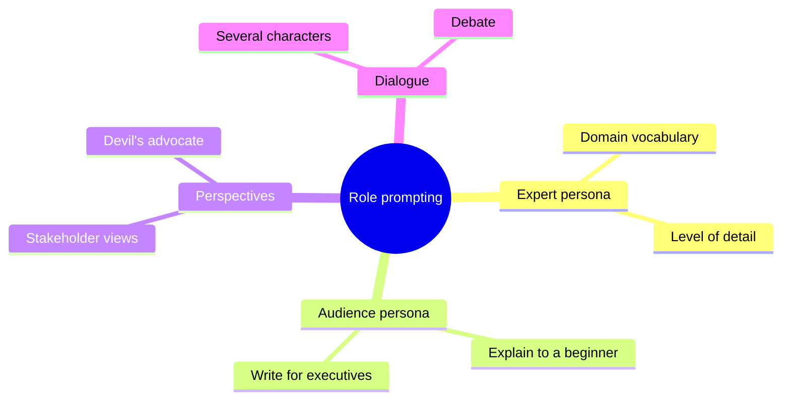

# Role prompting

## Summary

Role prompting assigns the model a role, persona or point of view, such as "a senior tax advisor", "a skeptical reviewer" or two characters in a dialogue, so that its answers take that perspective, vocabulary and level of detail. Clear role definitions, contextual instructions for each part of the conversation and iterative feedback are the three levers. Roles shape style and focus, but they do not give the model knowledge or authority it does not have.

## Prerequisites

- [Prompt engineering](prompt-engineering.md).

## Core concepts

### Definition

Handling roles and perspectives in a chat model means giving clear instructions or context that guide the model's responses according to a role or point of view. This tailors the generated content to specific perspectives or characters in a conversation. In chat APIs the role usually goes into the system message, so it applies to the whole conversation.

### The three levers

- **Role definition.** Clearly define the roles or perspectives the model should adopt: characters, personas or viewpoints.
- **Contextual instructions.** Specify within the prompt which role or perspective applies to each part of the conversation, so the model knows how to frame each response.
- **Iterative feedback.** If the first responses do not match the intended roles or perspectives, refine the instructions or examples in the following prompts.

### Kinds of roles

The mind map groups the common uses of roles.



What the evidence says: roles reliably change tone, vocabulary and focus. Whether an "expert" persona improves factual accuracy is debated: systematic studies on recent models found no consistent accuracy gain from adding personas to factual questions (Zheng et al., 2024). Use roles for perspective and style, and use context and examples for correctness.

## Worked example

**A dialogue with two perspectives.** Prompt:

```text
"Imagine a dialogue between two characters, Alex and Taylor. Alex is an environmentalist, and Taylor is a skeptic. Have them discuss the impact of renewable energy on the environment. Begin the conversation with each character expressing their initial thoughts."
```

Response:

```text
Alex: "I strongly believe that renewable energy is the key to a sustainable future. Wind and solar power reduce our reliance on fossil fuels, decreasing carbon emissions and mitigating climate change."

Taylor: "I'm not convinced. The costs associated with renewable energy implementation are too high, and the environmental benefits are overstated. We need to focus on other solutions."
```

**One problem, two perspectives.** A second example, from a ChatGPT session:

```text
I'll give you an issue I have and you have to find the solution following a specific
perspective that I'll also give you.

Issue: Potential clients are expressing frustration over the complexity of the initial
consultation process

Perspective #1: Service provider Perspective #2: Potential client
```

Asking for the same problem from the provider's and the client's side surfaces solutions that one viewpoint misses: the provider may propose internal process changes, while the client view points to a shorter intake form or a clearer explanation of the steps. A stronger version of this prompt asks for the answer in two labeled sections and ends with "List where the two perspectives conflict", which turns two monologues into an analysis.

## Trade offs and when to use it

- **Useful for:** adjusting tone and depth to an audience, generating opposing arguments, stakeholder analysis, role play for training (interview practice, negotiation), and consistent personas in products.
- **Not a substitute for knowledge:** "You are a doctor" does not add medical knowledge, and it can make wrong answers sound more authoritative.
- **Safety:** role play is a common path to [jailbreaking](../../ai-security/prompt-attacks/jailbreaking.md), because "pretend you are..." framings can lead a model past its rules. Applications that let users define personas must keep their safety rules outside the persona.

## Common mistakes

- **Vague roles.** "Act as an expert" says little. Fix: state the domain, the audience, the goal and the constraints, for example "an accountant explaining VAT registration to a first-time founder in under 200 words".
- **Roles that conflict with instructions.** A "witty comedian" role and a "formal legal summary" format pull in different directions. Fix: keep role and output requirements consistent.
- **Trusting the persona's confidence.** Fix: verify facts independently of the role.

## Practice

1. Rewrite "Act as a marketing expert and review my landing page" into a precise role prompt.
2. Why should safety rules not live inside a user-defined persona?
3. What does asking for two perspectives add compared to one?

Answers:

1. For example: "You are a conversion rate specialist for B2B SaaS. Review the landing page text below for a CFO audience. List the three changes most likely to increase demo requests, each with a one sentence reason."
2. A user can redefine or override the persona, and the rules would go with it. Rules belong in the system level instructions and in checks outside the model.
3. It surfaces trade offs and conflicts between stakeholders, which a single viewpoint hides.

## Further reading

- Zheng, M. et al. (2024). [*Is "A Helpful Assistant" the Best Role for Large Language Models? A Systematic Evaluation of Social Roles in System Prompts*](https://arxiv.org/abs/2311.10054). Findings of EMNLP 2024. Finds no consistent accuracy gain from personas on factual questions.
- Anthropic (2025). [*Giving Claude a role with a system prompt*](https://docs.anthropic.com/en/docs/build-with-claude/prompt-engineering/system-prompts). Anthropic documentation. Vendor guidance on role prompting through the system message.

TODO: check the content of this note against the sources above and record what was verified and when.
