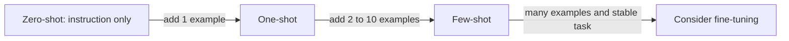

# Zero-shot and few-shot prompting

## Summary

Zero-shot, one-shot and few-shot prompting differ in how many worked examples the prompt contains: none, one or several. A zero-shot prompt relies only on the instruction and the model's pretrained knowledge, while one-shot and few-shot prompts show the model input and output pairs so it can copy the pattern, format and style. The model learns from the examples only for the duration of the request (*in-context learning*): its weights do not change.

## Prerequisites

- [Prompt engineering](prompt-engineering.md) for the parts of a prompt.

## Core concepts

### Definitions

Zero-shot and one-shot prompts are ways of interacting with language models such as ChatGPT, defined by the number of examples provided to the model.

- **Zero-shot prompt:** the user gives a query or instruction without any examples. The model is expected to perform the task from the information in the prompt alone, relying on its pretrained knowledge and general language understanding. Example: "Explain the concept of dark matter in astrophysics."
- **One-shot prompt:** the prompt includes a single example or instance of the task in addition to the instruction. The example guides the model by illustrating the desired type of response or behavior, which is useful when the user wants a specific context or style.
- **Few-shot prompt:** the prompt includes a small number of examples, typically two to ten, in addition to the instruction. The examples show the desired behavior or style in more than one variant.

"Translate the following sentence into Spanish: 'Hello, how are you?'" is often given as a one-shot example. Strictly, that prompt has no example in it and is zero-shot. A one-shot version adds one solved instance before the real input:

```text
Translate English to Spanish.
English: Good morning, see you later.
Spanish: Buenos días, hasta luego.
English: Hello, how are you?
Spanish:
```

### Why examples work: in-context learning

Brown et al. (2020) showed with GPT-3 that a large language model can perform a new task from a few demonstrations in its prompt, without any gradient update. The examples change what the model predicts next, because continuing a pattern of input and output pairs is exactly the kind of text the model was trained to predict. Research since then found that the format and the label space shown in the examples matter a lot, sometimes more than whether each example's label is correct (Min et al., 2022).

### Key points about few-shot prompts

1. **Multiple examples.** Unlike one-shot prompts with a single example, few-shot prompts offer several, which helps the model recognize the pattern and context.
2. **Richer context.** Diverse examples help the model generalize the intended behavior and adapt to different styles or tasks.
3. **Task customization.** Few-shot prompts customize the model's behavior for a specific task without training. The model is not fine-tuned: the customization lasts for that request only.
4. **Contextual understanding.** The examples give a more nuanced picture of the desired outcome, which helps when responses must follow specific patterns or themes.

The diagram shows how the three variants trade prompt length for guidance.



## Worked example

A few-shot prompt for text summarization as it is often written:

```text
Prompt: "Summarize the following article about renewable energy. Provide a concise summary with key points."
Example 1: "Article: Exploring Solar Power Advancements"
Example 2: "Article: Innovations in Wind Energy"
Example 3: "Article: The Role of Hydropower in Sustainable Energy"
```

The intent was that the model learns from related examples to produce a summary with key points. As written, though, the "examples" are only article titles: they show no article text and no summary, so they demonstrate neither the input nor the expected output. A working few-shot prompt pairs each input with the output it should produce:

```text
Summarize each article in two bullet points of at most 15 words.

Article: "Perovskite solar cells reached 26 % efficiency in laboratory tests, but they
degrade within months outdoors, which blocks commercial use."
Summary:
- Perovskite cells hit 26 % efficiency in the lab.
- Fast outdoor degradation still prevents commercial use.

Article: "Offshore wind farms in the North Sea produced a record 30 TWh last year, helped
by larger 15 MW turbines and new grid connections."
Summary:
- North Sea offshore wind produced a record 30 TWh.
- Larger 15 MW turbines and new grid links drove growth.

Article: "{new article text}"
Summary:
```

The two pairs fix the format (two bullets), the length (at most 15 words) and the style (facts with numbers) far more precisely than the instruction alone. The numbers in the example articles are invented for illustration.

In summary, zero-shot prompts rely only on the information in the prompt and the model's general knowledge. One-shot prompts add a single example to guide understanding and produce more contextually relevant responses. Few-shot prompts offer a balance between the minimal guidance of zero-shot prompts and the narrow guidance of a single example, giving the user more control over the responses.

## Trade offs and when to use it

| Variant | Use when | Cost |
| --- | --- | --- |
| Zero-shot | The task is common and well described by an instruction (translation, summarization). | Shortest prompt. |
| One-shot | The output format or style is unusual and one example shows it. | Small. Risk that the model copies the single example too closely. |
| Few-shot | The task has a specific pattern, edge cases or label set. | Every example adds tokens to every call. |
| Fine-tuning instead | Many examples exist and the task is stable and high volume. | Training effort, but shorter prompts afterwards. |

Modern instruction-tuned models handle many tasks well zero-shot, so few-shot examples are most valuable for format, style and edge cases rather than for explaining the task.

## Common mistakes

- **Examples that are not demonstrations.** Titles or descriptions of examples teach nothing. Fix: show complete input and output pairs in the exact format wanted.
- **Unbalanced examples.** If three of four classification examples are "positive", the model leans positive. Fix: balance labels and vary the examples.
- **Examples that leak into outputs.** The model copies names or numbers from the examples. Fix: use clearly different content in examples and real inputs, and test for copying.
- **Order effects.** The last example has extra influence. Fix: vary the order during testing and keep the most typical case last.

## Practice

1. Rewrite "Classify the sentiment of this review: {review}" as a few-shot prompt with three examples.
2. Why does few-shot prompting not count as fine-tuning?
3. A model ignores your output format in zero-shot mode. What do you try first?

Answers:

1. Add three labeled reviews in the form `Review: ... Sentiment: positive|negative|neutral`, one per label, then `Review: {review} Sentiment:`.
2. The model's weights do not change. The examples influence only the current request and must be sent again with every request.
3. Add one or two examples that show the exact format (one-shot or few-shot), or use the API's structured output feature.

## Further reading

- Brown, T. et al. (2020). [*Language Models are Few-Shot Learners*](https://arxiv.org/abs/2005.14165). NeurIPS 2020. Defines zero-, one- and few-shot evaluation and demonstrates in-context learning.
- Min, S. et al. (2022). [*Rethinking the Role of Demonstrations: What Makes In-Context Learning Work?*](https://arxiv.org/abs/2202.12837). EMNLP 2022. Shows that format and label space matter more than label correctness.
- Zhao, Z. et al. (2021). [*Calibrate Before Use: Improving Few-Shot Performance of Language Models*](https://arxiv.org/abs/2102.09690). ICML 2021. Documents majority label and recency biases in few-shot prompts.

TODO: check the content of this note against the sources above and record what was verified and when.
