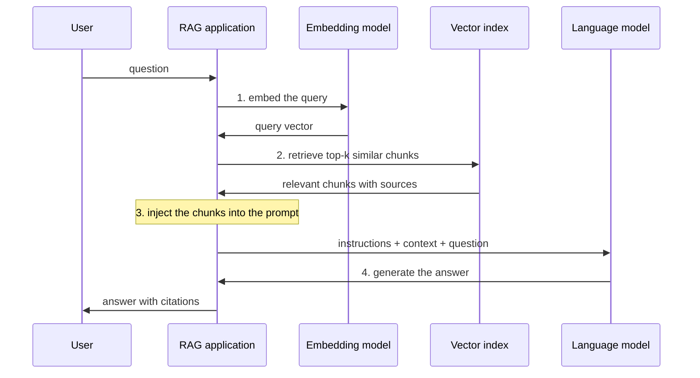

# Retrieval-augmented generation

## Summary

Retrieval-augmented generation (RAG) answers a question by first retrieving relevant documents from an external knowledge source and then giving them to a language model as context for its answer. It addresses the main knowledge limits of a model: its parameters are frozen at a training cutoff and contain no private company data. The standard flow is to embed the query, retrieve the most similar documents, inject them into the prompt and generate the answer. RAG reduces hallucinations and enables answers from enterprise knowledge, but the answer can only be as good as what retrieval finds.

## Prerequisites

- [Generative AI](../fundamentals/generative-ai.md) for how a language model generates text.
- [Prompt engineering](../prompt-engineering/prompt-engineering.md) for building the final prompt.

## Core concepts

### Why RAG exists

- **Language models are static.** Their knowledge ends at a training cutoff, and they know nothing of private documents.
- **Applications need dynamic, up-to-date knowledge:** current prices, today's incidents, internal policies.
- **Retraining is slow and expensive**, and fine-tuning is unreliable for adding facts. Putting the facts into the prompt at request time is cheap and immediate.

RAG is critical for production agents, which must act on current state rather than on what the model memorized. The term comes from Lewis et al. (2020), who combined a neural retriever with a sequence generator.

*Analogy.* An open book exam: instead of answering from memory, the student first looks up the relevant pages, then writes the answer with the pages open. The analogy breaks in two ways: the "student" may ignore the pages and answer from memory anyway, and if the index points to the wrong pages, the answer will confidently cite irrelevant material.

### The flow

RAG has an offline indexing path and an online query path. The sequence diagram shows the online path in four numbered steps.



1. **Query embedding:** an embedding model turns the question into a vector, a list of numbers that represents its meaning, so that texts with similar meaning get nearby vectors.
2. **Retrieve relevant documents:** the vector index returns the chunks whose vectors are most similar to the query vector, usually by cosine similarity.
3. **Inject into the prompt:** the retrieved chunks are placed into the prompt with an instruction to answer from them.
4. **Generate the answer:** the model writes an answer grounded in the provided context, ideally citing which chunk supports each claim.

The offline indexing path prepares the knowledge: load documents, split them into *chunks* (for example 200 to 800 tokens with some overlap), embed every chunk and store the vectors with the text and metadata in a vector database (see [agent memory](../../agents-and-cognitive-systems/llm-agents/agent-memory.md) for vector databases such as Pinecone, Weaviate, Chroma and Milvus).

### Benefits

- **Reduces hallucinations:** the model has the facts in front of it instead of reconstructing them.
- **Improves accuracy** on questions about specific, current or rare information.
- **Enables enterprise knowledge integration:** private documents are used without training a model on them, and access control can be applied at retrieval time.
- **Traceability:** answers can cite their sources, so users can check them.
- **Freshness:** updating the index updates the answers, with no retraining.

### Improving retrieval

Most RAG failures are retrieval failures. Common techniques, roughly in the order they are usually added:

| Technique | What it fixes |
| --- | --- |
| Better chunking (by headings, with overlap) | Facts split across chunk boundaries. |
| Hybrid search (vector plus keyword, such as BM25) | Exact terms, codes and names that embeddings match poorly. |
| Reranking with a cross-encoder | The best chunk retrieved but ranked too low. |
| Metadata filters (date, product, permissions) | Outdated or unauthorized documents in the results. |
| Query rewriting | Short or ambiguous user questions. |

## Worked example

A minimal retrieval step over four policy sentences. A bag-of-words vector with crude normalization stands in for a learned embedding model, so the mechanics are visible. Tested with Python 3.10 and NumPy 2.2.6.

```python
import re
import numpy as np

docs = [
    "Refunds are issued within 14 days of receiving the returned item.",
    "Our support line is open Monday to Friday from 9:00 to 17:00 CET.",
    "Premium plan customers get free express shipping on every order.",
    "Returned items must be unused and in the original packaging.",
]
query = "How long does a refund take after I return an item?"

STOP = {"a", "an", "the", "is", "are", "of", "to", "in", "on", "i", "my", "does", "how", "after", "from", "and", "be", "every", "must", "our", "get"}

def tokens(text):
    # crude normalization: lowercase, drop stop words, keep the first 5 letters as a "stem"
    return [w[:5] for w in re.findall(r"[a-z]+", text.lower()) if w not in STOP]

# A bag-of-words embedding stands in for a learned embedding model here.
vocab = sorted({t for d in docs + [query] for t in tokens(d)})
def embed(text):
    v = np.array([tokens(text).count(w) for w in vocab], dtype=float)
    return v / np.linalg.norm(v)

doc_vectors = np.stack([embed(d) for d in docs])     # the "vector index"
scores = doc_vectors @ embed(query)                   # cosine similarity
top = np.argsort(scores)[::-1][:2]
for i in top:
    print(f"score={scores[i]:.3f}  {docs[i]}")

context = "\n".join(f"- {docs[i]}" for i in top)
prompt = (f"Answer using only the context below. If the answer is not there, say so.\n"
          f"Context:\n{context}\n\nQuestion: {query}")
print("---\n" + prompt)
```

Output:

```text
score=0.507  Refunds are issued within 14 days of receiving the returned item.
score=0.200  Returned items must be unused and in the original packaging.
---
Answer using only the context below. If the answer is not there, say so.
Context:
- Refunds are issued within 14 days of receiving the returned item.
- Returned items must be unused and in the original packaging.

Question: How long does a refund take after I return an item?
```

Steps 1 to 3 of the flow are visible: the query is embedded, the two most similar chunks are retrieved, and they are injected into a prompt that also tells the model what to do when the answer is missing. Step 4 would send this prompt to a model, which can now answer "within 14 days of receiving the returned item" from the context. Without the crude stemming, "refund" and "Refunds" would not match and the right chunk would score lower. A learned embedding model handles such variation, synonyms and paraphrases, which is why real systems use one.

## Trade offs and when to use it

- **Use RAG** when answers depend on a body of documents that changes, is private or is too large for the context window, and when citations matter.
- **Use long context instead** when the whole relevant corpus fits comfortably in the window and the volume of requests is low. It is simpler, but costs more per request.
- **Use fine-tuning instead or in addition** to teach a style, format or skill. Fine-tuning is a poor way to add or update facts.
- **Costs:** an indexing pipeline, a vector store, embedding costs, retrieval latency and a new failure mode (bad retrieval) that must be evaluated separately from generation.

## Common mistakes

- **Evaluating only the final answers.** Fix: measure retrieval separately (is the right chunk in the top k?), then generation (is the answer faithful to the chunks?).
- **Chunks without context.** A chunk "It is valid for 30 days" is useless alone. Fix: chunk by structure and prepend titles or section names to each chunk.
- **Ignoring permissions.** Retrieval can surface documents the user may not see. Fix: filter by the user's access rights at retrieval time.
- **Trusting retrieved text blindly.** Retrieved documents can contain malicious instructions (indirect [prompt injection](../../ai-security/prompt-attacks/prompt-injection.md)). Fix: treat retrieved content as data, and limit what the model can do based on it.

## Practice

1. Name the four steps of the RAG query flow.
2. Why does RAG reduce hallucinations but not eliminate them?
3. A RAG system answers questions about product codes such as "XJ-4471" poorly. Which technique would you add first?

Answers:

1. Embed the query, retrieve relevant documents, inject them into the prompt, generate the answer.
2. The model can still ignore or misread the context, and retrieval can return wrong or incomplete chunks.
3. Hybrid search, adding keyword retrieval (such as BM25), because embeddings match exact codes poorly.

## Further reading

- Lewis, P. et al. (2020). [*Retrieval-Augmented Generation for Knowledge-Intensive NLP Tasks*](https://arxiv.org/abs/2005.11401). NeurIPS 2020. The paper that named RAG.
- Gao, Y. et al. (2023). [*Retrieval-Augmented Generation for Large Language Models: A Survey*](https://arxiv.org/abs/2312.10997). arXiv. A survey of naive, advanced and modular RAG designs.
- Es, S. et al. (2023). [*RAGAS: Automated Evaluation of Retrieval Augmented Generation*](https://arxiv.org/abs/2309.15217). arXiv. Metrics for faithfulness, answer relevance and context relevance.
- Robertson, S. and Zaragoza, H. (2009). [*The Probabilistic Relevance Framework: BM25 and Beyond*](https://doi.org/10.1561/1500000019). Foundations and Trends in Information Retrieval 3(4). The keyword ranking function used in hybrid search.

TODO: check the content of this note against the sources above and record what was verified and when.
