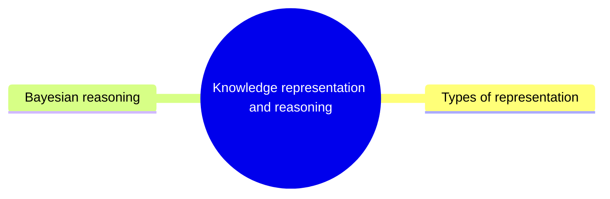

# Knowledge representation and reasoning

How knowledge is represented, symbolically, as learned subsymbolic representations or as graphical models, and how Bayesian reasoning draws conclusions from it under uncertainty.

This knowledge area follows the knowledge unit AI-KRR (Fundamental Knowledge Representation and Reasoning) of the AI knowledge area in [Computer Science Curricula 2023](https://csed.acm.org/) (ACM, IEEE-CS and AAAI). Logic and probabilistic models in depth have their own areas.

## Map

The map shows the sections of this knowledge area.

## Sections

- [Types of representation](types-of-representation/README.md) (planned): Symbolic, subsymbolic and graphical representations of knowledge and their trade offs.
- [Bayesian reasoning](bayesian-reasoning/README.md) (planned): Probability as a representation of belief, and inference with Bayes' rule.

TODO: no notes yet in this knowledge area. Start with the first planned topic of the first section.
