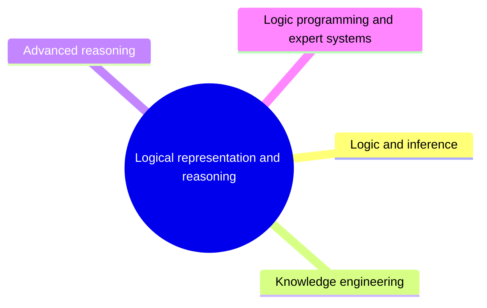

# Logical representation and reasoning

Logic as a language for knowledge: inference and theorem proving, ontologies and the semantic web, non-monotonic and temporal reasoning, logic programming and expert systems.

This knowledge area follows the knowledge unit AI-LRR (Logical Representation and Reasoning) of the AI knowledge area in [Computer Science Curricula 2023](https://csed.acm.org/) (ACM, IEEE-CS and AAAI).

## Map

The map shows the sections of this knowledge area.

## Sections

- [Logic and inference](logic-and-inference/README.md) (planned): Propositional and first-order logic and the algorithms that draw conclusions from them.
- [Knowledge engineering](knowledge-engineering/README.md) (planned): Representing domain knowledge with ontologies, description logics and knowledge graphs.
- [Advanced reasoning](advanced-reasoning/README.md) (planned): Reasoning beyond classical logic: defaults, arguments, action, time and space.
- [Logic programming and expert systems](logic-programming-and-expert-systems/README.md) (planned): Programs written as logic, and systems that encode expert knowledge as rules or cases.

TODO: no notes yet in this knowledge area. Start with the first planned topic of the first section.
