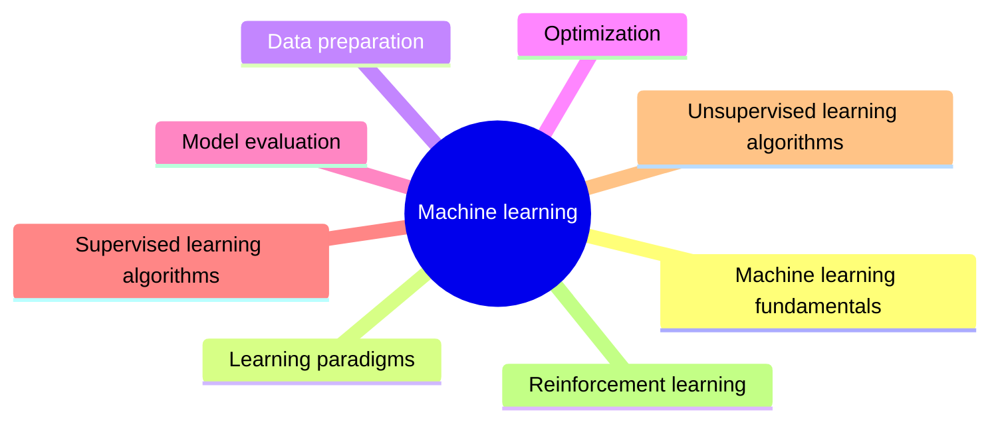

# Machine learning

Learning from data: the learning paradigms, data preparation, optimization, model evaluation and the classical algorithms of supervised, unsupervised and reinforcement learning.

This knowledge area follows the knowledge unit AI-ML (Machine Learning) of the AI knowledge area in [Computer Science Curricula 2023](https://csed.acm.org/) (ACM, IEEE-CS and AAAI). Because of the volume of material, neural networks are in [deep learning](../deep-learning/README.md) and generative models in [generative AI](../generative-ai/README.md), both derived from the same unit.

## Map

The map shows the sections of this knowledge area.

## Sections

- [Machine learning fundamentals](fundamentals/README.md) (3 notes): What machine learning is, its vocabulary, and the central problem of generalization.
- [Learning paradigms](learning-paradigms/README.md) (3 notes): Supervised, unsupervised and reinforcement learning, distinguished by the feedback the learner receives.
- [Data preparation](data-preparation/README.md) (planned): Turning raw data into features a model can learn from.
- [Optimization](optimization/README.md) (2 notes): Training as optimization: loss functions and the gradient based methods that minimize them.
- [Model evaluation](model-evaluation/README.md) (3 notes): Estimating how a model will perform on new data, and the metrics that measure it.
- [Supervised learning algorithms](supervised-learning-algorithms/README.md) (planned): The classical algorithms that learn a mapping from labeled examples.
- [Unsupervised learning algorithms](unsupervised-learning-algorithms/README.md) (planned): Algorithms that find structure in unlabeled data.
- [Reinforcement learning](reinforcement-learning/README.md) (planned): Algorithms for learning to act from rewards.
