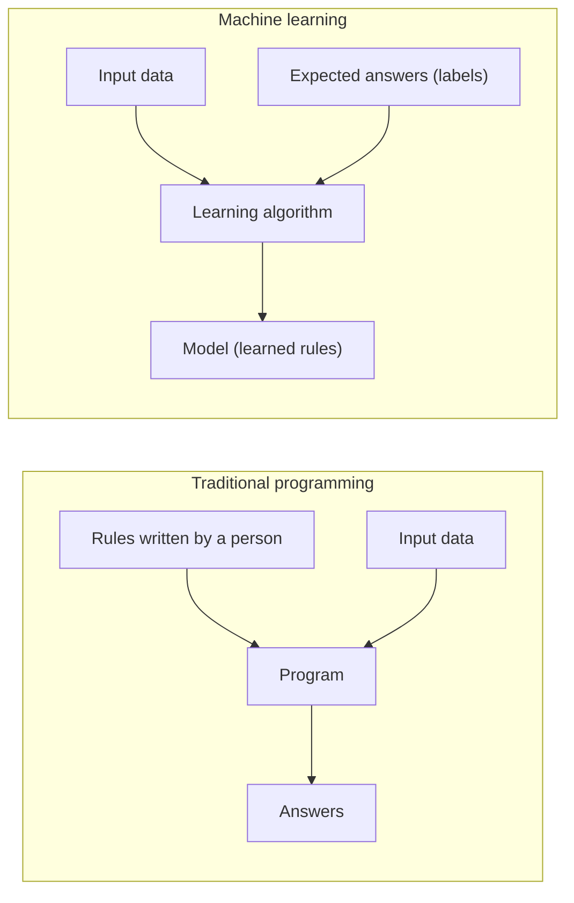
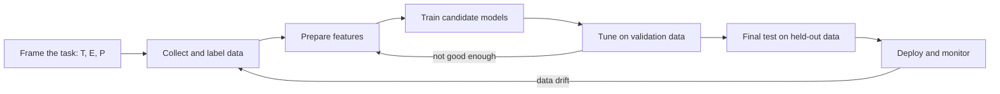

# Machine learning

## Summary

Machine learning (ML) is the branch of artificial intelligence in which computers learn to make decisions or predictions from data instead of being explicitly programmed with rules. A learning algorithm finds patterns in example data and stores them in the parameters of a model, which is then applied to new, unseen inputs. ML is the right tool when the rules of a task are unknown, too many to write down or changing, and when representative data is available.

## Prerequisites

- [Artificial intelligence](../../ai-foundations/what-is-ai/artificial-intelligence.md) for the place of ML inside AI.
- [AI model](../../ai-foundations/what-is-ai/ai-model.md) for the vocabulary of models, parameters and inference.

## Core concepts

### Definition

Machine learning is a branch of AI that enables computers to learn from data and make decisions or predictions without being explicitly programmed. Instead of following strict rules, ML algorithms identify patterns in data and adjust their behavior accordingly.

The classic operational definition is Tom Mitchell's (1997): a program *learns* from experience E with respect to a class of tasks T and a performance measure P if its performance at tasks in T, as measured by P, improves with experience E. The definition forces three questions that every ML project must answer: what is the task, what is the data, and how is success measured.

### Traditional programming and machine learning

The flowchart contrasts the two. In traditional programming a person writes the rules. In ML the rules (the model) are an output of the training algorithm.

### Key characteristics

- **Data driven.** ML models rely on large amounts of data to learn patterns and relationships. The data defines what the model can know.
- **Adaptive.** Unlike fixed algorithms, ML models improve as they are retrained on more data. A deployed model does not adapt by itself unless a retraining or online learning process is built around it.
- **Automation.** Once trained, ML models automate decision making, such as approving low risk transactions.
- **Predictive.** ML makes forecasts based on learned patterns, for example predicting demand or detecting fraud. Forecasts of prices in efficient markets, such as stock prices, are a known hard case: the patterns that exist are weak and disappear once exploited.
- **Generalization.** A good model applies what it learned to new, unseen data. Generalization, not performance on the training data, is the goal of ML.

### Core vocabulary

Each item has its own note. This list is the map.

- [Features and labels](features-and-labels.md): the inputs of a model (age, income, location) and the correct answers it learns to predict (loan approved or not).
- [Training, validation and test data](../model-evaluation/training-validation-and-test-data.md): the separate datasets used to fit a model, tune it and estimate its performance honestly.
- [Overfitting and underfitting](overfitting-and-underfitting.md): learning the noise of the training data versus failing to learn its patterns.
- Evaluation metrics: accuracy, precision, recall and the confusion matrix for [classification](../model-evaluation/classification-metrics.md), and mean squared error for [regression](../model-evaluation/regression-metrics.md).
- [Loss functions](../optimization/loss-functions.md) and [gradient descent](../optimization/gradient-descent.md): how training measures error and reduces it.

### Types of learning

Machine learning is broadly divided into three paradigms by the kind of feedback the learner receives.

| Paradigm | Feedback | Typical tasks | Common algorithms |
| --- | --- | --- | --- |
| [Supervised learning](../learning-paradigms/supervised-learning.md) | A correct output (label) for every training input. | Classification, regression. | Linear regression, logistic regression, decision trees, support vector machines, neural networks. |
| [Unsupervised learning](../learning-paradigms/unsupervised-learning.md) | None. The algorithm finds structure in unlabeled data. | Clustering, dimensionality reduction, anomaly detection. | K-means, DBSCAN, hierarchical clustering, PCA, t-SNE, autoencoders. |
| [Reinforcement learning](../learning-paradigms/reinforcement-learning.md) | A reward or penalty after actions in an environment. | Sequential decision making, control, games. | Q-learning, deep Q-networks, policy gradient methods. |

Further paradigms combine or relax these: *semi-supervised learning* uses a few labels and many unlabeled examples, and *self-supervised learning* creates labels from the data itself, such as predicting the next word of a text. Self-supervision is how large language models are pretrained.

### The machine learning workflow

A project is a loop, not a straight line. The flowchart shows the usual stages and where a project goes back.

### The no free lunch theorem

The no free lunch theorems (Wolpert, 1996) state that, averaged over all possible problems, no learning algorithm outperforms any other. In practice this means that every algorithm encodes assumptions (an *inductive bias*), for example that the target is smooth, linear or hierarchical, and an algorithm works well only on problems that match its assumptions. Choosing a model is choosing assumptions.

## Worked example

A bank wants to flag fraudulent card transactions. Framed with Mitchell's definition:

- **Task T:** classify each transaction as fraud or legitimate within 100 ms.
- **Experience E:** 2 million past transactions with features (amount, merchant category, country, time since the previous transaction) and labels from confirmed chargebacks.
- **Performance P:** recall on fraud at a fixed precision of 0.5, because each false alarm costs a manual review and each missed fraud costs the full amount.

This is supervised classification. The labels are imbalanced (fraud is often well under 1 % of transactions), so accuracy is a useless measure here: a model that never flags fraud would score above 99 %. The [classification metrics](../model-evaluation/classification-metrics.md) note works through this effect with numbers. Fraud patterns also change as fraudsters adapt, so the workflow must include monitoring and retraining.

## Trade offs and when to use it

Use machine learning when:

- the rules are unknown or too many to write by hand (recognizing faces, ranking search results),
- the environment changes and the system must be updated from new data (fraud, spam),
- labeled or at least representative data exists in sufficient quantity.

Do not use machine learning when:

- a correct deterministic rule exists and is cheap to write (tax calculation from a published formula),
- every decision must be fully explainable and guaranteed, and no interpretable model is good enough,
- data is scarce, unrepresentative or cannot legally be used.

The costs are data collection and labeling, compute for training, monitoring for drift, and the risk that the model learns biases present in the data.

## Common mistakes

- **Optimizing training performance.** A model that fits its training data perfectly may fail on new data. Fix: always judge on held-out data (see [overfitting and underfitting](overfitting-and-underfitting.md)).
- **Data leakage.** A feature that contains the answer (for example "chargeback date" when predicting fraud) yields excellent offline scores and a useless model. Fix: use only features that exist at prediction time, and split data by time when the task is a forecast.
- **Skipping the baseline.** Fix: compare every model with a trivial baseline (the majority class, the mean, a simple rule) before celebrating a score.
- **Treating the model as finished at deployment.** Fix: monitor input distributions and performance, and plan retraining.

## Practice

1. Write T, E and P for a model that predicts the delivery time of a parcel.
2. Which paradigm fits each case: grouping news articles by topic without labels, teaching a robot arm to grasp by trial and error, predicting a house price from its features?
3. What does the no free lunch theorem imply for the choice between a decision tree and a neural network?
4. Why is "adaptive" only true for a deployed model if something is built around it?

Answers:

1. T: predict delivery time in hours. E: past parcels with route, distance, carrier, weather and the actual delivery time. P: mean absolute error in hours on recent held-out parcels.
2. Unsupervised (clustering), reinforcement learning, supervised (regression).
3. Neither is better in general. The choice depends on whether the problem matches the assumptions of each, which must be tested on validation data.
4. A trained model's parameters are fixed. It adapts only if a pipeline collects new labeled data and retrains or updates it.

## Further reading

- Mitchell, T. (1997). *Machine Learning*. McGraw-Hill. Chapter 1 gives the E, T, P definition used here.
- Hastie, T., Tibshirani, R. and Friedman, J. (2009). [*The Elements of Statistical Learning, 2nd edition*](https://hastie.su.domains/ElemStatLearn/). Springer. The standard statistical treatment of supervised learning, free online.
- Murphy, K. (2022). [*Probabilistic Machine Learning: An Introduction*](https://probml.github.io/pml-book/book1.html). MIT Press. A modern, probabilistic view of the whole field.
- Wolpert, D. (1996). [*The Lack of A Priori Distinctions Between Learning Algorithms*](https://doi.org/10.1162/neco.1996.8.7.1341). Neural Computation 8(7). The no free lunch theorem for supervised learning.

TODO: check the content of this note against the sources above and record what was verified and when.
