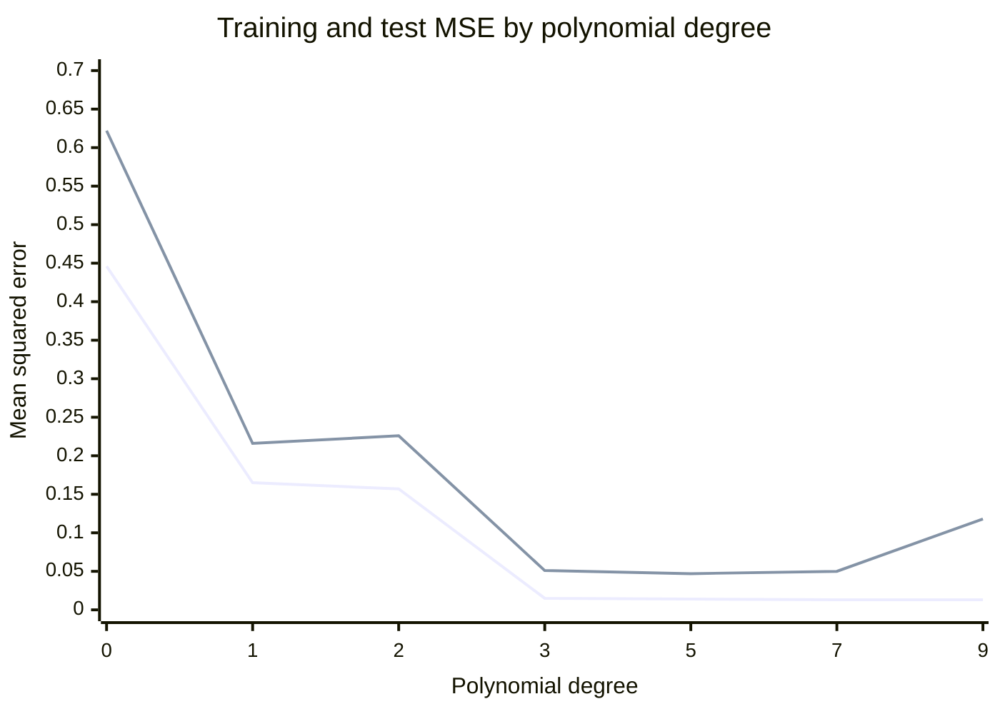

# Overfitting and underfitting

## Summary

*Overfitting* happens when a model learns too much from its training data, including the noise, and performs poorly on new data. *Underfitting* happens when a model is too simple to capture the important patterns, so it performs poorly even on the training data. Both are detected by comparing the error on the training data with the error on held-out data, and both are controlled by matching model capacity to the amount and quality of data.

## Prerequisites

- [Machine learning](machine-learning.md) for the idea of generalization.
- [Training, validation and test data](../model-evaluation/training-validation-and-test-data.md) for held-out evaluation.

## Core concepts

### Definitions

- **Overfitting:** the model learns too much from the training data, including noise, and performs poorly on new data. Symptom: low training error, much higher validation error.
- **Underfitting:** the model is too simplistic and fails to capture important patterns. Symptom: high training error and similar or higher validation error.
- **Generalization gap:** the difference between validation (or test) error and training error. A large gap signals overfitting.
- **Capacity:** the range of functions a model can represent. A degree 9 polynomial has more capacity than a straight line, and a deep network more than a shallow one.

*Analogy.* A student preparing for an exam can memorize the answers to last year's paper word for word (overfitting: perfect on that paper, lost on new questions) or learn only the chapter titles (underfitting: lost on every paper). Understanding the material is the goal. The analogy breaks for very large neural networks, which can memorize their training data and still generalize well, a phenomenon studied as *benign overfitting* and *double descent*.

### The bias and variance trade off

For squared error, the expected error of a learned model on a new point decomposes into three parts:

$$
\mathbb{E}\left[(y - \hat{f}(x))^2\right] = \underbrace{\left(\mathbb{E}[\hat{f}(x)] - f(x)\right)^2}_{\text{bias}^2} + \underbrace{\mathbb{E}\left[\left(\hat{f}(x) - \mathbb{E}[\hat{f}(x)]\right)^2\right]}_{\text{variance}} + \underbrace{\sigma^2}_{\text{irreducible noise}}
$$

- *Bias* is the error from wrong assumptions, such as fitting a line to a curve. High bias causes underfitting.
- *Variance* is the error from sensitivity to the particular training sample. High variance causes overfitting: a different sample of training data would give a very different model.
- *Irreducible noise* is the noise in the labels themselves, which no model can remove.

Increasing capacity lowers bias and raises variance. The best model sits where their sum is smallest.

### Remedies

| Problem | Remedies |
| --- | --- |
| Underfitting (high bias) | More capacity (more features, higher degree, deeper network), better features, less regularization, longer training. |
| Overfitting (high variance) | More training data, data augmentation, regularization (L1, L2, dropout), simpler model, early stopping, ensembles that average models. |

*Regularization* adds a penalty on the size of the parameters to the loss, for example `λ · Σ w²` for L2 regularization, which discourages the extreme weights that fit noise. *Early stopping* ends training when the validation error stops improving.

## Worked example

Fit polynomials of increasing degree to 15 noisy training points from `sin(2πx)` and measure the mean squared error (MSE) on the training points and on 200 new test points. Tested with Python 3.10 and NumPy 2.2.6.

```python
import numpy as np

rng = np.random.default_rng(42)
def make(n):
    x = rng.uniform(0, 1, n)
    return x, np.sin(2 * np.pi * x) + rng.normal(0, 0.2, n)

x_train, y_train = make(15)
x_test, y_test = make(200)
for degree in (0, 1, 2, 3, 5, 7, 9, 11):
    coef = np.polyfit(x_train, y_train, degree)
    train = np.mean((np.polyval(coef, x_train) - y_train) ** 2)
    test = np.mean((np.polyval(coef, x_test) - y_test) ** 2)
    print(f"degree={degree:2d} train_mse={train:.3f} test_mse={test:.3f}")
```

Output:

```text
degree= 0 train_mse=0.446 test_mse=0.622
degree= 1 train_mse=0.165 test_mse=0.216
degree= 2 train_mse=0.157 test_mse=0.226
degree= 3 train_mse=0.015 test_mse=0.051
degree= 5 train_mse=0.014 test_mse=0.047
degree= 7 train_mse=0.013 test_mse=0.050
degree= 9 train_mse=0.013 test_mse=0.118
degree=11 train_mse=0.005 test_mse=104793.426
```

The chart plots the training and test error for degrees 0 to 9 from this output. Degree 11 is left out because its test error of about 100,000 would flatten the other points.



Reading the numbers:

- Degrees 0 to 2 **underfit**: both errors are high, because a constant, a line or a parabola cannot follow a full sine period.
- Degrees 3 to 7 fit well: test error is lowest at degree 5 (0.047), close to the noise variance of 0.04 (standard deviation 0.2).
- Degree 9 starts to **overfit**: training error keeps falling while test error more than doubles.
- Degree 11 overfits catastrophically: with 12 coefficients for 15 points, the polynomial passes close to every training point and swings wildly between and beyond them.

## Trade offs and when to use it

- More data is the most reliable cure for overfitting, but it is often the most expensive.
- Regularization and early stopping add hyperparameters that must themselves be tuned on validation data.
- In deep learning, very large models trained with appropriate regularization often generalize better than smaller ones, so "reduce capacity" is not the default remedy there. Prefer more data, augmentation and regularization first.

## Common mistakes

- **Judging a model by its training error.** Fix: always report validation or test error next to training error.
- **Tuning against the test set.** Repeatedly choosing the model with the best test score overfits the test set itself. Fix: tune on validation data and touch the test set once.
- **Calling every gap overfitting.** A gap can also come from a *distribution shift* between training and test data. Fix: check whether the test data comes from the same distribution.
- **Fixing underfitting with more data.** More data does not help a model that cannot represent the pattern. Fix: add capacity or better features first.

## Practice

1. A model has a training accuracy of 99 % and a validation accuracy of 71 %. Which problem is it, and name two remedies.
2. A model has a training MSE of 40 and a validation MSE of 42, while the target needs an MSE below 10. Which problem is it?
3. Why does the lowest test error in the worked example sit close to 0.04?

Answers:

1. Overfitting. Remedies: more data or augmentation, regularization, a simpler model, early stopping.
2. Underfitting: both errors are high and close together.
3. The labels contain Gaussian noise with standard deviation 0.2, whose variance 0.04 is irreducible.

## Further reading

- Hastie, T., Tibshirani, R. and Friedman, J. (2009). [*The Elements of Statistical Learning, 2nd edition*](https://hastie.su.domains/ElemStatLearn/). Springer. Chapter 7 derives the bias and variance decomposition and model selection.
- Bishop, C. (2006). *Pattern Recognition and Machine Learning*. Springer. Section 1.1 uses the same polynomial curve fitting example.
- Belkin, M., Hsu, D., Ma, S. and Mandal, S. (2019). [*Reconciling modern machine learning practice and the bias-variance trade-off*](https://arxiv.org/abs/1812.11118). PNAS. Introduces double descent, where test error falls again past the interpolation point.

TODO: check the content of this note against the sources above and record what was verified and when.
