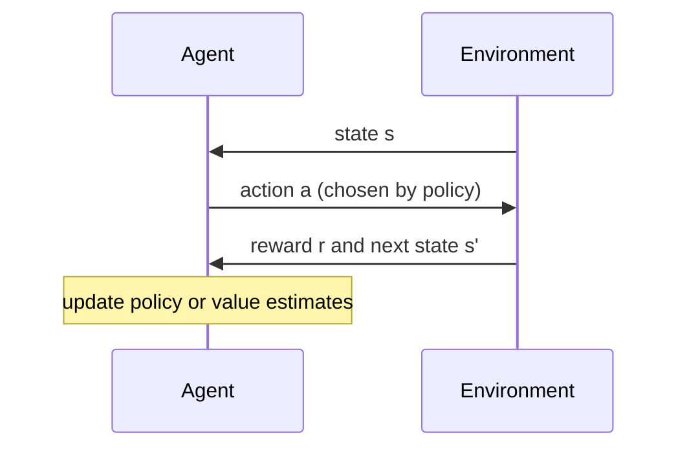

# Reinforcement learning

## Summary

In reinforcement learning (RL) an agent learns by interacting with an environment: it takes actions, receives feedback in the form of rewards or penalties, and adjusts its behavior to maximize the total reward over time. There is no labeled correct action, only a delayed and often sparse signal of how good the outcome was. Game playing (AlphaGo), robot control and the fine-tuning of language models from human feedback are well known applications.

## Prerequisites

- [Machine learning](../fundamentals/machine-learning.md) for the three learning paradigms.
- [AI agent](../../agents-and-cognitive-systems/agent-fundamentals/ai-agent.md) for the agent and environment vocabulary.

## Core concepts

### Definition and vocabulary

The algorithm learns by interacting with an environment and receiving feedback as rewards or penalties, and it tries to maximize the reward accumulated over time. The standard formalization is the *Markov decision process* (MDP):

- **State** `s`: the situation of the environment as the agent observes it.
- **Action** `a`: a choice available to the agent in a state.
- **Transition**: the environment moves to a new state `s'`, possibly at random.
- **Reward** `r`: a number the environment returns after each step.
- **Policy** `π(a | s)`: the agent's rule for choosing actions. Learning a good policy is the goal.
- **Return**: the discounted sum of future rewards `r1 + γ r2 + γ² r3 + ...`, where the *discount factor* γ between 0 and 1 makes near rewards worth more than distant ones.
- **Value function** `Q(s, a)`: the expected return of taking action `a` in state `s` and following the policy afterwards.

The sequence diagram shows one step of the interaction loop, which repeats until the episode ends.



*Analogy.* Training a dog with treats: the dog tries behaviors, gets a treat for some, and repeats those more often. The analogy breaks on *credit assignment*: a chess agent receives its only reward at the end of the game and must work out which of its 40 moves deserved the credit, something no treat schedule asks of a dog.

### Exploration and exploitation

The agent must *exploit* actions known to be good and *explore* untried actions that might be better. Too little exploration locks in a mediocre policy, too much wastes reward. The simplest strategy is *epsilon-greedy*: act at random with probability ε, otherwise take the best known action.

### Families of methods

| Family | Idea | Examples |
| --- | --- | --- |
| Value based | Learn `Q(s, a)` and act greedily with respect to it. | Q-learning, deep Q-networks (DQN). |
| Policy based | Learn the policy directly by following the gradient of expected return. | REINFORCE and other policy gradient methods. |
| Actor-critic | Learn a policy (actor) and a value function (critic) that reduces the variance of the policy update. | A2C, PPO. |
| Model based | Learn or use a model of the environment and plan with it. | AlphaZero (with a known game model), MuZero. |

- **Q-learning** (Watkins, 1989) updates a table of action values with `Q(s,a) ← Q(s,a) + α [r + γ max_a' Q(s',a') - Q(s,a)]`, where α is the learning rate.
- **Deep Q-networks** (Mnih et al., 2015) replace the table by a neural network, which made RL work from raw screen pixels on Atari games.
- **Policy gradient methods** adjust the parameters of a stochastic policy in the direction that increases expected return, and handle continuous actions naturally.

### Examples of use

- **Game AI:** AlphaGo combined policy and value networks with tree search and defeated the Go champion Lee Sedol in 2016.
- **Robotics:** learning locomotion and manipulation, usually in simulation first.
- **Self-driving cars:** learning parts of driving behavior. Deployed systems combine RL with supervised learning and hand engineered safety layers, because exploration on public roads is not acceptable.
- **Language models:** reinforcement learning from human feedback (RLHF) fine-tunes a model with a reward model trained on human preferences.

## Worked example

An agent in a corridor of five cells starts in cell 0 and receives +1 when it reaches cell 4. Every other move costs -0.01. It learns with tabular Q-learning and epsilon-greedy exploration. Tested with Python 3.10 and NumPy 2.2.6.

```python
import numpy as np

# A corridor of 5 cells. The agent starts in cell 0; cell 4 is the goal (+1, episode ends).
# Every other move costs -0.01. Actions: 0 = left, 1 = right.
n_states, goal = 5, 4
Q = np.zeros((n_states, 2))
alpha, gamma, epsilon = 0.5, 0.9, 0.2
rng = np.random.default_rng(0)

def step(s, a):
    s2 = max(0, s - 1) if a == 0 else min(goal, s + 1)
    return s2, (1.0 if s2 == goal else -0.01), s2 == goal

for episode in range(200):
    s, done = 0, False
    while not done:
        # epsilon-greedy: explore with probability epsilon, otherwise exploit
        a = rng.integers(2) if rng.random() < epsilon else int(np.argmax(Q[s]))
        s2, r, done = step(s, a)
        target = r if done else r + gamma * np.max(Q[s2])
        Q[s, a] += alpha * (target - Q[s, a])     # the Q-learning update
        s = s2

print(np.round(Q[:goal], 3))
print("greedy policy:", ["left" if q[0] > q[1] else "right" for q in Q[:goal]])
```

Output (rows are cells 0 to 3, columns are left and right):

```text
[[0.622 0.702]
 [0.622 0.791]
 [0.702 0.89 ]
 [0.791 1.   ]]
greedy policy: ['right', 'right', 'right', 'right']
```

The values can be checked by hand. Moving right from cell 3 reaches the goal: 1.0. From cell 2: -0.01 + 0.9 × 1.0 = 0.89. From cell 1: -0.01 + 0.9 × 0.89 = 0.791. From cell 0: -0.01 + 0.9 × 0.791 = 0.702. The discount factor makes the agent prefer the shortest path, and the learned policy is "always move right".

## Trade offs and when to use it

- Use RL for sequential decisions where actions affect future states and the quality of a decision shows only later, and where a simulator or safe environment allows many trials.
- RL is sample hungry: DQN needed millions of frames per Atari game. Real world trials are expensive or dangerous, so most successes rely on simulation.
- If the correct action for each state is known, supervised learning (imitation learning) is simpler and more stable than RL.
- Designing the reward is hard. An agent maximizes exactly what is rewarded, which may not be what was intended (*reward hacking*).

## Common mistakes

- **Rewarding a proxy.** An agent rewarded for points in a boat racing game learned to circle and collect bonuses instead of finishing the race (a case reported by OpenAI in 2016). Fix: test the reward with adversarial thinking and inspect learned behavior, not only the return.
- **No exploration.** A greedy agent that never explores can stay with the first action that gave any reward. Fix: use epsilon-greedy, entropy bonuses or optimistic initialization.
- **Comparing runs with one seed.** RL results vary strongly between random seeds. Fix: report the mean and spread over several seeds.

## Practice

1. Name the five elements of a Markov decision process.
2. In the worked example, what would the value of moving right from cell 2 be with γ = 0.5?
3. Why is pure exploitation risky early in training?

Answers:

1. States, actions, transition probabilities, rewards and the discount factor.
2. -0.01 + 0.5 × 1.0 = 0.49.
3. Early value estimates are wrong, so the agent may lock in a poor action and never discover better ones.

## Further reading

- Sutton, R. and Barto, A. (2018). [*Reinforcement Learning: An Introduction, 2nd edition*](http://incompleteideas.net/book/the-book-2nd.html). MIT Press. The standard textbook, free online.
- Mnih, V. et al. (2015). [*Human-level control through deep reinforcement learning*](https://doi.org/10.1038/nature14236). Nature 518. The DQN paper.
- Silver, D. et al. (2016). [*Mastering the game of Go with deep neural networks and tree search*](https://doi.org/10.1038/nature16961). Nature 529. The AlphaGo paper.
- Williams, R. (1992). [*Simple statistical gradient-following algorithms for connectionist reinforcement learning*](https://doi.org/10.1007/BF00992696). Machine Learning 8. The REINFORCE policy gradient algorithm.

TODO: check the content of this note against the sources above and record what was verified and when.
