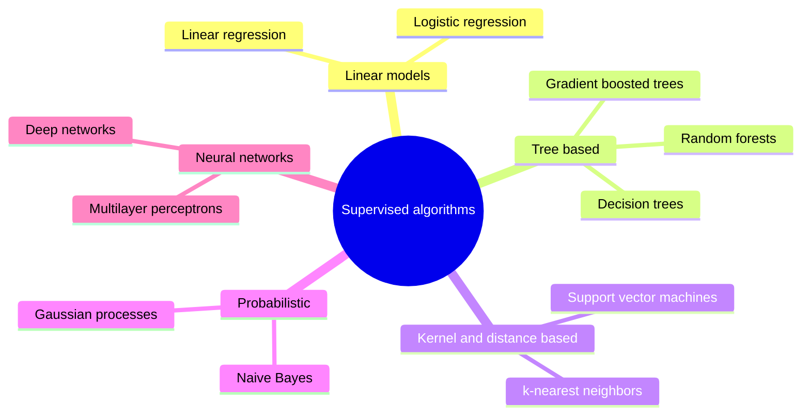

# Supervised learning

## Summary

In supervised learning the algorithm learns from labeled data: every training input comes with its correct output, and the goal is to learn a mapping from inputs to outputs that is also correct for new inputs. When the output is a category the task is *classification*, and when it is a number the task is *regression*. Spam detection, image classification and house price prediction are typical supervised problems.

## Prerequisites

- [Machine learning](../fundamentals/machine-learning.md) for the three learning paradigms.
- [Features and labels](../fundamentals/features-and-labels.md) for the structure of labeled data.

## Core concepts

### Definition

Given a training set of n labeled examples `(x1, y1), ..., (xn, yn)` drawn from an unknown distribution, supervised learning searches a *hypothesis space* of functions for an `f` such that `f(x)` is close to `y` on new examples from the same distribution. "Close" is defined by a [loss function](../optimization/loss-functions.md), and the search is usually done by minimizing the average loss on the training set (*empirical risk minimization*), with regularization to avoid [overfitting](../fundamentals/overfitting-and-underfitting.md).

*Analogy.* Supervised learning is learning with a teacher who marks every exercise with the correct answer. The student generalizes from marked exercises to unmarked exam questions. The analogy breaks because the teacher in ML is only a dataset: if the marked exercises contain systematic errors, the student learns them faithfully.

### Classification and regression

| Task | Label | Examples | Typical loss | Typical metrics |
| --- | --- | --- | --- | --- |
| Classification | A category | Spam detection (spam or not spam), image classification (cat or dog). | Cross-entropy | Accuracy, precision, recall, F1 ([classification metrics](../model-evaluation/classification-metrics.md)) |
| Regression | A number | Predicting house prices from square footage, location and other features. | Mean squared error | MSE, RMSE, MAE ([regression metrics](../model-evaluation/regression-metrics.md)) |

### Common algorithms

The diagram groups the common supervised algorithms by the shape of the function they learn.



- **Linear regression** predicts a number as a weighted sum of the features. Fast and interpretable, but only captures linear relations unless features are transformed.
- **Logistic regression** passes a weighted sum through the sigmoid function to output a class probability. Despite its name it is a classification method.
- **Decision trees** split the feature space with a sequence of if-then questions. Interpretable and handle mixed feature types, but a single tree overfits easily. Ensembles of trees (random forests, gradient boosting) fix most of this.
- **Support vector machines (SVM)** find the boundary with the largest margin between classes, and with kernels can learn nonlinear boundaries.
- **Neural networks** compose many simple units into flexible functions and dominate on images, audio and text (see [neural networks](../../deep-learning/neural-network-fundamentals/neural-networks.md)).

Each algorithm will get its own note in the [supervised learning algorithms](../supervised-learning-algorithms/README.md) section.

## Worked example

Predict the price of a house from its floor area and its distance to the city center with linear regression. Tested with Python 3.10 and NumPy 2.2.6.

```python
import numpy as np

# Labeled examples: (floor area in m2, distance to center in km) -> price in k$
X = np.array([[50, 10], [70, 8], [80, 3], [100, 5], [120, 2], [65, 12]], dtype=float)
y = np.array([210, 280, 360, 390, 500, 240], dtype=float)

A = np.column_stack([X, np.ones(len(X))])           # add a bias column
coef, *_ = np.linalg.lstsq(A, y, rcond=None)         # least squares fit
print("weights (area, distance) and bias:", coef.round(2))
new_house = np.array([90, 4, 1.0])
print("predicted price for 90 m2, 4 km:", round(float(new_house @ coef), 1))
```

Output:

```text
weights (area, distance) and bias: [  3.08  -8.52 137.6 ]
predicted price for 90 m2, 4 km: 381.0
```

The learned model says that each additional square meter adds about 3,080 dollars and each kilometer of distance removes about 8,520 dollars. The signs match intuition, which is a cheap sanity check. Six examples are far too few for a real model: the point of the example is the shape of the problem (labeled inputs, a learned mapping, a prediction for an unseen input), not the numbers.

## Trade offs and when to use it

- Use supervised learning when labeled examples exist or can be produced at acceptable cost, and when the target is well defined.
- Labels are the main cost. When they are scarce, consider semi-supervised learning, transfer learning from a pretrained model, or prompting a large language model with a few examples.
- A supervised model only learns the relation present in its training distribution. When the input distribution or the relation changes (*data drift*, *concept drift*), performance degrades silently.

## Common mistakes

- **Assuming the labels are the truth.** Labels are human or process outputs with noise and bias. Fix: audit a sample of labels and measure annotator agreement.
- **Ignoring class imbalance.** With 1 % positives, accuracy rewards a model that always predicts negative. Fix: use precision, recall or the area under the precision-recall curve, and consider reweighting.
- **Extrapolating.** A model trained on houses between 50 and 120 square meters says nothing reliable about a 400 square meter villa. Fix: check that inputs at inference time lie in the range of the training data.

## Practice

1. Is predicting tomorrow's maximum temperature classification or regression? Is predicting whether it will rain?
2. Why is logistic regression a classification method?
3. Which supervised algorithm would you try first on a tabular dataset with 5,000 rows and mixed numeric and categorical features, and why?

Answers:

1. Regression (a number) and classification (rain or no rain).
2. It outputs the probability of a class through the sigmoid function, and a threshold turns that probability into a class decision.
3. A gradient boosted tree ensemble, because tree ensembles handle mixed feature types, need little preprocessing and are strong on tabular data of this size. A logistic or linear regression is a useful baseline next to it.

## Further reading

- Hastie, T., Tibshirani, R. and Friedman, J. (2009). [*The Elements of Statistical Learning, 2nd edition*](https://hastie.su.domains/ElemStatLearn/). Springer. Chapters 2 to 4 cover linear methods for regression and classification.
- Russell, S. and Norvig, P. (2021). [*Artificial Intelligence: A Modern Approach, 4th edition*](https://aima.cs.berkeley.edu/). Pearson. Chapter 19 covers learning from examples, including decision trees and linear models.
- Cortes, C. and Vapnik, V. (1995). [*Support-vector networks*](https://doi.org/10.1007/BF00994018). Machine Learning 20(3). The original soft margin support vector machine.

TODO: check the content of this note against the sources above and record what was verified and when.
