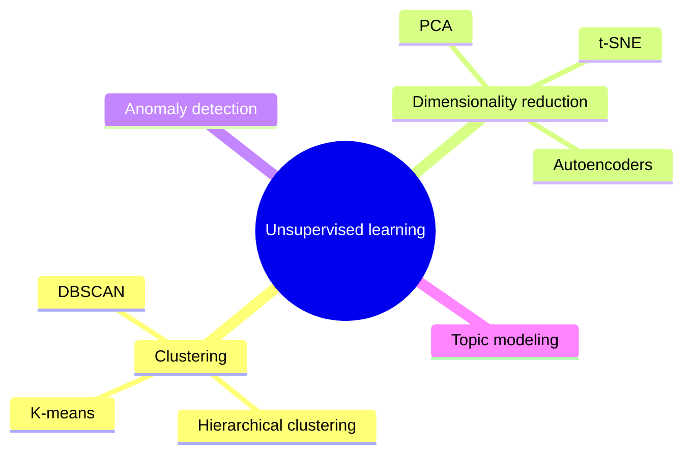

# Unsupervised learning

## Summary

In unsupervised learning the algorithm learns patterns from unlabeled data: it finds hidden structure, such as groups, directions of variation or unusual points, without a predefined correct answer. The main tasks are clustering, dimensionality reduction and anomaly detection. Customer segmentation, anomaly detection in cybersecurity and topic modeling of documents are typical uses.

## Prerequisites

- [Machine learning](../fundamentals/machine-learning.md) for the three learning paradigms.
- [Features and labels](../fundamentals/features-and-labels.md), since unsupervised learning works on features without labels.

## Core concepts

### Definition

Given only inputs `x1, ..., xn`, unsupervised learning models the structure of their distribution. Because there is no label, there is no single correct answer, and the result depends heavily on the chosen notion of similarity, the number of groups and the scaling of the features.

*Analogy.* Sorting a box of mixed buttons without instructions: you might group them by color, by size or by number of holes, and each grouping is defensible. The analogy holds in that the algorithm's "choice" is fixed by its similarity measure. It breaks in that the algorithm has no idea which grouping is useful to you. Usefulness must be checked by a person or by a downstream task.

### Tasks and algorithms

| Task | Goal | Examples | Common algorithms |
| --- | --- | --- | --- |
| Clustering | Group similar examples. | Customer segmentation in marketing. | K-means, DBSCAN, hierarchical clustering, Gaussian mixture models. |
| Dimensionality reduction | Represent data with fewer variables while keeping its structure. | Visualizing high dimensional data, compressing features. | Principal component analysis (PCA), t-SNE, UMAP, autoencoders. |
| Anomaly detection | Find examples that do not fit the normal pattern. | Anomaly detection in cybersecurity, fraud screening. | Isolation forest, density estimates, reconstruction error of an autoencoder. |
| Topic modeling | Discover themes in a collection of documents. | Topic modeling in natural language processing. | Latent Dirichlet allocation, clustering of text embeddings. |

Short characterizations of the algorithms named in the table:

- **K-means** partitions data into k clusters by alternating two steps: assign each point to the nearest centroid, then move each centroid to the mean of its points. It assumes roughly spherical clusters of similar size and needs k in advance.
- **DBSCAN** grows clusters from dense regions and labels points in sparse regions as noise. It finds clusters of arbitrary shape and needs no k, but needs a density threshold.
- **Hierarchical clustering** builds a tree of nested clusters (a dendrogram) by repeatedly merging the closest groups, so the number of clusters can be chosen afterwards.
- **PCA** finds the orthogonal directions of maximum variance and projects the data onto the first few. It is linear and fast.
- **t-SNE** maps points to two or three dimensions so that neighbors stay neighbors. It is for visualization only: distances between clusters in a t-SNE plot are not meaningful.
- **Autoencoders** are neural networks trained to reconstruct their input through a narrow middle layer, which becomes a learned compressed representation.

The mind map places these algorithms under their tasks.



## Worked example

Segment nine customers described by annual spend (thousands of dollars) and visits per month into three groups with k-means. Tested with Python 3.10 and NumPy 2.2.6.

```python
import numpy as np

# Customers described by (annual spend in k$, visits per month); no labels
X = np.array([[1, 2], [1.5, 1.8], [1.2, 2.5], [8, 8], [9, 9.5], [8.5, 9],
              [4.5, 1], [5, 1.5], [5.5, 0.8]])
rng = np.random.default_rng(3)
k = 3
centroids = X[rng.choice(len(X), k, replace=False)]
for it in range(10):
    # assignment step: nearest centroid by Euclidean distance
    labels = np.argmin(((X[:, None, :] - centroids[None]) ** 2).sum(-1), axis=1)
    # update step: each centroid moves to the mean of its points
    new = np.array([X[labels == j].mean(0) for j in range(k)])
    if np.allclose(new, centroids):
        break
    centroids = new
inertia = ((X - centroids[labels]) ** 2).sum()
print("iterations:", it + 1)
print("labels:", labels)
print("centroids:", centroids.round(2).tolist())
print("inertia:", round(inertia, 3))
```

Output:

```text
iterations: 3
labels: [0 0 0 2 2 2 1 1 1]
centroids: [[1.23, 2.1], [5.0, 1.1], [8.5, 8.83]]
inertia: 2.813
```

The algorithm found three segments: low spend and rare visits, medium spend and rare visits, high spend and frequent visits. The cluster numbers 0, 1 and 2 carry no meaning. A person names the segments by inspecting the centroids. *Inertia* (the sum of squared distances to the assigned centroid) measures compactness and is used to compare runs, but it always falls as k grows, so it cannot choose k alone.

## Trade offs and when to use it

- Use unsupervised learning to explore data, to create features or segments for later supervised models, and to detect anomalies when labeled anomalies are rare.
- Evaluation is the hard part. Internal scores such as inertia or the silhouette score measure compactness, not usefulness. Validate clusters with domain experts or with a downstream metric.
- Results depend on feature scaling: a feature measured in dollars will dominate one measured in visits unless both are standardized.

## Common mistakes

- **Not scaling features.** Fix: standardize features before distance based methods such as k-means and DBSCAN.
- **Reading meaning into t-SNE distances.** Fix: use t-SNE for qualitative views only, and PCA or the original features for quantitative claims.
- **Trusting a single k-means run.** K-means converges to a local optimum that depends on the initial centroids. Fix: run several initializations (or k-means++) and keep the lowest inertia.
- **Treating clusters as ground truth.** Fix: describe clusters as hypotheses and check them against independent information.

## Practice

1. Why can inertia not be used alone to choose the number of clusters?
2. Which algorithm would you choose for clusters shaped like two interleaved half moons, and why?
3. A security team has millions of login events and only 20 confirmed attacks. Which paradigm fits, and why?

Answers:

1. Inertia always decreases as k increases, down to zero when every point is its own cluster.
2. DBSCAN, because it follows dense regions of any shape, while k-means assumes compact, roughly spherical clusters.
3. Unsupervised anomaly detection, possibly validated with the 20 known attacks, because there are too few labels to train a classifier.

## Further reading

- Hastie, T., Tibshirani, R. and Friedman, J. (2009). [*The Elements of Statistical Learning, 2nd edition*](https://hastie.su.domains/ElemStatLearn/). Springer. Chapter 14 covers clustering, PCA and other unsupervised methods.
- Ester, M., Kriegel, H.-P., Sander, J. and Xu, X. (1996). *A Density-Based Algorithm for Discovering Clusters in Large Spatial Databases with Noise*. KDD 1996. The DBSCAN paper.
- van der Maaten, L. and Hinton, G. (2008). [*Visualizing Data using t-SNE*](https://www.jmlr.org/papers/v9/vandermaaten08a.html). JMLR 9. The t-SNE paper.
- Wattenberg, M., Viégas, F. and Johnson, I. (2016). [*How to Use t-SNE Effectively*](https://distill.pub/2016/misread-tsne/). Distill. Interactive examples of how t-SNE plots mislead.

TODO: check the content of this note against the sources above and record what was verified and when.
