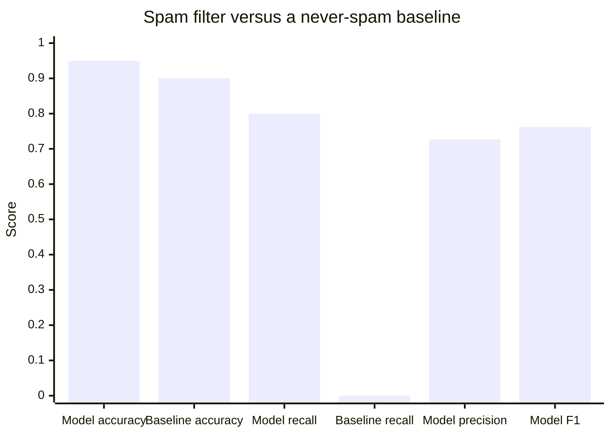

# Classification metrics

## Summary

Classification metrics summarize how often and in which way a classifier is wrong. *Accuracy* is the proportion of correct predictions, *precision* measures how many of the predicted positives are real, *recall* measures how many of the real positives were found, and the *confusion matrix* shows all four kinds of outcome at once. On imbalanced data accuracy is misleading, and precision and recall, chosen according to the cost of each error, are what matter.

## Prerequisites

- [Supervised learning](../learning-paradigms/supervised-learning.md) for classification.
- [Training, validation and test data](training-validation-and-test-data.md) for where metrics are computed.

## Core concepts

### The confusion matrix

A confusion matrix is a table that helps visualize the performance of a classifier. For two classes it counts four outcomes:

| | Predicted positive | Predicted negative |
| --- | --- | --- |
| **Actually positive** | True positive (TP) | False negative (FN), a miss |
| **Actually negative** | False positive (FP), a false alarm | True negative (TN) |

For K classes it is a K × K table with the true class in rows and the predicted class in columns. The diagonal holds the correct predictions, and the off-diagonal cells show which classes are confused with which.

### Metrics

| Metric | Formula | Question it answers |
| --- | --- | --- |
| Accuracy | (TP + TN) / all | What proportion of all predictions is correct? |
| Precision | TP / (TP + FP) | Of the examples flagged positive, how many are positive? (Cost of false positives.) |
| Recall (sensitivity, true positive rate) | TP / (TP + FN) | Of the positive examples, how many were found? (Cost of false negatives.) |
| Specificity | TN / (TN + FP) | Of the negative examples, how many were correctly left alone? |
| F1 score | 2 · P · R / (P + R) | The harmonic mean of precision and recall, high only when both are high. |

Precision and recall are used in classification problems to measure the effect of false positives and false negatives. They pull against each other: lowering the decision threshold flags more examples, raising recall and usually lowering precision.

### Thresholds, ROC and precision-recall curves

Most classifiers output a score or probability, and a *threshold* turns it into a class. Metrics computed at one threshold describe one operating point. Curves describe all of them:

- The **ROC curve** plots the true positive rate against the false positive rate for every threshold. Its area (*ROC AUC*) is the probability that a random positive gets a higher score than a random negative.
- The **precision-recall curve** plots precision against recall. On heavily imbalanced data it is more informative than ROC, because the false positive rate stays small even when false positives outnumber true positives.

### Multi-class averaging

With more than two classes, precision and recall are computed per class and averaged. *Macro averaging* gives each class equal weight, which exposes poor performance on rare classes. *Micro averaging* pools all decisions and is dominated by frequent classes. *Weighted averaging* weights each class by its frequency.

## Worked example

A spam filter is evaluated on 1,000 emails, of which 100 are spam. It flags 110 emails, 80 of them correctly. Tested with Python 3.10 and NumPy 2.2.6.

```python
import numpy as np

# 1,000 emails, 100 of them spam (label 1). The model flags 110 emails.
y_true = np.array([1] * 100 + [0] * 900)
y_pred = np.array([1] * 80 + [0] * 20 + [1] * 30 + [0] * 870)

tp = int(np.sum((y_true == 1) & (y_pred == 1)))
fn = int(np.sum((y_true == 1) & (y_pred == 0)))
fp = int(np.sum((y_true == 0) & (y_pred == 1)))
tn = int(np.sum((y_true == 0) & (y_pred == 0)))

accuracy = (tp + tn) / len(y_true)
precision = tp / (tp + fp)
recall = tp / (tp + fn)
f1 = 2 * precision * recall / (precision + recall)
print(f"confusion matrix: TP={tp} FN={fn} FP={fp} TN={tn}")
print(f"accuracy={accuracy:.3f} precision={precision:.3f} recall={recall:.3f} f1={f1:.3f}")

# A baseline that never flags spam
baseline = np.zeros_like(y_true)
print(f"baseline accuracy={np.mean(baseline == y_true):.3f} recall={0 / 100:.3f}")
```

Output:

```text
confusion matrix: TP=80 FN=20 FP=30 TN=870
accuracy=0.950 precision=0.727 recall=0.800 f1=0.762
baseline accuracy=0.900 recall=0.000
```

The chart compares the model with the baseline that never flags spam, using the numbers above.



The baseline reaches 90 % accuracy while catching no spam at all, which is the *accuracy paradox* on imbalanced data. The model's 95 % accuracy hides the two numbers that matter to users: 30 legitimate emails (3.3 % of the 900) end up in the spam folder, and 20 % of spam still reaches the inbox. Whether to move the threshold depends on which error costs more. For email, a lost legitimate message is usually worse than a missed spam, so precision is favored.

## Trade offs and when to use it

| Situation | Favor | Example |
| --- | --- | --- |
| False negatives are expensive | Recall | Cancer screening, fraud detection with cheap review. |
| False positives are expensive | Precision | Spam filtering, automated account suspension. |
| Both matter, classes imbalanced | F1, precision-recall AUC | Information extraction, rare event detection. |
| Classes balanced, errors cost the same | Accuracy | Balanced digit recognition. |

A single number never describes a classifier fully. Report the confusion matrix with the chosen threshold, and the curve when the threshold may change.

## Common mistakes

- **Reporting accuracy on imbalanced data.** Fix: report precision, recall and the confusion matrix, and compare with the majority class baseline.
- **Comparing models at different thresholds.** Fix: compare curves (ROC AUC or precision-recall AUC), or fix the operating point, such as recall at precision 0.9.
- **Swapping the positive class.** Precision and recall change when the positive class changes. Fix: state which class is positive.
- **Using ROC AUC alone on rare positives.** Fix: add the precision-recall curve.

## Practice

1. A cancer screening model has recall 0.99 and precision 0.05. Is it useless?
2. Compute precision and recall for TP = 45, FP = 5, FN = 15.
3. Why is F1 the harmonic and not the arithmetic mean of precision and recall?

Answers:

1. Not necessarily. As a first screening stage it misses almost no cancers, and the many false positives are filtered by a cheaper follow-up test. Whether that is acceptable depends on the cost of the follow-up.
2. Precision 45 / 50 = 0.9, recall 45 / 60 = 0.75.
3. The harmonic mean is dominated by the smaller value, so a model cannot score high F1 by maximizing one metric at the expense of the other.

## Further reading

- Fawcett, T. (2006). [*An introduction to ROC analysis*](https://doi.org/10.1016/j.patrec.2005.10.010). Pattern Recognition Letters 27(8). The standard tutorial on ROC curves and AUC.
- Saito, T. and Rehmsmeier, M. (2015). [*The Precision-Recall Plot Is More Informative than the ROC Plot When Evaluating Binary Classifiers on Imbalanced Datasets*](https://doi.org/10.1371/journal.pone.0118432). PLOS ONE 10(3). Evidence for precision-recall curves on imbalanced data.
- Powers, D. (2011). [*Evaluation: From Precision, Recall and F-Measure to ROC, Informedness, Markedness and Correlation*](https://arxiv.org/abs/2010.16061). Journal of Machine Learning Technologies 2(1). A critical review of classification metrics.

TODO: check the content of this note against the sources above and record what was verified and when.
