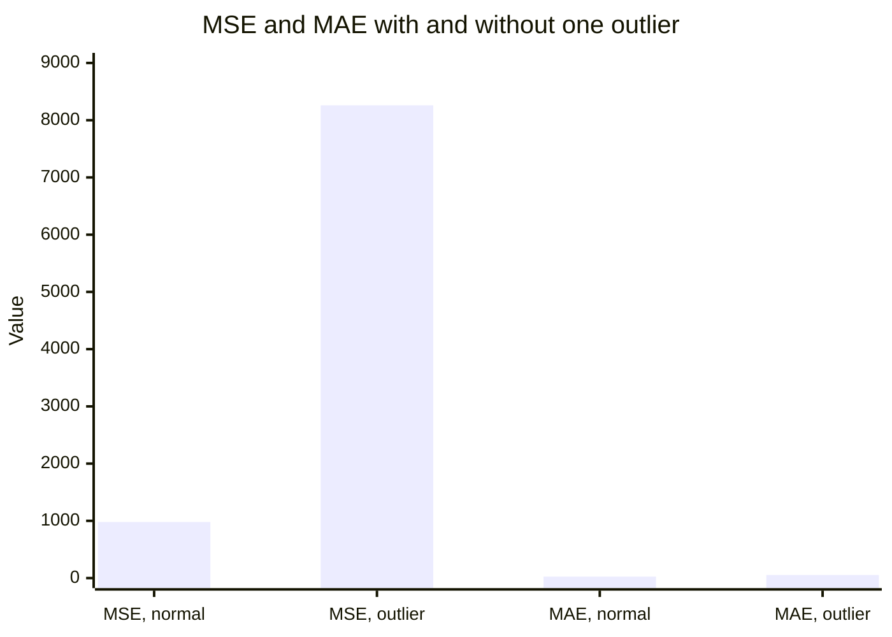

# Regression metrics

## Summary

Regression metrics measure how far numeric predictions are from the actual values. *Mean squared error* (MSE) measures the average squared error and is the standard for regression models. Its square root (RMSE) is in the units of the target, the *mean absolute error* (MAE) is less sensitive to outliers, and the *coefficient of determination* (R²) compares the model with always predicting the mean.

## Prerequisites

- [Supervised learning](../learning-paradigms/supervised-learning.md) for regression.
- [Loss functions](../optimization/loss-functions.md), since MSE is both a loss and a metric.

## Core concepts

### Definitions

For n examples with actual values `y` and predictions `ŷ`:

$$
\text{MSE} = \frac{1}{n}\sum_{i=1}^{n}(y_i - \hat{y}_i)^2 \qquad \text{RMSE} = \sqrt{\text{MSE}} \qquad \text{MAE} = \frac{1}{n}\sum_{i=1}^{n}\lvert y_i - \hat{y}_i \rvert
$$

$$
R^2 = 1 - \frac{\sum_i (y_i - \hat{y}_i)^2}{\sum_i (y_i - \bar{y})^2}
$$

| Metric | Unit | Sensitive to outliers | Reads as |
| --- | --- | --- | --- |
| MSE | Squared unit of the target | Strongly | The quantity most models minimize. |
| RMSE | Unit of the target | Strongly | A typical error size, weighted toward large errors. |
| MAE | Unit of the target | Weakly | The average absolute error. |
| R² | None | Strongly | The fraction of variance explained. 1 is perfect, 0 equals predicting the mean, negative is worse than the mean. |
| MAPE | Percent | Breaks near zero | The average relative error, undefined when the actual value is 0. |

MSE measures error in regression models by squaring the differences, so large errors dominate. RMSE and MAE are easier to communicate because they share the unit of the target.

## Worked example

A model predicts the prices of five houses (thousands of dollars). Tested with Python 3.10 and NumPy 2.2.6.

```python
import numpy as np

# Prices in thousands of dollars for five houses
y_true = np.array([300.0, 450.0, 250.0, 600.0, 380.0])
y_pred = np.array([320.0, 430.0, 270.0, 540.0, 390.0])

err = y_pred - y_true
mse = np.mean(err ** 2)
rmse = np.sqrt(mse)
mae = np.mean(np.abs(err))
r2 = 1 - np.sum(err ** 2) / np.sum((y_true - y_true.mean()) ** 2)
print(f"errors={err}")
print(f"MSE={mse:.1f} RMSE={rmse:.2f} MAE={mae:.1f} R2={r2:.3f}")

# One outlier changes MSE far more than MAE
y_pred_outlier = y_pred.copy(); y_pred_outlier[3] = 400.0
err2 = y_pred_outlier - y_true
print(f"with outlier: MSE={np.mean(err2**2):.1f} MAE={np.mean(np.abs(err2)):.1f}")
```

Output:

```text
errors=[ 20. -20.  20. -60.  10.]
MSE=980.0 RMSE=31.30 MAE=26.0 R2=0.935
with outlier: MSE=8260.0 MAE=54.0
```

The chart compares the two metrics before and after one prediction becomes an outlier (600 predicted as 400), from the output above.



One bad prediction multiplies MSE by about 8.4 and MAE by about 2.1. RMSE (31.3) is larger than MAE (26) because the single error of 60 weighs more after squaring. A gap between RMSE and MAE is a quick signal that a few large errors exist.

## Trade offs and when to use it

- Use **MSE or RMSE** when large errors are disproportionately bad, for example in load forecasting where a big miss causes an outage.
- Use **MAE** when every unit of error costs the same and outliers in the data should not dominate.
- Use **R²** to compare models on the same dataset, never across datasets, because it depends on the variance of the target.
- Use **quantile loss** or interval coverage when the decision depends on uncertainty, for example stocking enough inventory for the 90th percentile of demand.

## Common mistakes

- **Comparing MSE across targets with different scales.** Fix: compare RMSE relative to the spread of the target, or R² on the same data.
- **Using MAPE with values near zero.** Fix: use MAE, or a scaled error such as MASE for time series.
- **Reporting one number without the error distribution.** Fix: plot residuals against predictions to find systematic bias, for example underpredicting expensive houses.

## Practice

1. Why is RMSE always greater than or equal to MAE?
2. A model has R² = -0.2 on test data. What does that mean?
3. Which metric would you report to a manager who asks "by how much is the forecast typically off"?

Answers:

1. Squaring weights large errors more, and the quadratic mean of the absolute errors is never smaller than their arithmetic mean.
2. The model is worse than always predicting the mean of the test targets.
3. MAE (or RMSE), in the unit of the target, because it reads directly as a typical error.

## Further reading

- Hyndman, R. and Athanasopoulos, G. (2021). [*Forecasting: Principles and Practice, 3rd edition*](https://otexts.com/fpp3/). OTexts. Section 5.8 compares scale dependent, percentage and scaled errors.
- Hastie, T., Tibshirani, R. and Friedman, J. (2009). [*The Elements of Statistical Learning, 2nd edition*](https://hastie.su.domains/ElemStatLearn/). Springer. Chapter 3 covers least squares and its error measures.

TODO: check the content of this note against the sources above and record what was verified and when.
